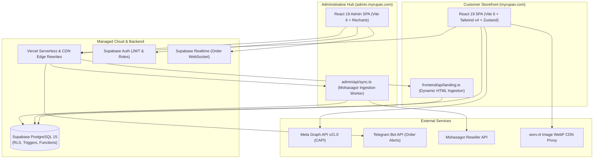
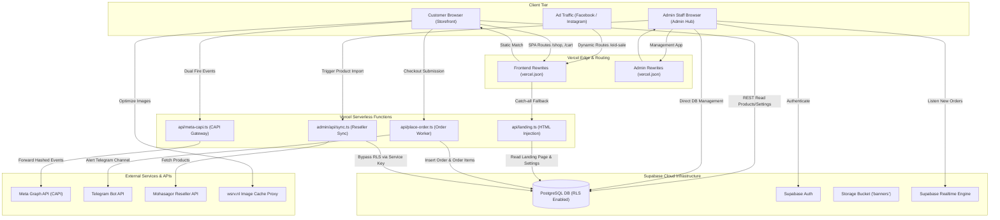
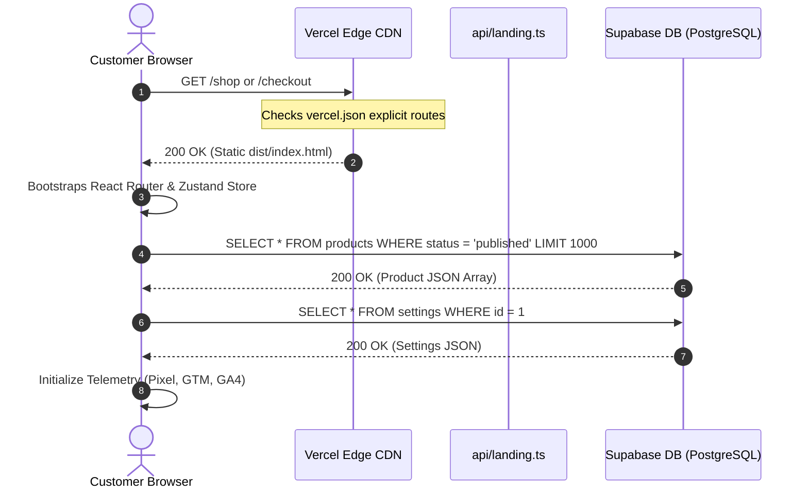
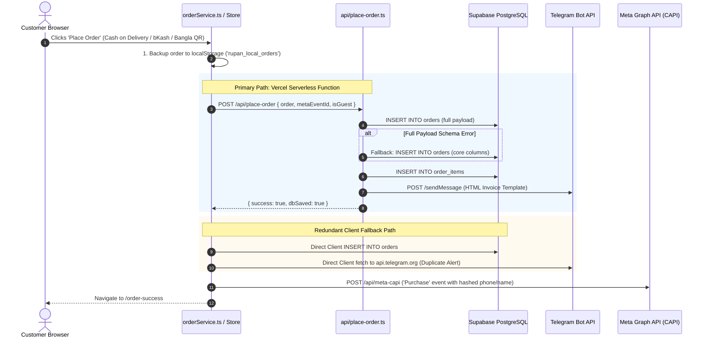
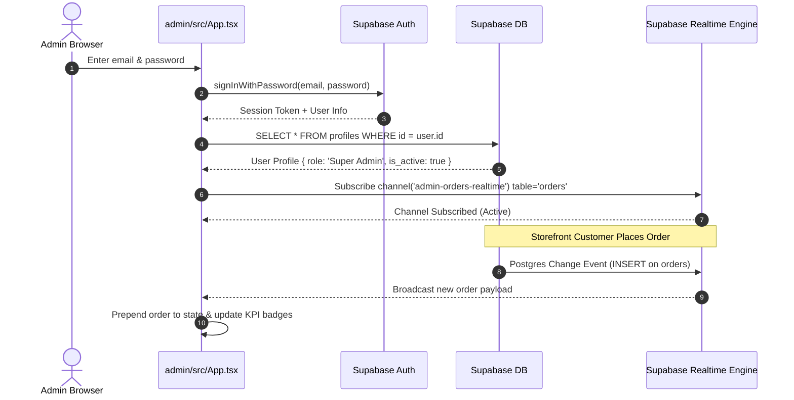
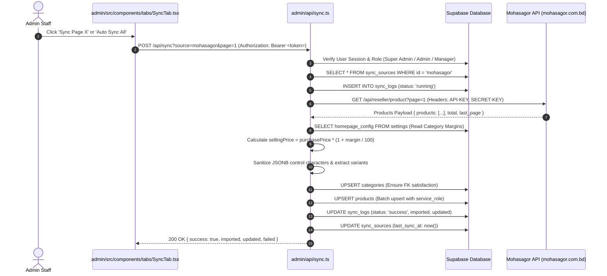
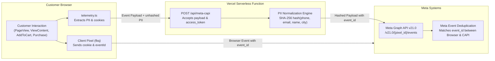
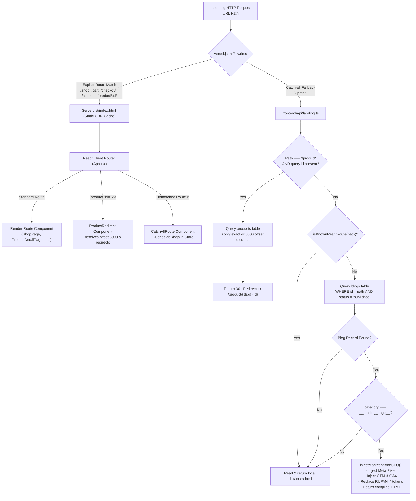
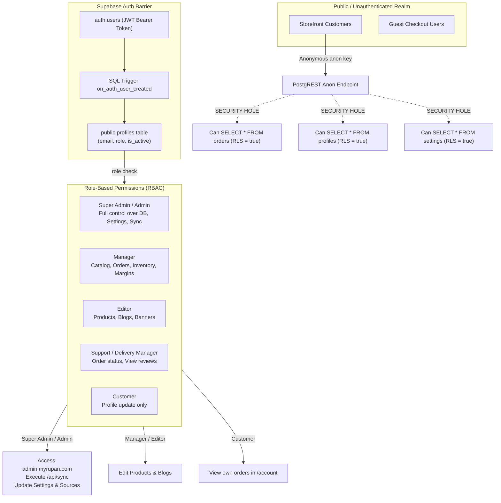
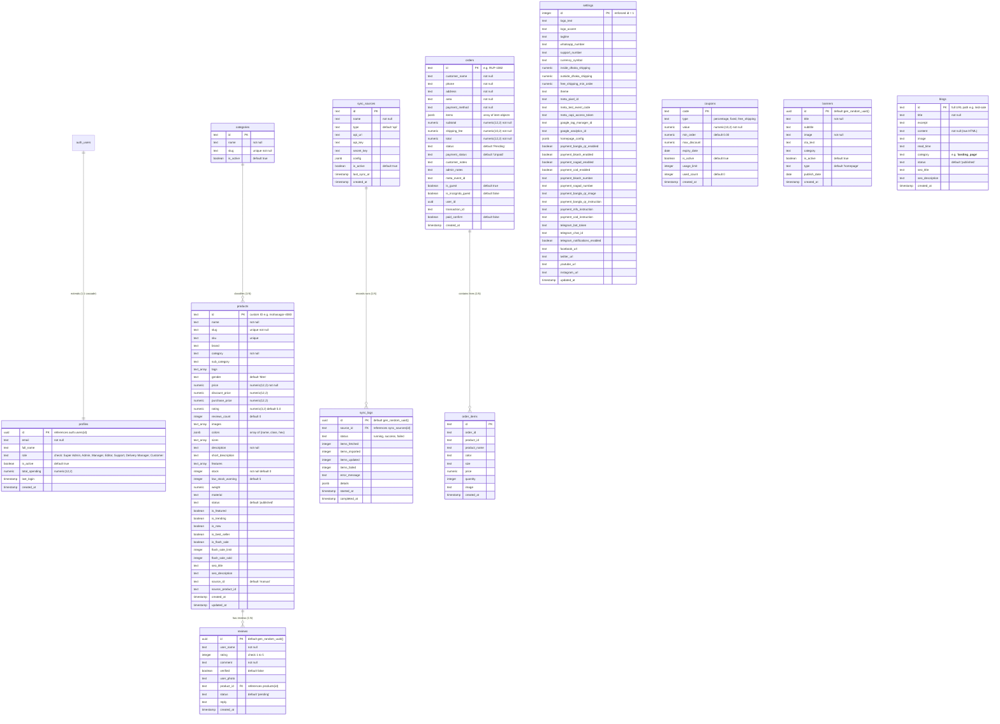

# RUPAN (myrupan.com) — ALL-IN-ONE ARCHITECTURAL & PROJECT INTELLIGENCE DOSSIER

> **CONFIDENTIAL ARCHITECTURAL SPECIFICATION & SYSTEM AUDIT**
> **Target Domain**: https://www.myrupan.com (Storefront) | https://admin.myrupan.com (Admin Hub)
> **Evaluation Date**: October 26, 2026
> **Architecture Snapshot**: Codebase version v3.6.1 (Branch `main`)
> **Target Audience**: AI Coding Assistants, Lead Architects, Full-Stack Engineers, Security Auditors, and System Owners.
>
> *Notice: This document aggregates all 12 analytical volumes of the Rupan Architectural Intelligence Dossier into a single contiguous, self-contained reference. All findings are derived directly from static source code inspection, dependency manifests, and database DDL definitions.*

---

## Master Table of Contents

- [Part 0: Master Brief & Executive Architecture Summary](#00-master-brief-rupan-project-intelligence-and-architecture-dossier)
  - [1. Master Executive Summary](#1-master-executive-summary)
  - [2. High-Level Architecture & Verified Technology Stack](#3-high-level-architecture--verified-technology-stack)
  - [3. Top Five Critical Verified Findings](#4-top-five-critical-verified-findings)
  - [4. Major Architectural Strengths](#5-major-architectural-strengths)
  - [5. Existing Capabilities That Must Be Preserved](#6-existing-capabilities-that-must-be-preserved)
  - [6. Recommended Modernization Strategy](#7-recommended-modernization-strategy)
  - [7. Immediate Action Items for the Engineering Team](#8-immediate-action-items-for-the-engineering-team)
  - [8. Guidance for External AI Assistants](#10-guidance-for-another-ai-assistant-reading-this-dossier)
- [Part 1: Project Identity & Business Context](#01-project-identity-and-business-context)
  - [1.1 Product Identity](#11-product-identity)
  - [1.2 Current Product Capabilities](#12-current-product-capabilities)
  - [1.3 Product Gaps and Architectural Inconsistencies](#13-product-gaps-and-architectural-inconsistencies)
- [Part 2: Technology Stack & Monorepo Inventory](#02-technology-stack-and-repository-inventory)
  - [2.1 Technology Stack Inventory](#21-technology-stack-inventory)
  - [2.2 Runtime Requirements and Tooling Limitations](#22-runtime-requirements-and-tooling-limitations)
  - [2.3 Repository Structure and Directory Roles](#23-repository-structure-and-directory-roles)
  - [2.4 Environment Variables Inventory](#24-environment-variables-inventory)
  - [2.5 Build, Dev, and Script Commands](#25-build-dev-and-script-commands)
- [Part 3: System Architecture & Dependency Map](#03-system-architecture-and-dependency-map)
  - [3.1 Architecture and Deployment Topology](#31-architecture-and-deployment-topology)
  - [3.2 System Architecture Diagrams (8 Mermaid Diagrams)](#32-system-architecture-diagrams)
  - [3.3 Module Dependency Map and Drift Analysis](#33-module-dependency-map-and-drift-analysis)
- [Part 4: Complete User Journeys and Business Logic](#04-complete-user-journeys-and-business-logic)
  - [4.1 Investigation: Test Customer Details & Placeholder Data](#41-investigation-test-customer-details--placeholder-data)
  - [4.2 Customer Journeys (C1 to C7)](#42-customer-journeys)
  - [4.3 Administrator Journeys (A1 to A4)](#43-administrator-journeys)
- [Part 5: API and Integration Catalog](#05-api-and-integration-catalog)
  - [5.1 Internal Serverless Endpoints](#51-internal-serverless-endpoints)
  - [5.2 External Integrations](#52-external-integrations)
- [Part 6: Database, Data Model, and Security Assessment](#06-database-data-model-and-security-assessment)
  - [6.1 Database Architecture and Schema DDL](#61-database-architecture-and-schema-ddl)
  - [6.2 Row-Level Security (RLS) Policy Audit](#62-row-level-security-rls-policy-audit)
  - [6.3 Secret Management & Exposed Credentials](#63-secret-management--exposed-credentials)
  - [6.4 Security Threat Assessment](#64-security-threat-assessment)
- [Part 7: Frontend Architecture, UI/UX, and Accessibility](#07-frontend-architecture-uiux-and-accessibility)
  - [7.1 Page and Route Inventory](#71-page-and-route-inventory)
  - [7.2 Component Hierarchy and Layout Structure](#72-component-hierarchy-and-layout-structure)
  - [7.3 Design Tokens, Brand Colors, and Typography](#73-design-tokens-brand-colors-and-typography)
  - [7.4 Forms, Validation, and User Feedback States](#74-forms-validation-and-user-feedback-states)
  - [7.5 SEO, Structured Data, and Image Optimization](#75-seo-structured-data-and-image-optimization)
  - [7.6 Verified Performance Bottlenecks & UI Defects](#76-verified-performance-bottlenecks--ui-defects)
- [Part 8: Testing, Quality Assurance, and Operations](#08-testing-quality-assurance-and-operations)
  - [8.1 Automated Test Suite & Coverage](#81-automated-test-suite--coverage)
  - [8.2 Deployment and Hosting Configuration](#82-deployment-and-hosting-configuration)
  - [8.3 CI/CD, Migrations, and Disaster Recovery](#83-cicd-migrations-and-disaster-recovery)
- [Part 9: Technical Debt and Strategic Modernization](#09-technical-debt-and-strategic-modernization)
  - [9.1 Prioritized Technical Debt Inventory (DEBT-01 to DEBT-13)](#91-prioritized-technical-debt-inventory)
  - [9.2 Evaluation of Strategic Modernization Approaches](#92-evaluation-of-strategic-modernization-approaches)
  - [9.3 Strategic Recommendation: Phased Modular Modernization](#93-strategic-recommendation-phased-modular-modernization)
  - [9.4 Component Roadmap: Preserve, Refactor, Replace, or Investigate](#94-component-roadmap-preserve-refactor-replace-or-investigate)
- [Part 10: Complete Codebase and Symbol Reference](#10-complete-codebase-and-symbol-reference)
  - [10.1 Core Serverless Endpoints (`api/`)](#101-core-serverless-endpoints-api)
  - [10.2 Shared and Core Domain Layer (`shared/`)](#102-shared-and-core-domain-layer-shared)
  - [10.3 State, Telemetry, and Utility Layer](#103-state-telemetry-and-utility-layer)
- [Part 11: Open Questions and Required Owner Decisions](#11-open-questions-and-required-owner-decisions)
  - [11.1 Highest-Priority Decisions (Blocks Security Remediation)](#111-highest-priority-decisions-blocks-security-remediation)
  - [11.2 Business Rules and Operational Decisions](#112-business-rules-and-operational-decisions)
  - [11.3 Summary of Required Owner Actions](#113-summary-of-required-owner-actions)

---


<!-- ===================================================================== -->
<!-- START: Part 0: Master Brief & Executive Architecture Summary -->
<!-- ===================================================================== -->

# 00. Master Brief: Rupan Project Intelligence and Architecture Dossier

> **CRITICAL NOTICE FOR AI ASSISTANTS & ARCHITECTS**:
> This report is an evidence-based snapshot of the **Rupan (`myrupan.com`)** repository conducted on **October 26, 2026**. It reflects the actual source code, SQL DDL migrations, package manifests, and configuration files present in the local codebase. It does not represent a guarantee of live production database state, active Vercel environment variables, or third-party service statuses. **Do not fabricate unverified features or assume the application requires a complete ground-up rewrite.** The website is currently functional in production.

---

## 1. Master Executive Summary

**Rupan** (`myrupan.com`) is a functional direct-to-consumer (D2C) e-commerce storefront, administrative operations hub, and dropshipping inventory synchronization platform tailored for the Bangladeshi retail market (traditional and modern lifestyle fashion: Panjabis, Sarees, Couple Collections, Western Wear, Kids Fashion).

Originally generated using AI coding tools and incrementally upgraded across versions (current codebase tagged as `v3.6.1`), the system features high cultural alignment with Bangladeshi e-commerce practices (guest checkout, Bangla QR, bKash/Nagad personal send-money, Inside/Outside Dhaka delivery tiers) and a dynamic landing page engine for advertising traffic.

However, incremental development without automated testing or formal architectural governance has left severe security vulnerabilities, data leakage risks, fragile file-copying build scripts, and test data baked into active checkout states.

---

## 2. Master Table of Contents & Supporting Report Index

| Report Document | Title & Core Subject | Key Contents & Purpose |
| :--- | :--- | :--- |
| **[`01_PROJECT_OVERVIEW.md`](file:///Users/Admin/Developer/antigravity/RupanV3/project-report/01_PROJECT_OVERVIEW.md)** | Project Identity & Business Context | Brand purpose, revenue model, customer segments, verified capabilities inventory, product gaps. |
| **[`02_TECH_STACK_AND_REPOSITORY.md`](file:///Users/Admin/Developer/antigravity/RupanV3/project-report/02_TECH_STACK_AND_REPOSITORY.md)** | Tech Stack & Monorepo Inventory | Exact dependency versions (React 19, Tailwind v4, Vite 6, Zustand 5, Supabase JS 2.110), file tree, env vars. |
| **[`03_SYSTEM_ARCHITECTURE.md`](file:///Users/Admin/Developer/antigravity/RupanV3/project-report/03_SYSTEM_ARCHITECTURE.md)** | Architecture & Dependency Map | 8 Mermaid architecture diagrams, request topologies, module coupling, `sync-shared.js` drift analysis. |
| **[`04_FEATURES_AND_BUSINESS_FLOWS.md`](file:///Users/Admin/Developer/antigravity/RupanV3/project-report/04_FEATURES_AND_BUSINESS_FLOWS.md)** | Complete User Journeys | 12-point step-by-step tracing of customer & admin workflows; investigation into hardcoded test data. |
| **[`05_APIS_AND_INTEGRATIONS.md`](file:///Users/Admin/Developer/antigravity/RupanV3/project-report/05_APIS_AND_INTEGRATIONS.md)** | API & Integration Catalog | Detailed schemas, validation, and error modes for `/api/landing`, `/api/place-order`, `/api/meta-capi`, `/api/sync`. |
| **[`06_DATABASE_AND_SECURITY.md`](file:///Users/Admin/Developer/antigravity/RupanV3/project-report/06_DATABASE_AND_SECURITY.md)** | Database, DDL & Security Assessment | Full PostgreSQL schema DDL, ER diagram, Row Level Security (RLS) audit, secret management, threat matrix. |
| **[`07_FRONTEND_AND_UX.md`](file:///Users/Admin/Developer/antigravity/RupanV3/project-report/07_FRONTEND_AND_UX.md)** | Frontend Architecture & UX | Route table, design tokens, typography, component hierarchy, SEO hook, performance bottlenecks. |
| **[`08_QUALITY_AND_OPERATIONS.md`](file:///Users/Admin/Developer/antigravity/RupanV3/project-report/08_QUALITY_AND_OPERATIONS.md)** | Testing, Reliability & Operations | Zero automated tests finding, Vercel routing, Supabase migration procedures, observability gaps. |
| **[`09_TECHNICAL_DEBT_AND_RECOMMENDATIONS.md`](file:///Users/Admin/Developer/antigravity/RupanV3/project-report/09_TECHNICAL_DEBT_AND_RECOMMENDATIONS.md)** | Technical Debt & Modernization Options | 13 prioritized technical debt items, comparison of 3 strategic modernization options, phased roadmap. |
| **[`10_CODEBASE_REFERENCE.md`](file:///Users/Admin/Developer/antigravity/RupanV3/project-report/10_CODEBASE_REFERENCE.md)** | Codebase & Symbol Index | Quick-reference index of core files, functions, hooks, classes, exported types, callers, and tables. |
| **[`11_OPEN_QUESTIONS.md`](file:///Users/Admin/Developer/antigravity/RupanV3/project-report/11_OPEN_QUESTIONS.md)** | Open Questions for the Owner | 8 high-leverage business and policy questions that cannot be resolved from code inspection alone. |

---

## 3. High-Level Architecture & Verified Technology Stack



- **Languages & Frameworks**: TypeScript 5.8, React 19.0.1, React DOM 19.0.1.
- **Styling & Icons**: Tailwind CSS 4.1.14 (Vite plugin, CSS `@theme` tokens), Lucide React 0.546.
- **Routing & State**: React Router DOM 7.18.1, Zustand 5.0.14 with `localStorage` persistence.
- **Backend & Database**: Supabase JS Client 2.110.0, PostgreSQL 15 with Row Level Security, Supabase Storage (`banners` bucket), Supabase Realtime WebSocket engine.
- **Hosting & Infrastructure**: Dual Vercel projects (Storefront + Admin) with Node.js 20 serverless functions (`@vercel/node` 5.8).

---

## 4. Top Five Critical Verified Findings

1. **Customer Order PII & User Profile Leakage (Critical Security Risk)**:
   - In [`supabase/schema.sql#L275`](file:///Users/Admin/Developer/antigravity/RupanV3/supabase/schema.sql#L275) and [`#L41`](file:///Users/Admin/Developer/antigravity/RupanV3/supabase/schema.sql#L41), Row Level Security policies on `public.orders` and `public.profiles` are configured as `using (true)`.
   - **Impact**: Any unauthenticated person with the public Supabase anon key can query PostgREST directly and download all customer orders (names, phone numbers, home delivery addresses, ordered items) and all registered user/admin emails and spending figures.
2. **Third-Party Secrets Exposed via Public Settings Table & Public HTML**:
   - Private Meta CAPI Graph API tokens and Telegram bot tokens are stored as plain text columns in `public.settings`.
   - Because `settings` has a public read policy (`using (true)`), the frontend client queries `select('*')` on mount and caches the Meta CAPI token and Telegram bot token into browser memory and `localStorage`.
   - Furthermore, customer browsers directly call the Telegram API (`https://api.telegram.org/bot<token>/sendMessage`), and `api/landing.ts` replaces `RUPAN_META_CAPI_TOKEN` placeholders with the live token in delivered HTML source.
3. **Hardcoded Test Customer Details in Storefront Checkout State**:
   - In [`frontend/src/store/useStore.ts#L208-L233`](file:///Users/Admin/Developer/antigravity/RupanV3/frontend/src/store/useStore.ts#L208-L233), default state for `currentUser` and `checkoutForm` is hardcoded with dummy values: `name: 'test'`, `phone: '534534563453'`, `address: 'test'`, and `email: 'phone-534534563453-nz9rfv2h@rupan.invalid'`.
   - Real customers arriving at `/checkout` see these fields pre-filled, leading to corrupted order submissions and user confusion.
4. **Order Price Verification Failure in SQL Trigger**:
   - The PostgreSQL trigger `validate_order_total()` ([`supabase/schema.sql#L382`](file:///Users/Admin/Developer/antigravity/RupanV3/supabase/schema.sql#L382)) correctly calculates `calc_subtotal` from database product prices and deducts stock.
   - However, it **never assigns** `calc_subtotal` to `new.subtotal` or `new.total`. It only verifies `if new.total < 0 then new.total := 0; end if;`.
   - As a result, direct API callers can submit orders with `total: 1`, and the database deducts stock and accepts the manipulated price without enforcement.
5. **Fragile, Destructive Build Script & Monorepo Drift (`sync-shared.js`)**:
   - The root script [`sync-shared.js`](file:///Users/Admin/Developer/antigravity/RupanV3/sync-shared.js) unidirectionally copies `shared/` to `frontend/` and `admin/` on every `npm run dev` and `npm run build`.
   - Active fixes in `frontend/src/types.ts`, `frontend/src/lib/supabase.ts`, and `frontend/src/services/orderService.ts` were **not** backported to `shared/`.
   - Running a build in `frontend/` executes `sync-shared.js` and **silently overwrites and destroys** these updates.

---

## 5. Major Architectural Strengths

Despite accumulated debt, the system possesses genuine architectural strengths that should be preserved:
- **Resilient Static CDN Routing**: Standard SPA routes are explicitly declared in `vercel.json`, bypassing serverless cold starts and maximizing CDN cache efficiency.
- **Dynamic Landing Page Generation**: Marketing managers can deploy standalone HTML/CSS/JS landing pages from the admin panel that render without storefront chrome and receive automated Meta Pixel and GA4 script injection.
- **Hyper-Local Checkout Design**: Guest checkout flow with Inside/Outside Dhaka shipping tiers and native payment options (Bangla QR, bKash, Nagad) is exceptionally well-suited for the Bangladeshi e-commerce landscape.
- **Robust Realtime Admin Updates**: Admin dashboard leverages Supabase Realtime WebSocket replication to auto-inject incoming orders instantly without manual refreshing.
- **Offline Simulator Engine**: The client-side `LocalDatabase` sandbox in `supabase.ts` allows local previews and UI development even when database credentials are not supplied.

---

## 6. Existing Capabilities That Must Be Preserved

When modernizing or refactoring the repository, **do not alter or break** the following established business capabilities:
1. **Bangla QR & MFS Payment Verification**: The multi-tab payment selector supporting Bangla QR, bKash Personal, Nagad Personal, and COD.
2. **Product ID Offset 3000 Tolerance**: The logic in `landing.ts` and `productService.ts` mapping legacy IDs (e.g. `Mohasagor8184` <-> `mohasagor-5184`) via +/- 3000 offset resolution.
3. **Dynamic Landing Page Injection Engine**: The capability of `api/landing.ts` to query `public.blogs` (`category = '__landing_page__'`) and inject ad tracking scripts into raw HTML.
4. **Mohasagor Reseller Ingestion Workflow**: Product attribute mapping, variant parsing (size/color), and category-level markup calculations in `admin/api/sync.ts`.
5. **Sitemap Generation Pipeline**: `generate-sitemap.cjs` building canonical URLs in the format `/product/{slug}-{numericId}`.

---

## 7. Recommended Modernization Strategy

The recommended strategy is **Approach B: Incremental Modular Modernization**, avoiding a high-risk total rewrite while methodically eliminating technical debt in three phases:

```
┌────────────────────────────────────────────────────────────────────────┐
│ PHASE 1: IMMEDIATE SECURITY & UX HOTFIXES (Days 1–3)                   │
│ - Tighten RLS on orders, profiles, and banners storage bucket          │
│ - Purge hardcoded 'test' customer details from useStore and forms      │
│ - Fix validate_order_total() trigger to assign calculated totals       │
│ - Migrate Meta CAPI and Telegram Bot tokens to Vercel environment vars │
│ - Disable client-side browser fetch to api.telegram.org                │
└───────────────────────────────────┬────────────────────────────────────┘
                                    │
                                    ▼
┌────────────────────────────────────────────────────────────────────────┐
│ PHASE 2: MONOREPO CONSOLIDATION & CLEANUP (Weeks 1–2)                  │
│ - Backport frontend/admin fixes to shared/ to prevent build overwrite  │
│ - Consolidate frontend/api and admin/api to eliminate code drift       │
│ - Delete 3,301 lines of dead AdminPanel.tsx from frontend codebase     │
│ - Transition to native pnpm workspaces; retire sync-shared.js          │
│ - Decompose monolithic 1,500-line modal code in admin/AdminPanel.tsx   │
└───────────────────────────────────┬────────────────────────────────────┘
                                    │
                                    ▼
┌────────────────────────────────────────────────────────────────────────┐
│ PHASE 3: SCALABILITY, PERFORMANCE & TESTING (Weeks 3–4)                │
│ - Implement on-demand server-side catalog pagination (12–24 per page)  │
│ - Migrate image optimization from wsrv.nl to dedicated CDN             │
│ - Add Vitest unit test suite and Playwright guest checkout E2E test    │
└────────────────────────────────────────────────────────────────────────┘
```

---

## 8. Immediate Action Items for the Engineering Team

1. **SQL DDL Execution in Supabase Editor**:
   - Run a migration to tighten RLS on `orders` (allow SELECT only if `auth.uid() = user_id` or `public.is_admin(auth.uid())`).
   - Run a migration to tighten RLS on `profiles` (allow SELECT only if `auth.uid() = id` or `public.is_admin(auth.uid())`).
   - Update `validate_order_total()` function to assign `new.subtotal := calc_subtotal; new.total := calc_subtotal + shipping - discount;`.
   - Update storage policies on `banners` bucket to require `public.is_admin(auth.uid())` for `INSERT`, `UPDATE`, and `DELETE`.
2. **Rotate Credentials**:
   - Rotate Mohasagor Reseller API key and secret key.
   - Rotate Telegram Bot Token via `@BotFather`.
   - Rotate Meta CAPI Graph API System User Token.
3. **Codebase Cleanup**:
   - Clear test defaults in [`frontend/src/store/useStore.ts`](file:///Users/Admin/Developer/antigravity/RupanV3/frontend/src/store/useStore.ts) and [`frontend/src/pages/AccountPage.tsx`](file:///Users/Admin/Developer/antigravity/RupanV3/frontend/src/pages/AccountPage.tsx).
   - Backport drift into `shared/` before running any build commands.
   - Delete [`frontend/src/components/AdminPanel.tsx`](file:///Users/Admin/Developer/antigravity/RupanV3/frontend/src/components/AdminPanel.tsx) and [`frontend/src/components/tabs/`](file:///Users/Admin/Developer/antigravity/RupanV3/frontend/src/components/tabs/).

---

## 9. Key Investigation Limitations

1. **Static Analysis Environment**: Node.js and npm are not present in the execution environment PATH; dynamic build, lint, and test commands (`npm run build`, `npm run lint`) could not be run.
2. **No Production Database Connection**: Live Supabase database contents, active rows in `public.settings`, and storage bucket contents could not be queried directly.
3. **No External Side Effects**: In compliance with strict execution guidelines, no live API requests were made to Telegram, Meta, or Mohasagor endpoints.
4. **Historical Origins**: The underlying rationale for the 3000 offset tolerance mapping on product IDs remains undocumented in Git commit messages.

---

## 10. Guidance for Another AI Assistant Reading This Dossier

When using this dossier to plan tasks or generate code for Rupan:
1. **Always refer to exact files**: Consult [`10_CODEBASE_REFERENCE.md`](file:///Users/Admin/Developer/antigravity/RupanV3/project-report/10_CODEBASE_REFERENCE.md) for symbol definitions and component responsibilities.
2. **Never overwrite without checking `shared/`**: Remember that `npm run build` runs `sync-shared.js`. Any modifications made to `frontend/src/services/` or `admin/src/services/` must also be reflected in `shared/services/` to prevent automated erasure.
3. **Respect Vercel Routing**: Maintain the explicit route list in `frontend/vercel.json` and keep the dynamic catch-all rewrite `"source": "/:path*"` at the bottom of the list.
4. **Preserve Cultural E-commerce Logic**: Do not replace Bangla QR, bKash, Nagad, or Inside/Outside Dhaka delivery models with generic Western e-commerce paradigms (e.g. Stripe or state-based taxes).

---


<!-- ===================================================================== -->
<!-- START: Part 1: Project Identity & Business Context -->
<!-- ===================================================================== -->

# 01. Project Identity and Business Context

## 1.1 Product Identity

| Dimension | Verified Fact / Implementation Detail |
| :--- | :--- |
| **Project Name** | **Rupan** (referred to in metadata and headers as *Rupan Clothing*, *Rupan Bangladesh*, *myrupan.com*) |
| **Live Domain** | `https://www.myrupan.com` (Storefront), `https://admin.myrupan.com` (Admin Hub / Management Dashboard) |
| **Product Category** | E-commerce Storefront, Admin Operations Hub, and Dropshipping / Reseller Catalog Synchronization System |
| **Core Purpose** | Direct-to-consumer (D2C) retail e-commerce focused on Bangladeshi fashion (Panjabis, Sarees, Salwar Kameez, Couple Collections, Western Wear, Kids Fashion) with integrated reseller dropshipping ingestion from Mohasagor. |
| **Geographic Market** | Bangladesh (primarily Dhaka metropolitan and all 64 national districts). |
| **Currency Handling** | Bangladeshi Taka (`৳` / BDT), strictly formatted and calculated in BDT with discrete shipping tiers: Inside Dhaka (`৳60.00`) and Outside Dhaka (`৳120.00`), with free shipping threshold at `৳3,000.00`. |
| **Customer Segments** | 1. **Retail Bangladeshi Online Shoppers**: Purchasing lifestyle fashion and festival wear via cash-on-delivery (COD) or mobile financial services (bKash, Nagad, Bangla QR).<br>2. **Social Media / Ad Campaign Traffic**: Visitors arriving from Facebook/Instagram ads directly to dynamic landing pages (`/eid-sale`, `/offer/...`).<br>3. **Internal Brand Operators & Managers**: Warehouse, marketing, and order fulfillment personnel running inventory, margin calculations, and order dispatch. |
| **Business Model & Revenue** | Retail markup on sourced and dropshipped products. Profit is generated via dynamic margin calculation applied over supplier purchase prices (default markup 25%, configurable per category in `settings.homepage_config`). |
| **Customer Problems Solved** | - Frictionless guest checkout without mandatory password registration (instant 1-page checkout).<br>- Hyper-local payment options familiar to Bangladeshi consumers (Bangla QR, bKash Personal Send-Money, Nagad Personal Send-Money, Cash on Delivery).<br>- Transparent delivery options split by Inside Dhaka vs. Outside Dhaka.<br>- Real-time parcel tracking via Order ID and Phone Number. |
| **Main Business Objectives** | 1. Rapidly launch marketing campaign landing pages directly from admin without deploying new code.<br>2. Automatically import, price-markup, and synchronize thousands of inventory SKUs from reseller partner Mohasagor.<br>3. Track advertising ROI and customer conversions via dual-channel Meta Pixel + Meta Conversions API (CAPI).<br>4. Notify fulfillment staff instantly via Telegram bot alerts for every placed order. |
| **Differentiating Features** | - **Dual SPA & Dynamic Landing Engine**: Standard e-commerce catalog coexisting with standalone full-HTML landing pages served by Vercel serverless function (`api/landing.ts`) with automated SEO and ad script injection.<br>- **Bangla QR Direct Integration**: Instant QR scan payment gateway tailored for Bangladesh Bank's unified Bangla QR standard.<br>- **Offline Simulator Sandbox**: Browser-based LocalStorage mock database engine that allows previewing the entire application without a live Supabase connection. |

---

## 1.2 Current Product Capabilities

The application divides its capabilities between the customer storefront (`frontend/`) and the administrative hub (`admin/`). Below is the comprehensive capability inventory verified from code inspection.

| Capability / Module | Target Users | Implementation Files | Dependencies & Integrations | Verification Status | Functional Summary |
| :--- | :--- | :--- | :--- | :--- | :--- |
| **Storefront Homepage** | Public Customers | [`HomePage.tsx`](file:///Users/Admin/Developer/antigravity/RupanV3/frontend/src/pages/HomePage.tsx), [`HeroCarousel.tsx`](file:///Users/Admin/Developer/antigravity/RupanV3/frontend/src/components/home/HeroCarousel.tsx), [`CategoryGrid.tsx`](file:///Users/Admin/Developer/antigravity/RupanV3/frontend/src/components/home/CategoryGrid.tsx) | `public.banners`, `public.settings`, `public.products`, `useStore` | **Verified** | Displays promotional banners, category navigation, trending/featured products, and value propositions. |
| **Catalog & Shop Filters** | Public Customers | [`ShopPage.tsx`](file:///Users/Admin/Developer/antigravity/RupanV3/frontend/src/pages/ShopPage.tsx), [`productService.ts`](file:///Users/Admin/Developer/antigravity/RupanV3/frontend/src/services/productService.ts) | `public.products`, `wsrv.nl` image CDN proxy | **Verified** | Filter by category, gender, brand, price range, stock status; sorts by price, popularity, and arrival date. |
| **Product Detail & Variants** | Public Customers | [`ProductDetailPage.tsx`](file:///Users/Admin/Developer/antigravity/RupanV3/frontend/src/pages/ProductDetailPage.tsx), [`ProductDetail.tsx`](file:///Users/Admin/Developer/antigravity/RupanV3/frontend/src/components/ProductDetail.tsx) | `public.products`, `public.reviews`, `wsrv.nl` | **Verified** | Image gallery, variant selection (size/color), stock level indicator, delivery fee calculator, size guide modal, and review submission. |
| **Shopping Cart** | Public Customers | [`CartPage.tsx`](file:///Users/Admin/Developer/antigravity/RupanV3/frontend/src/pages/CartPage.tsx), [`useStore.ts`](file:///Users/Admin/Developer/antigravity/RupanV3/frontend/src/store/useStore.ts) | Browser `localStorage` (`rup_cart`) | **Verified** | Quantity adjustment, item removal, free-shipping progress meter, subtotal computation. |
| **Single-Page Checkout** | Public Customers | [`CheckoutPage.tsx`](file:///Users/Admin/Developer/antigravity/RupanV3/frontend/src/pages/CheckoutPage.tsx), [`place-order.ts`](file:///Users/Admin/Developer/antigravity/RupanV3/frontend/api/place-order.ts) | `public.orders`, `public.order_items`, `public.settings`, Telegram Bot API | **Verified** | Delivery address input, Dhaka shipping selector, coupon redemption, payment method selection (Bangla QR, bKash, Nagad, COD), order dispatch. |
| **Order Placement & Fallback** | Public Customers | [`place-order.ts`](file:///Users/Admin/Developer/antigravity/RupanV3/frontend/api/place-order.ts), [`orderService.ts`](file:///Users/Admin/Developer/antigravity/RupanV3/frontend/src/services/orderService.ts) | Supabase DB, Vercel Serverless, Telegram API | **Verified** | Dual insertion path: client calls `/api/place-order` serverless function with Telegram alert; client also attempts direct Supabase REST fallback. |
| **Order Tracking** | Public Customers | [`OrderTrackingPage.tsx`](file:///Users/Admin/Developer/antigravity/RupanV3/frontend/src/pages/OrderTrackingPage.tsx), [`orderService.ts`](file:///Users/Admin/Developer/antigravity/RupanV3/frontend/src/services/orderService.ts) | `public.orders` | **Verified** | Look up order status by Order ID and Phone Number. Shows delivery timeline (Pending -> Shipped -> Delivered). |
| **Customer Account & History** | Registered Customers | [`AccountPage.tsx`](file:///Users/Admin/Developer/antigravity/RupanV3/frontend/src/pages/AccountPage.tsx) | Supabase Auth, `public.orders`, `public.profiles` | **Partially Verified** | Login, register, profile update, past order list. *Note: Pre-filled with dummy 'test' credentials in default state.* |
| **Dynamic Landing Engine** | Ad Traffic / Public | [`landing.ts`](file:///Users/Admin/Developer/antigravity/RupanV3/frontend/api/landing.ts), `vercel.json` | `public.blogs` (`category = '__landing_page__'`), `public.settings` | **Verified** | Intercepts unmatched routes via rewrite, fetches HTML from `blogs` table, injects Meta Pixel, GA4, GTM, and serves raw HTML. |
| **Product ID Query Redirect** | Legacy Links / Reseller URLs | [`landing.ts`](file:///Users/Admin/Developer/antigravity/RupanV3/frontend/api/landing.ts), [`App.tsx`](file:///Users/Admin/Developer/antigravity/RupanV3/frontend/src/App.tsx) | `public.products` | **Verified** | Redirects `/product?id=...` with exact match or +/-3000 offset tolerance mapping to `/product/{slug}-{id}` via 301 HTTP redirect. |
| **Admin Authentication & RBAC** | Admin Staff | [`App.tsx`](file:///Users/Admin/Developer/antigravity/RupanV3/admin/src/App.tsx), [`schema.sql`](file:///Users/Admin/Developer/antigravity/RupanV3/supabase/schema.sql) | Supabase Auth, `public.profiles`, `is_admin()` SQL function | **Verified** | Role gating (`Super Admin`, `Admin`, `Manager`, `Editor`, `Support`, `Delivery Manager`). Deactivated accounts rejected. |
| **Admin Overview Dashboard** | Admin Staff | [`OverviewTab.tsx`](file:///Users/Admin/Developer/antigravity/RupanV3/admin/src/components/tabs/OverviewTab.tsx) | `public.orders`, `public.products`, `public.profiles`, Recharts | **Verified** | Visual metrics: revenue, order count, average order value, conversion indicators, status breakdowns, and low-stock alerts. |
| **Catalog & Product Management** | Admin Staff | [`ProductsTab.tsx`](file:///Users/Admin/Developer/antigravity/RupanV3/admin/src/components/tabs/ProductsTab.tsx), [`AdminPanel.tsx`](file:///Users/Admin/Developer/antigravity/RupanV3/admin/src/components/AdminPanel.tsx) | `public.products`, `public.categories`, `supabase.storage` | **Verified** | Server-side paginated product table, status filters (Published/Draft/Archived), SKU creator/editor modal with image URL or upload. |
| **Realtime Order Management** | Admin Staff | [`OrdersTab.tsx`](file:///Users/Admin/Developer/antigravity/RupanV3/admin/src/components/tabs/OrdersTab.tsx), [`AdminPanel.tsx`](file:///Users/Admin/Developer/antigravity/RupanV3/admin/src/components/AdminPanel.tsx) | `public.orders`, Supabase Realtime channel | **Verified** | Live-sync order registry listening to Postgres `INSERT` and `UPDATE` events. Status updater, payment status toggler, invoice printer. |
| **Inventory & Stock Tracking** | Admin Staff | [`InventoryTab.tsx`](file:///Users/Admin/Developer/antigravity/RupanV3/admin/src/components/tabs/InventoryTab.tsx) | `public.products` | **Verified** | Filter low-stock and out-of-stock SKUs, inline stock adjustment, warning threshold editor. |
| **Profit Margin Manager** | Admin Staff | [`MarginsTab.tsx`](file:///Users/Admin/Developer/antigravity/RupanV3/admin/src/components/tabs/MarginsTab.tsx) | `public.settings`, `public.products` | **Verified** | Category-level and product-level markup rules applied over wholesale purchase prices. |
| **Landing Page Visual Builder** | Admin Staff | [`LandingPagesTab.tsx`](file:///Users/Admin/Developer/antigravity/RupanV3/admin/src/components/tabs/LandingPagesTab.tsx) | `public.blogs` | **Verified** | Full HTML/CSS/JS code editor with preview mode, metadata toggles (SEO/marketing script injection), and live compilation viewer. |
| **Reseller API Synchronization** | Admin Staff | [`SyncTab.tsx`](file:///Users/Admin/Developer/antigravity/RupanV3/admin/src/components/tabs/SyncTab.tsx), [`sync.ts`](file:///Users/Admin/Developer/antigravity/RupanV3/admin/api/sync.ts) | `public.sync_sources`, `public.sync_logs`, Mohasagor API | **Verified** | Batch product fetch from Mohasagor endpoint, dynamic category markup, color/size normalization, bulk upsert into `public.products`. |
| **Coupon Code System** | Admin & Customers | [`CouponsTab.tsx`](file:///Users/Admin/Developer/antigravity/RupanV3/admin/src/components/tabs/CouponsTab.tsx), [`useStore.ts`](file:///Users/Admin/Developer/antigravity/RupanV3/frontend/src/store/useStore.ts) | `public.coupons` | **Verified** | Percentage, fixed amount, and free shipping coupons with minimum order amount, usage limits, and expiry dates. |
| **Ad Pixel & Telemetry** | System / Marketers | [`telemetry.ts`](file:///Users/Admin/Developer/antigravity/RupanV3/frontend/src/lib/telemetry.ts), [`meta-capi.ts`](file:///Users/Admin/Developer/antigravity/RupanV3/frontend/api/meta-capi.ts) | Meta Graph API (v21.0), Google Tag Manager, GA4 | **Verified** | Dual-event emission: client-side `fbq` + serverless `/api/meta-capi` with SHA-256 hashed user data (`em`, `ph`, `fn`, `ln`, `ct`). |
| **Offline Sandbox Simulator** | Developers / Local Preview | [`supabase.ts`](file:///Users/Admin/Developer/antigravity/RupanV3/shared/supabase.ts) | Browser `localStorage`, `data.ts` | **Verified** | Client-side `LocalDatabase` and `MockAuth` simulating table queries, latency, and auth sessions when Supabase keys are missing. |

---

## 1.3 Product Gaps and Architectural Inconsistencies

1. **Test Data Contamination in Production State**:
   - In [`frontend/src/store/useStore.ts#L208-L233`](file:///Users/Admin/Developer/antigravity/RupanV3/frontend/src/store/useStore.ts#L208-L233), initial store state for `currentUser` and `checkoutForm` is hardcoded with placeholder values:
     - `name: 'test'`
     - `phone: '534534563453'`
     - `address: 'test'`
     - `email: 'phone-534534563453-nz9rfv2h@rupan.invalid'`
   - In [`frontend/src/pages/AccountPage.tsx#L18-L33`](file:///Users/Admin/Developer/antigravity/RupanV3/frontend/src/pages/AccountPage.tsx#L18-L33), username, password, and email fields are pre-populated with `'test'` and `'phone-534534563453-nz9rfv2h@borbila.invalid'`.
   - **Impact**: Real customers who navigate to checkout see these test inputs pre-filled unless cleared, creating trust breakdown and invalid checkout submissions.

2. **Database Trigger Price Enforcement Failure**:
   - In [`supabase/schema.sql#L382-L447`](file:///Users/Admin/Developer/antigravity/RupanV3/supabase/schema.sql#L382-L447), trigger function `validate_order_total()` computes `calc_subtotal` by querying `public.products` and checking stock.
   - However, lines 440-444 only verify `if new.total < 0 then new.total := 0; end if; return new;`.
   - The trigger **never assigns** `new.subtotal := calc_subtotal` or `new.total := calc_subtotal + shipping`.
   - **Impact**: Any direct API or REST client can submit an order with `total: 1` or arbitrary prices, and the database accepts it without recalculating or rejecting the manipulated price.

3. **Orphaned Dead Admin Code in Frontend Distribution**:
   - [`frontend/src/components/AdminPanel.tsx`](file:///Users/Admin/Developer/antigravity/RupanV3/frontend/src/components/AdminPanel.tsx) (3,301 lines) and all 12 tab components under [`frontend/src/components/tabs/`](file:///Users/Admin/Developer/antigravity/RupanV3/frontend/src/components/tabs/) are present in the frontend package but never imported in [`frontend/src/App.tsx`](file:///Users/Admin/Developer/antigravity/RupanV3/frontend/src/App.tsx).
   - Route `/admin` in frontend redirects to `/account`.
   - **Impact**: Clutters codebase and creates maintenance confusion, risk of accidental leakage, and asset build overhead.

4. **Codebase Synchronization Drift (`sync-shared.js`)**:
   - The root script [`sync-shared.js`](file:///Users/Admin/Developer/antigravity/RupanV3/sync-shared.js) only synchronizes `types.ts`, `supabase.ts`, and `services/` from `shared/` to `frontend/` and `admin/`.
   - Inspection reveals that active updates have occurred in `frontend/src/types.ts`, `frontend/src/lib/supabase.ts`, and `frontend/src/services/orderService.ts` that were **not** backported to `shared/`.
   - Running `npm run build` or `npm run dev` in `frontend` executes `node ../sync-shared.js`, which will **overwrite and wipe out** un-synced fixes.
   - Furthermore, `api/` directories (`place-order.ts`, `meta-capi.ts`) are **not** managed by `sync-shared.js` and have significantly diverged between frontend and admin.

5. **Customer Order Security & Privacy Gaps**:
   - In [`supabase/schema.sql#L275`](file:///Users/Admin/Developer/antigravity/RupanV3/supabase/schema.sql#L275), Row Level Security (RLS) on `public.orders` is defined as:
     ```sql
     create policy "Allow public tracking query" on public.orders for select using (true);
     ```
   - While the UI performs a filtered lookup using ID and Phone number, any anonymous user holding the public Supabase anon key can query `supabase.from('orders').select('*')` and dump every customer's name, phone, physical address, and purchase records.
   - Similarly, [`supabase/schema.sql#L41`](file:///Users/Admin/Developer/antigravity/RupanV3/supabase/schema.sql#L41) allows public read of `public.profiles` (`using (true)`), exposing all registered user emails, roles, and spending figures.

6. **Public Exposure of Server Secrets via `public.settings`**:
   - `meta_capi_access_token`, `telegram_bot_token`, and `telegram_chat_id` are stored as columns in `public.settings`.
   - RLS on `public.settings` allows public read (`using (true)`).
   - In [`frontend/src/services/settingsService.ts#L10`](file:///Users/Admin/Developer/antigravity/RupanV3/frontend/src/services/settingsService.ts#L10), the frontend client issues `select('*')`, loading the Meta CAPI token and Telegram bot credentials directly into browser memory and `localStorage`.

---


<!-- ===================================================================== -->
<!-- START: Part 2: Technology Stack & Monorepo Inventory -->
<!-- ===================================================================== -->

# 02. Technology Stack and Repository Inventory

## 2.1 Technology Stack Inventory

All dependency versions below are verified directly from [`frontend/package.json`](file:///Users/Admin/Developer/antigravity/RupanV3/frontend/package.json), [`admin/package.json`](file:///Users/Admin/Developer/antigravity/RupanV3/admin/package.json), and their respective `package-lock.json` manifests.

| Layer / Concern | Technology | Version | Verified Location | Notes & Operational Context |
| :--- | :--- | :--- | :--- | :--- |
| **Language** | TypeScript | `~5.8.2` | `devDependencies` (both packages) | Modern strict TypeScript compiler. Both `frontend/tsconfig.json` and `admin/tsconfig.json` configure `"jsx": "react-jsx"`, `"target": "ES2022"`, and `"moduleResolution": "bundler"`. |
| **UI Framework** | React | `^19.0.1` | `dependencies` (both packages) | React 19 production release with JSX transforms and automatic batching. |
| **DOM Renderer** | React DOM | `^19.0.1` | `dependencies` (both packages) | Standard DOM bindings for React 19. |
| **Bundler & Dev Server** | Vite | `^6.2.3` | `dependencies` & `devDependencies` | Vite 6 build engine utilizing ES modules for local dev and Rollup for production bundle generation. |
| **Vite React Plugin** | `@vitejs/plugin-react` | `^5.0.4` | `dependencies` (both packages) | Standard Fast Refresh & JSX transformation plugin. |
| **CSS Framework** | Tailwind CSS | `^4.1.14` | `dependencies` & `devDependencies` | Modern Tailwind CSS v4 using `@tailwindcss/vite` plugin. Configured via CSS `@theme` directives instead of legacy `tailwind.config.js`. |
| **Tailwind Vite Plugin** | `@tailwindcss/vite` | `^4.1.14` | `dependencies` (both packages) | Native Vite integration plugin for Tailwind v4. |
| **Client Routing** | React Router DOM | `^7.18.1` | `dependencies` (both packages) | Modern React Router v7 used in SPA mode with `<BrowserRouter>`, `<Routes>`, `<Route>`, `<Link>`, and hooks (`useNavigate`, `useLocation`, `useSearchParams`). |
| **Global State Management**| Zustand | `^5.0.14` | `dependencies` (both packages) | Lightweight client state manager with custom hooks, localStorage persistence wrappers, and computed selectors. |
| **Iconography** | Lucide React | `^0.546.0` | `dependencies` (both packages) | Tree-shakeable SVG icon collection. |
| **Data Visualization** | Recharts | `^3.9.2` | `dependencies` (both packages) | Composable charting library utilized in `admin/src/components/tabs/OverviewTab.tsx` for sales and order status analytics. |
| **Backend & Database** | Supabase JS Client | `^2.110.0` | `dependencies` (both packages) | Official Supabase isomorphic client (`@supabase/supabase-js`) providing Postgres REST querying, Auth, Storage, and Realtime WebSocket subscriptions. |
| **Serverless Runtime** | `@vercel/node` | `^5.8.23` | `frontend/package.json` (`devDependencies`) | Type definitions and request/response helpers for Vercel Edge/Serverless functions (`landing.ts`, `place-order.ts`, `meta-capi.ts`). *Note: Missing from `admin/package.json`.* |
| **Node Execution / TS** | `tsx` | `^4.21.0` | `devDependencies` (both packages) | TypeScript execution runtime for Node.js scripts. |
| **Build Bundler Core** | `esbuild` | `^0.25.0` | `devDependencies` (both packages) | Underlying fast JS/TS bundler powering Vite. |
| **CSS Autoprefixing** | `autoprefixer` | `^10.4.21` | `devDependencies` (both packages) | PostCSS autoprefixer. |
| **Windows Optional** | `@tailwindcss/oxide-win32-x64-msvc` | `^4.3.2` | `optionalDependencies` | Native Rust-based binary parser for Tailwind v4 on Windows. |

---

## 2.2 Runtime Requirements and Tooling Limitations

1. **Package Management**:
   - The repository is organized as an informal multi-package workspace without a root `package.json` or native npm/yarn/pnpm workspaces manifest.
   - Both `frontend/` and `admin/` maintain independent `package.json` and `package-lock.json` files.
2. **Execution Environment Note**:
   - In the current inspection environment, Node.js and npm binaries are not present in the system PATH (`which node` returned not found).
   - In accordance with absolute rules, build and typecheck verification commands (`npm run build`, `npm run lint`) could not be executed dynamically; all findings are based on static code analysis, configuration inspection, and dependency manifest cross-referencing.

---

## 2.3 Repository Structure and Directory Roles

```text
/Users/Admin/Developer/antigravity/RupanV3
├── .agents/
│   └── AGENTS.md               # User workspace rules (Vercel routing, rewrite priorities, offset mapping)
├── .env.example                # Root environment variables template (contains legacy AI Studio variables)
├── .gitignore                  # Git ignore rules (node_modules, dist, .env, .DS_Store)
├── README.md                   # Legacy project documentation referencing original Google AI Studio template
├── sync-shared.js              # Node.js script synchronizing types, supabase client, and services to apps
├── metadata.json               # App descriptor ("Rupan Clothing", Bangladeshi fashion brand)
├── fixed.png                   # Image asset
├── Rupan Logo part (1).png     # Brand asset
├── Rupan Logo low (2).png      # Brand asset
├── assets/                     # Shared static media directory
├── shared/                     # Canonical shared business logic and service layer
│   ├── types.ts                # TypeScript interfaces (Product, Order, Review, BlogPost, Coupon, etc.)
│   ├── supabase.ts             # Supabase client wrapper and LocalDatabase mock simulator
│   └── services/               # Shared domain service abstractions
│       ├── productService.ts   # Product fetching, catalog indexing, search RPC, and filtering
│       ├── orderService.ts     # Order placement, customer lookups, order tracking
│       ├── blogService.ts      # Blog and landing page CRUD
│       ├── reviewService.ts    # Product review submission and fetching
│       ├── bannerService.ts    # Advertising banner retrieval
│       └── settingsService.ts  # Global website settings and payment parameters
├── supabase/                   # Database schema definitions and SQL migrations
│   ├── schema.sql              # Master DDL: tables, indexes, triggers, RLS policies, RPC functions
│   ├── add_capi_token_migration.sql   # Migration adding meta_capi_access_token to settings
│   └── update_payment_settings.sql    # Migration adding payment gateway settings and banner storage bucket
├── frontend/                   # Customer-facing storefront application (myrupan.com)
│   ├── package.json            # Frontend dependencies and npm scripts
│   ├── package-lock.json       # Lockfile
│   ├── tsconfig.json           # TypeScript configuration
│   ├── vite.config.ts          # Vite configuration with React and Tailwind v4 plugins
│   ├── vercel.json             # Vercel CDN static rewrites and dynamic catch-all serverless fallback
│   ├── generate-sitemap.cjs    # Build-time SEO sitemap generator querying published items
│   ├── index.html              # Storefront SPA HTML entry point
│   ├── public/                 # Static assets (robots.txt, sitemap.xml, payment logos)
│   ├── dist/                   # Production build output (bundled JS/CSS, index.html)
│   ├── api/                    # Vercel Serverless Functions
│   │   ├── landing.ts          # Dynamic landing page injector & product redirect handler
│   │   ├── place-order.ts      # Order persistence endpoint with Telegram bot alert dispatch
│   │   └── meta-capi.ts        # Server-side Meta Conversions API gateway with PII hashing
│   └── src/                    # Frontend React Application Source
│       ├── main.tsx            # React application root entry point
│       ├── App.tsx             # Main router, route definitions, modal controller, telemetry setup
│       ├── index.css           # Global CSS with Tailwind v4 @theme tokens and fonts
│       ├── types.ts            # Local copy of types (synchronized via sync-shared.js)
│       ├── version.ts          # Application version and build timestamp
│       ├── data.ts             # Mock products, reviews, and blog fallback fixtures
│       ├── hooks/
│       │   └── useSEO.ts       # Dynamic document title, meta description, and canonical tag hook
│       ├── lib/
│       │   ├── formatter.ts    # Currency and date formatting helpers
│       │   ├── supabase.ts     # Local copy of Supabase client / simulator wrapper
│       │   └── telemetry.ts    # Dual-channel tracking client (Pixel, CAPI, GA4, GTM)
│       ├── utils/
│       │   └── image.ts        # wsrv.nl image proxy optimizer and slug generator
│       ├── store/
│       │   └── useStore.ts     # Primary Zustand store (cart, catalog, filters, checkout)
│       ├── pages/              # Routed page components
│       │   ├── HomePage.tsx            # Main storefront home
│       │   ├── ShopPage.tsx            # Catalog browsing with multi-facet sidebar
│       │   ├── ProductDetailPage.tsx   # Detailed product view with gallery & variants
│       │   ├── CartPage.tsx            # Cart item manager
│       │   ├── CheckoutPage.tsx        # Single-page checkout with payment methods
│       │   ├── OrderSuccessPage.tsx    # Order confirmation screen
│       │   ├── OrderTrackingPage.tsx   # Live order tracking screen
│       │   ├── WishlistPage.tsx        # Customer wishlist view
│       │   ├── AccountPage.tsx         # Customer login/profile/orders page
│       │   ├── SearchPage.tsx          # Dedicated search page
│       │   ├── OffersPage.tsx          # Promotional sales page
│       │   ├── NewArrivalsPage.tsx     # New collections page
│       │   ├── CategoriesPage.tsx      # Category visual directory
│       │   ├── AboutPage.tsx           # Brand story page
│       │   ├── ContactPage.tsx         # Contact details and inquiry form
│       │   ├── FAQPage.tsx             # Frequently asked questions
│       │   └── PolicyPage.tsx          # Privacy policy, terms, return policy
│       ├── components/         # Reusable storefront UI components
│       │   ├── Header.tsx              # Main navigation header with search and bag counters
│       │   ├── Footer.tsx              # Storefront footer with policy and social links
│       │   ├── MobileBottomMenu.tsx    # Sticky mobile navigation bar
│       │   ├── ProductCard.tsx         # Reusable product grid card with hover image
│       │   ├── ProductDetail.tsx       # Core product presentation component
│       │   ├── ProductImage.tsx        # Image component with shimmer loading fallback
│       │   ├── QuickViewModal.tsx      # Quick product preview popup
│       │   ├── SizeGuideModal.tsx      # Measurement charts for Panjabi, Saree, etc.
│       │   ├── WhatsAppButton.tsx      # Floating WhatsApp direct chat widget
│       │   ├── ToastContainer.tsx      # Floating toast notification portal
│       │   ├── ErrorBoundary.tsx       # React error boundary preventing white-screen crashes
│       │   ├── BlogPage.tsx            # Standard blog article reader
│       │   ├── home/                   # Homepage subsection modules
│       │   │   ├── HeroCarousel.tsx    # Main advertising slider
│       │   │   ├── CategoryGrid.tsx    # Interactive category cards
│       │   │   ├── FlashSale.tsx       # Countdown timer flash sale module
│       │   │   ├── ValueProps.tsx      # Delivery, return, and authenticity banners
│       │   │   └── BlogPreview.tsx     # Recent articles snippet
│       │   ├── AdminPanel.tsx          # [ORPHANED] 3,301-line dead admin panel
│       │   └── tabs/                   # [ORPHANED] 12 dead admin tab components
│       └── services/           # Service layer copied from shared/
├── admin/                      # Administrative Hub application (admin.myrupan.com)
│   ├── package.json            # Admin dependencies and npm scripts
│   ├── package-lock.json       # Lockfile
│   ├── tsconfig.json           # TypeScript configuration
│   ├── vite.config.ts          # Vite configuration
│   ├── vercel.json             # Admin rewrite configuration (rewrites non-API paths to index.html)
│   ├── index.html              # Admin SPA HTML entry point
│   ├── public/                 # Static assets
│   ├── dist/                   # Production build output
│   ├── api/                    # Admin Serverless Functions
│   │   ├── sync.ts             # Reseller catalog ingestion worker (Mohasagor API)
│   │   ├── place-order.ts      # [DRIFTED COPY] Older duplicate of frontend place-order
│   │   └── meta-capi.ts        # [DRIFTED COPY] Older duplicate of frontend meta-capi
│   └── src/                    # Admin React Application Source
│       ├── main.tsx            # Application root
│       ├── App.tsx             # Admin login gate, RBAC role verification, connection monitor
│       ├── index.css           # Styling
│       ├── types.ts            # Admin types (diverged from shared/types.ts)
│       ├── version.ts          # Version constants
│       ├── data.ts             # Fixtures
│       ├── lib/
│       │   └── supabase.ts     # Supabase client / offline simulator wrapper
│       ├── components/
│       │   ├── AdminPanel.tsx  # Central administrative controller (3,701 lines)
│       │   ├── ErrorBoundary.tsx
│       │   └── tabs/           # Active administrative module tabs
│       │       ├── OverviewTab.tsx      # High-level analytics and business KPIs
│       │       ├── ProductsTab.tsx      # Master catalog CRUD and status management
│       │       ├── OrdersTab.tsx        # Realtime order processing and invoice printer
│       │       ├── InventoryTab.tsx     # Stock level adjustments and low-stock alerts
│       │       ├── MarginsTab.tsx       # Profit markup rules by category and SKU
│       │       ├── LandingPagesTab.tsx  # Raw HTML landing page builder with preview
│       │       ├── SyncTab.tsx          # Mohasagor catalog synchronization runner
│       │       ├── CustomersTab.tsx     # Registered user profiles and spend tracking
│       │       ├── CouponsTab.tsx       # Discount coupon management
│       │       ├── HomepageTab.tsx      # Homepage category and featured SKU arranger
│       │       ├── BlogsTab.tsx         # Blog article composer
│       │       ├── ReviewsTab.tsx       # Customer review moderation
│       │       ├── SeoMarketingTab.tsx  # Meta Pixel, GA4, GTM, and CAPI credentials
│       │       └── SettingsTab.tsx      # Store identity, shipping fees, payment toggles
│       └── services/           # Service layer copied from shared/
└── scratch/                    # Developer scripts and diagnostic utilities
    ├── analyze_project.js      # Directory and line count analyzer
    ├── check_log.js            # Sync log validator
    ├── completed_landing.html  # Diagnostic landing page sample
    ├── get_blogs.js            # Blog query utility
    ├── merge.js                # Content merge utility
    ├── test_blog_crud.js       # Blog CRUD tester
    └── test_supabase_rest.js   # Supabase REST endpoint tester
```

---

## 2.4 Environment Variables Inventory

The table below documents every environment variable identified across source code, configuration files, and serverless functions. In accordance with security guidelines, no secret values are exposed.

| Variable Name | Declared / Referenced Files | Target Environment | Intended Purpose | Security Sensitivity |
| :--- | :--- | :--- | :--- | :--- |
| `VITE_SUPABASE_URL` | `.env.example`, `frontend/src/lib/supabase.ts`, `admin/src/lib/supabase.ts`, `frontend/api/landing.ts`, `admin/api/sync.ts` | Frontend Client, Admin Client, Serverless Functions | The public HTTPS project URL for the Supabase instance (e.g. `https://xyz.supabase.co`). | Low (Publicly bundled in client assets). |
| `VITE_SUPABASE_ANON_KEY` | `.env.example`, `frontend/src/lib/supabase.ts`, `admin/src/lib/supabase.ts`, `frontend/api/landing.ts`, `admin/api/sync.ts` | Frontend Client, Admin Client, Serverless Functions | Public anon/publishable JWT for Supabase PostgREST client, subject to Row Level Security. | Low (Publicly bundled in client assets). |
| `SUPABASE_URL` | `frontend/api/place-order.ts`, `admin/api/place-order.ts`, `generate-sitemap.cjs` | Vercel Serverless Functions | Non-Vite prefixed URL for serverless functions where `VITE_` variables may not be automatically forwarded by Vercel. | Low (Project reference URL). |
| `SUPABASE_ANON_KEY` | `frontend/api/place-order.ts`, `admin/api/place-order.ts` | Vercel Serverless Functions | Non-Vite prefixed anon key fallback for serverless execution. | Low (Public anon key). |
| `SUPABASE_SERVICE_ROLE_KEY` | `frontend/api/place-order.ts`, `admin/api/sync.ts`, `frontend/api/landing.ts` | Vercel Serverless Functions (Backend Only) | Privileged admin service key that **completely bypasses Row Level Security (RLS)**. Required by `sync.ts` to bulk write products and sync logs. | **CRITICAL**: Privileged administrative key. Must never be exposed to browser bundles. |
| `NEXT_PUBLIC_SUPABASE_URL` | `frontend/api/place-order.ts` | Vercel Serverless Functions | Fallback variable name commonly used in Next.js/Vercel projects. | Low. |
| `NEXT_PUBLIC_SUPABASE_ANON_KEY` | `frontend/api/place-order.ts` | Vercel Serverless Functions | Fallback variable name commonly used in Next.js/Vercel projects. | Low. |
| `TELEGRAM_BOT_TOKEN` | `frontend/api/place-order.ts`, `admin/api/place-order.ts` | Vercel Serverless Functions | API authentication token issued by Telegram `@BotFather` to send dispatch alert messages. | **HIGH**: Private Bot Token. *(Note: Code also attempts to read this from `public.settings` table).* |
| `TELEGRAM_CHAT_ID` | `frontend/api/place-order.ts`, `admin/api/place-order.ts` | Vercel Serverless Functions | Target chat or channel ID where order dispatch notifications are posted. | Medium (Private channel ID). |
| `DISABLE_HMR` | `frontend/vite.config.ts`, `admin/vite.config.ts` | Development Server | When set to `'true'`, disables Vite Hot Module Replacement and file watchers to reduce CPU load during agent edits. | None (Dev flag). |
| `GEMINI_API_KEY` | `.env.example`, `frontend/.env.example`, `admin/.env.example`, `README.md` | Legacy Template | Legacy variable inherited from original Google AI Studio app export. Not referenced in application source code. | None in current app (Dead config). |
| `APP_URL` | `.env.example`, `frontend/.env.example`, `admin/.env.example` | Legacy Template | Legacy variable from AI Studio Cloud Run hosting template. Not referenced in application source code. | None in current app (Dead config). |

---

## 2.5 Build, Dev, and Script Commands

The repository declares the following scripts in `frontend/package.json` and `admin/package.json`:

```json
// frontend/package.json
"scripts": {
  "dev": "node ../sync-shared.js && vite --port=3000 --host=0.0.0.0",
  "build": "node ../sync-shared.js && node generate-sitemap.cjs && vite build",
  "preview": "vite preview",
  "clean": "rm -rf dist server.js",
  "lint": "tsc --noEmit"
}

// admin/package.json
"scripts": {
  "dev": "node ../sync-shared.js && vite --port=3001 --host=0.0.0.0",
  "build": "node ../sync-shared.js && vite build",
  "preview": "vite preview",
  "clean": "rm -rf dist server.js",
  "lint": "tsc --noEmit"
}
```

### Script Execution Observations
1. **Port Allocation**: Storefront binds to port `3000`; Admin binds to port `3001`.
2. **Coupled Synchronization**: Both `dev` and `build` commands prepend `node ../sync-shared.js`. As documented in Section 1.3, this causes files in `frontend/src/` and `admin/src/` to be overwritten by `shared/` upon build or startup.
3. **Sitemap Generation**: Storefront `build` script executes `node generate-sitemap.cjs`, which attempts to connect to Supabase at build time to produce static `sitemap.xml` entries. If credentials are missing in the build container, it writes fallback placeholder URLs.
4. **Testing Absence**: Neither package contains a `"test"` script, test framework (`vitest`, `jest`), or end-to-end test runner (`playwright`, `cypress`).

---


<!-- ===================================================================== -->
<!-- START: Part 3: System Architecture & Dependency Map -->
<!-- ===================================================================== -->

# 03. System Architecture and Dependency Map

## 3.1 Architecture and Deployment Topology

Rupan operates on a decoupled client-server architecture deployed primarily on **Vercel** with a managed **Supabase** backend.

```
                      ┌──────────────────────────────────────────────┐
                      │              PUBLIC INTERNET                 │
                      └───────┬──────────────────────────────┬───────┘
                              │                              │
                    https://myrupan.com             https://admin.myrupan.com
                              │                              │
                              ▼                              ▼
             ┌────────────────────────────────┐  ┌──────────────────────────────┐
             │       VERCEL PROJECT:          │  │       VERCEL PROJECT:        │
             │          FRONTEND              │  │           ADMIN              │
             │ ┌────────────────────────────┐ │  │ ┌──────────────────────────┐ │
             │ │ Vercel Edge / CDN Rewrites │ │  │ │ Vercel Edge Rewrites     │ │
             │ └──────────────┬─────────────┘ │  │ └────────────┬─────────────┘ │
             │                │               │  │              │               │
             │   ┌────────────┴───────────┐   │  │   ┌──────────┴──────────┐    │
             │   ▼                        ▼   │  │   ▼                     ▼    │
             │ Static SPA       Serverless    │  │ Static SPA      Serverless   │
             │ (index.html)     Functions:    │  │ (index.html)    Functions:   │
             │                  - landing.ts  │  │                 - sync.ts    │
             │                  - place-order │  │                 - place-order│
             │                  - meta-capi   │  │                 - meta-capi  │
             └─────────┬──────────────┬───────┘  └─────────┬──────────────┬─────┘
                       │              │                    │              │
                       │              └──────────┬─────────┘              │
                       │                         │                        │
                       ▼                         ▼                        ▼
        ┌────────────────────────────────────────────────────────────────────────┐
        │                        SUPABASE MANAGED CLOUD                          │
        │  ┌───────────────────────┐  ┌──────────────────┐  ┌──────────────────┐ │
        │  │ PostgreSQL 15 Database│  │ Supabase Auth    │  │ Supabase Storage │ │
        │  │  - Row Level Security │  │  - JWT & Sessions│  │  - 'banners'     │ │
        │  │  - SQL Triggers       │  │  - profiles sync │  │    public bucket │ │
        │  │  - Realtime Channels  │  └──────────────────┘  └──────────────────┘ │
        │  └───────────────────────┘                                             │
        └───────────────────────────────────┬────────────────────────────────────┘
                                            │
                                            ▼
                           ┌─────────────────────────────────┐
                           │       EXTERNAL SERVICES         │
                           │  - Telegram Bot API             │
                           │  - Meta Graph API (v21.0)       │
                           │  - Mohasagor Reseller API       │
                           │  - wsrv.nl Image CDN Proxy      │
                           └─────────────────────────────────┘
```

### Architectural Boundaries & Data Ownership
1. **Frontend Boundary (`frontend/`)**:
   - Single-Page Application (SPA) built with React Router 7.
   - Responsible for presentation, cart state, local UI filtering, guest checkout, and client-side pixel events.
   - Connects directly to Supabase PostgREST API using the public anonymous key (`VITE_SUPABASE_ANON_KEY`).
2. **Admin Boundary (`admin/`)**:
   - Isolated management SPA deployed under `admin.myrupan.com`.
   - Requires Supabase Auth authentication and role verification against `public.profiles`.
   - Interacts with Supabase PostgREST via user session tokens and connects to the `/api/sync` serverless worker.
3. **Serverless Boundary (`api/`)**:
   - Node.js functions running on Vercel's serverless infrastructure.
   - `landing.ts`: Dynamic HTML rendering and script injection for marketing pages.
   - `place-order.ts`: Backend order persistence and Telegram notification dispatch.
   - `meta-capi.ts`: Server-side conversions forwarding to Meta Graph API.
   - `sync.ts`: Privileged reseller product synchronization executing with `SUPABASE_SERVICE_ROLE_KEY`.
4. **Data Ownership & Source of Truth**:
   - **Catalog & Orders**: Managed PostgreSQL in Supabase is the primary source of truth.
   - **Local Browser Cache**: The frontend maintains substantial data copies in browser `localStorage` (`rup_db_products`, `rup_db_settings`, `rup_cart`, `rup_orders`). When offline or when keys are missing, the client reads and writes exclusively to this local sandbox.

---

## 3.2 System Architecture Diagrams

### Diagram 1: High-Level System Architecture



---

### Diagram 2: Customer Storefront Request Flow



---

### Diagram 3: Order Creation and Persistence Flow



---

### Diagram 4: Admin Operations and Realtime Access Flow



---

### Diagram 5: Reseller Catalog Synchronization Flow



---

### Diagram 6: Meta Conversions API (CAPI) Event Flow



---

### Diagram 7: Product and Landing Page Routing Architecture



---

### Diagram 8: Authentication and Authorization Boundaries



---

## 3.3 Module Dependency Map and Drift Analysis

### Evaluation of `shared/` and `sync-shared.js`

The monorepo attempts to avoid code duplication across `frontend/` and `admin/` by maintaining a single source of truth in `shared/` and copying files at build/dev time using [`sync-shared.js`](file:///Users/Admin/Developer/antigravity/RupanV3/sync-shared.js).

#### Verified Synchronization Drift
A line-by-line diff reveals that `shared/` is **outdated and desynchronized** from both `frontend/src/` and `admin/src/`:

1. **`types.ts` Drift**:
   - `frontend/src/types.ts` and `admin/src/types.ts` were updated to include `purchasePrice?: number;`, `sourceProductId?: string;`, and `supabaseUrl?: string;`.
   - `shared/types.ts` is missing these properties.
2. **`supabase.ts` Drift**:
   - `frontend/src/lib/supabase.ts` and `admin/src/lib/supabase.ts` include `removeChannel()` mock stubs, `items` JSON column handling, and `is_incognito_guest` field serialization.
   - `shared/supabase.ts` lacks these updates.
3. **`orderService.ts` Drift**:
   - `frontend/src/services/orderService.ts` has been heavily modified to execute `/api/place-order`, backup orders to `rupan_local_orders`, and implement core-column insert fallbacks.
   - `shared/services/orderService.ts` contains none of this logic.
4. **Build Destruction Vulnerability**:
   - Running `npm run dev` or `npm run build` in either application triggers `node ../sync-shared.js`.
   - Because `sync-shared.js` executes **unidirectional copying from `shared/` to apps**, running a build will **silently overwrite and delete** all recent fixes in `frontend/src` and `admin/src`!
5. **Unmanaged `api/` Duplication**:
   - `sync-shared.js` does not cover `api/` directories.
   - `frontend/api/place-order.ts` and `admin/api/place-order.ts` have diverged. Frontend includes critical fixes (such as chat ID normalization and fallback inserts) that are missing from `admin/api/place-order.ts`.
   - `frontend/api/meta-capi.ts` and `admin/api/meta-capi.ts` have also drifted.

### Single Points of Failure
1. **Single Database Row for Global Settings**:
   - All store configuration, payment phone numbers, Bangla QR image path, shipping charges, ad tracking credentials, and Telegram tokens reside in a single row (`id = 1`) in `public.settings`. If this row is deleted or malformed, the storefront cannot calculate shipping, render payments, or send notifications.
2. **External Image Proxy (`wsrv.nl`)**:
   - All product images are routed through `https://wsrv.nl/?url=...` in [`image.ts`](file:///Users/Admin/Developer/antigravity/RupanV3/frontend/src/utils/image.ts). If `wsrv.nl` experiences downtime, rate limits Rupan, or is blocked by local Bangladeshi ISPs, product thumbnails across the entire catalog fail to load.
3. **Client-Side Initial 1,000 Product Load**:
   - [`productService.ts#L16`](file:///Users/Admin/Developer/antigravity/RupanV3/frontend/src/services/productService.ts#L16) queries `limit(1000)` on initial page load, followed by background chunked pagination of the complete catalog index. As the reseller catalog grows beyond 5,000 items, client browser memory and initial payload size will degrade severely.

---


<!-- ===================================================================== -->
<!-- START: Part 4: Complete User Journeys & Business Logic -->
<!-- ===================================================================== -->

# 04. Complete User Journeys and Business Logic

## 4.1 Investigation: Test Customer Details & Placeholder Data

### Critical Finding: Hardcoded Test Data in Active State
Static inspection of [`frontend/src/store/useStore.ts#L208-L233`](file:///Users/Admin/Developer/antigravity/RupanV3/frontend/src/store/useStore.ts#L208-L233) confirms that **real customer sessions are populated with test data by default**.

```typescript
// frontend/src/store/useStore.ts (lines 208-233)
currentUser: {
  username: 'test',
  displayName: 'test',
  email: 'phone-534534563453-nz9rfv2h@rupan.invalid',
  phone: '534534563453',
  billingAddress: 'test',
  shippingAddress: 'test',
  city: 'Dhaka',
  zip: '1000'
},
appliedCoupon: null,
lastPlacedOrder: null,
recentlyViewedIds: (() => {
  const cached = localStorage.getItem('rup_recently_viewed');
  return cached ? JSON.parse(cached) : [];
})(),
checkoutForm: {
  name: 'test',
  phone: '534534563453',
  address: 'test',
  area: 'Inside Dhaka',
  paymentMethod: 'Bangla QR',
  email: 'phone-534534563453-nz9rfv2h@rupan.invalid',
  transactionId: '',
  paidConfirm: false
},
```

Furthermore, in [`frontend/src/pages/AccountPage.tsx#L18-L33`](file:///Users/Admin/Developer/antigravity/RupanV3/frontend/src/pages/AccountPage.tsx#L18-L33):
```typescript
// Login States initialized with 'test'
const [loginUsername, setLoginUsername] = useState<string>('test');
const [loginPassword, setLoginPassword] = useState<string>('test');
...
// Account Details initialized with 'test'
const [profileFirstName, setProfileFirstName] = useState<string>('test');
const [profileEmail, setProfileEmail] = useState<string>('phone-534534563453-nz9rfv2h@borbila.invalid');
```

### Impact & Customer Experience
1. When a new customer lands on `myrupan.com` and navigates to `/checkout`, the input fields (`Name`, `Phone`, `Address`, `Email`) are pre-populated with:
   - Name: `test`
   - Phone: `534534563453`
   - Delivery Address: `test`
   - Email: `phone-534534563453-nz9rfv2h@rupan.invalid`
2. If the user does not delete each field manually, submitting the order registers an order with phone number `534534563453` and delivery address `test`.
3. When navigating to `/account`, the login username and password fields already display `test`, and the dummy profile from an earlier project name (`@borbila.invalid`) appears in the profile view.

---

## 4.2 Customer Journeys

### Journey C1: Initial Visit and Storefront Navigation
1. **Entry Point**: Customer requests `https://www.myrupan.com/` or `https://www.myrupan.com/shop`.
2. **Routes & Components**:
   - Route `/`: [`HomePage.tsx`](file:///Users/Admin/Developer/antigravity/RupanV3/frontend/src/pages/HomePage.tsx), [`Header.tsx`](file:///Users/Admin/Developer/antigravity/RupanV3/frontend/src/components/Header.tsx), [`HeroCarousel.tsx`](file:///Users/Admin/Developer/antigravity/RupanV3/frontend/src/components/home/HeroCarousel.tsx), [`CategoryGrid.tsx`](file:///Users/Admin/Developer/antigravity/RupanV3/frontend/src/components/home/CategoryGrid.tsx), [`Footer.tsx`](file:///Users/Admin/Developer/antigravity/RupanV3/frontend/src/components/Footer.tsx).
3. **State Management**:
   - `useStore.loadInitialData()` executes in [`App.tsx#L146`](file:///Users/Admin/Developer/antigravity/RupanV3/frontend/src/App.tsx#L146).
   - Telemetry initializes from `localStorage.getItem('rup_db_settings')` before network responses arrive.
4. **Service & API Calls**:
   - `checkSupabaseConnection()` calls `getSupabaseConnectionError()` (`SELECT id FROM products LIMIT 1`).
   - `productService.fetchProducts()` (`SELECT ... FROM products WHERE status = 'published' LIMIT 1000`).
   - `productService.fetchProductCatalogIndex()` (paginated background loop fetching all IDs & slugs).
   - `settingsService.fetchSettings()` (`SELECT * FROM settings WHERE id = 1`).
   - `bannerService.fetchBanners()` (`SELECT * FROM banners WHERE is_active = true`).
5. **Database Reads & Writes**:
   - Reads: `products`, `settings`, `banners`, `blogs`, `reviews`.
   - Writes: None.
6. **Validation & Business Rules**:
   - If Supabase returns error or offline status, client sets `isSupabaseOnline = false` and reads from `MOCK_PRODUCTS` and `localStorage` cache.
7. **Success Behavior**: Homepage renders hero banner slider, category circles, and product carousels (Trending, Best Sellers, Flash Sale).
8. **Error Behavior**: React `ErrorBoundary` wraps main content; shows fallback reload banner if rendering fails.
9. **Authorization Checks**: None (Public).
10. **Edge Cases**: Slow network connection triggers background loading spinners while cached `localStorage` data renders immediately.
11. **Related Tests**: None in repository.
12. **Unverified Assumptions**: Assumes `wsrv.nl` image CDN responds promptly for all product imagery.

---

### Journey C2: Product Discovery, Filtering & Search
1. **Entry Point**: Customer clicks category, nav link, or visits `/shop`, `/product-search`.
2. **Routes & Components**:
   - [`ShopPage.tsx`](file:///Users/Admin/Developer/antigravity/RupanV3/frontend/src/pages/ShopPage.tsx), [`SearchPage.tsx`](file:///Users/Admin/Developer/antigravity/RupanV3/frontend/src/pages/SearchPage.tsx), [`ProductCard.tsx`](file:///Users/Admin/Developer/antigravity/RupanV3/frontend/src/components/ProductCard.tsx).
3. **State Management**:
   - Filters stored in `useStore`: `checkedCategories`, `checkedSubCategories`, `selectedBrands`, `minPrice`, `maxPrice`, `selectedStock`, `sortBy`, `searchQuery`.
4. **Service & API Calls**:
   - Server-side filter mode: `productService.fetchProductsFiltered(...)` executing Postgres queries with `.in()`, `.gte()`, `.lte()`, `.ilike()`, `.order()`, and `.range()`.
   - RPC search mode: `productService.searchProducts(query)` calling PostgreSQL `search_products` RPC function with `ts_rank` and tsvector full-text matching.
5. **Database Reads & Writes**:
   - Reads: `products` table via PostgREST and RPC function.
   - Writes: None.
6. **Validation & Business Rules**:
   - Published status enforced (`status = 'published'`).
   - Price range bounds validation.
7. **Success Behavior**: Grid of product cards rendered with primary image, secondary hover image, pricing badges (regular vs discount), and quick action buttons.
8. **Error Behavior**: If search returns 0 matches, fallback SKU search executes (`ilike %query%`). If still 0, shows "No products found" empty state with "Reset Filters" action.
9. **Authorization Checks**: None.
10. **Edge Cases**: URL query parameter `?category=...` syncs into store state upon direct navigation.
11. **Related Tests**: None.
12. **Unverified Assumptions**: Assumes full-text search index (`idx_products_search`) is created in the production Supabase database.

---

### Journey C3: Product Details and Variant Selection
1. **Entry Point**: Customer navigates to `/product/:id` (e.g. `/product/royal-panjabi-4083`).
2. **Routes & Components**:
   - [`ProductDetailPage.tsx`](file:///Users/Admin/Developer/antigravity/RupanV3/frontend/src/pages/ProductDetailPage.tsx), [`ProductDetail.tsx`](file:///Users/Admin/Developer/antigravity/RupanV3/frontend/src/components/ProductDetail.tsx), [`SizeGuideModal.tsx`](file:///Users/Admin/Developer/antigravity/RupanV3/frontend/src/components/SizeGuideModal.tsx).
3. **State Management**:
   - Active product, selected size, selected color, selected quantity.
   - Telemetry tracks `trackViewContent(product)` via Meta Pixel and CAPI.
4. **Service & API Calls**:
   - `productService.fetchProductByIdOrSlug(idOrSlug)`:
     1. Exact match on `id` or `slug`.
     2. 3000 offset tolerance mapping on trailing number (`searchNum +/- 3000`).
   - `reviewService.fetchReviews()` (`SELECT * FROM reviews WHERE status = 'approved' AND product_id = ...`).
5. **Database Reads & Writes**:
   - Reads: `products`, `reviews`.
   - Writes: None (unless customer posts a review, which inserts into `reviews` with `status: 'pending'`).
6. **Validation & Business Rules**:
   - Size selection is mandatory before adding clothing to cart.
   - Stock level check: if `stock === 0`, "Add to Bag" button is disabled and displays "Out of Stock".
7. **Success Behavior**: Displays high-resolution gallery, interactive color swatches, size selector, delivery fee calculator preview, description, features list, and customer reviews.
8. **Error Behavior**: If product ID fails exact match and offset tolerance resolution, displays 404 screen with link to `/shop`.
9. **Authorization Checks**: None.
10. **Edge Cases**: Bengali slugs or legacy reseller IDs with offset differences (e.g., Mohasagor IDs shifted by 3,000) are resolved transparently.
11. **Related Tests**: None.
12. **Unverified Assumptions**: Assumes reseller offset mapping remains fixed at +/- 3000.

---

### Journey C4: Shopping Bag and Cart Management
1. **Entry Point**: Customer clicks bag icon in header or navigates to `/cart`.
2. **Routes & Components**:
   - [`CartPage.tsx`](file:///Users/Admin/Developer/antigravity/RupanV3/frontend/src/pages/CartPage.tsx), [`Header.tsx`](file:///Users/Admin/Developer/antigravity/RupanV3/frontend/src/components/Header.tsx).
3. **State Management**:
   - `cart: CartItem[]` in `useStore`. Synchronized with `localStorage.setItem('rup_cart', ...)`.
4. **Service & API Calls**: None (pure client-side state).
5. **Database Reads & Writes**: None.
6. **Validation & Business Rules**:
   - Item key is compound: `${productId}-${selectedSize}-${selectedColor}`.
   - Updating quantity clamps at min 1. Removal cleans item from array.
   - Dynamic free-shipping calculation: compares `subtotal` against `settings.free_shipping_min_order` (`৳3,000`).
7. **Success Behavior**: Shows items list with thumbnails, variant labels, item price, subtotal, shipping fee estimate, and "Proceed to Checkout" button.
8. **Error Behavior**: Empty bag state renders empty cart illustration and "Explore Catalog" CTA.
9. **Authorization Checks**: None.
10. **Edge Cases**: Multiple variants of the same product maintain distinct lines in the cart.
11. **Related Tests**: None.
12. **Unverified Assumptions**: Assumes product prices in cart remain consistent with database prices.

---

### Journey C5: Checkout Form & Order Submission
1. **Entry Point**: Customer navigates to `/checkout`.
2. **Routes & Components**:
   - [`CheckoutPage.tsx`](file:///Users/Admin/Developer/antigravity/RupanV3/frontend/src/pages/CheckoutPage.tsx), [`useStore.ts`](file:///Users/Admin/Developer/antigravity/RupanV3/frontend/src/store/useStore.ts), [`place-order.ts`](file:///Users/Admin/Developer/antigravity/RupanV3/frontend/api/place-order.ts).
3. **State Management**:
   - `checkoutForm` in `useStore`.
   - `trackInitiateCheckout(cart, total)` fired via Telemetry.
4. **Service & API Calls**:
   - Coupon verification: `useStore.applyCoupon(code)` queries `public.coupons` where `is_active = true` and checks `min_order` and `expiry_date`.
   - Order submission: `fetch('/api/place-order', { method: 'POST', body: JSON.stringify({ order, metaEventId, isGuest }) })`.
   - Direct client backup: `orderService.createOrder(...)` direct insert into Supabase `orders` and `order_items`.
   - Direct Telegram call: `fetch('https://api.telegram.org/bot' + token + '/sendMessage')`.
5. **Database Reads & Writes**:
   - Reads: `coupons`, `settings`.
   - Writes: `INSERT INTO orders`, `INSERT INTO order_items`.
   - Trigger execution: `on_order_created` executes `validate_order_total()`, which loops items and deducts stock from `products`.
6. **Validation & Business Rules**:
   - Required fields: `name`, `phone`, `address`.
   - Payment validation:
     - `bKash` / `Nagad`: requires `transactionId` input.
     - `Bangla QR`: requires `paidConfirm` checkbox toggle.
     - `Cash on Delivery`: no transaction ID required.
   - Shipping fee: `৳60` for Inside Dhaka, `৳120` for Outside Dhaka; waived if `subtotal >= ৳3,000` or free-shipping coupon applied.
7. **Success Behavior**:
   - Order stored in database.
   - Telegram notification sent to brand operators.
   - Meta CAPI `Purchase` event transmitted.
   - Cart emptied, `lastPlacedOrder` saved in store, redirects to `/order-success`.
8. **Error Behavior**:
   - If `/api/place-order` fails, client falls back to direct Supabase insert.
   - If all network requests fail, order is saved in `localStorage.setItem('rupan_local_orders', ...)`.
9. **Authorization Checks**: None. Guest checkout is permitted for all users.
10. **Edge Cases**:
    - **Test Data Vulnerability**: Form pre-populates with `test` and `534534563453`.
    - **Price Tampering**: Client computes total; backend trigger does not enforce calculated total.
11. **Related Tests**: None.
12. **Unverified Assumptions**: Assumes Vercel serverless function has access to `SUPABASE_SERVICE_ROLE_KEY` or `SUPABASE_ANON_KEY`.

---

### Journey C6: Customer Order Tracking
1. **Entry Point**: Customer navigates to `/track-order`.
2. **Routes & Components**:
   - [`OrderTrackingPage.tsx`](file:///Users/Admin/Developer/antigravity/RupanV3/frontend/src/pages/OrderTrackingPage.tsx), [`orderService.ts`](file:///Users/Admin/Developer/antigravity/RupanV3/frontend/src/services/orderService.ts).
3. **State Management**:
   - Tracking form state: `orderIdInput`, `phoneInput`, `trackedOrder`, `loading`, `error`.
4. **Service & API Calls**:
   - `orderService.fetchOrderByIdAndPhone(orderId, phone)`:
     ```typescript
     supabase.from('orders').select('*').eq('id', id).eq('phone', phone).maybeSingle()
     ```
5. **Database Reads & Writes**:
   - Reads: `orders` table.
   - Writes: None.
6. **Validation & Business Rules**:
   - Both Order ID (e.g. `RUP-1082`) and Phone Number are required.
7. **Success Behavior**: Displays visual status timeline (Pending -> Confirmed -> Processing -> Packed -> Shipped -> Delivered -> Cancelled), order items, and shipping summary.
8. **Error Behavior**: Displays "No matching order found. Please verify your Order ID and Phone Number."
9. **Authorization Checks**: Handled in application query (`eq id and eq phone`), but RLS policy on table allows public read.
10. **Edge Cases**: Order ID prefixes (case sensitivity handled by exact match).
11. **Related Tests**: None.
12. **Unverified Assumptions**: Assumes customer enters the exact phone number provided at checkout.

---

### Journey C7: Dynamic Landing Page Access & Ingestion
1. **Entry Point**: User clicks an ad with URL `https://myrupan.com/eid-sale` or `https://myrupan.com/offer/special`.
2. **Routes & Components**:
   - Handled at edge by `vercel.json` catch-all rewrite to [`frontend/api/landing.ts`](file:///Users/Admin/Developer/antigravity/RupanV3/frontend/api/landing.ts).
3. **State Management**: None (Serverless HTML generation).
4. **Service & API Calls**:
   - `landing.ts` queries Supabase `blogs` table for `id = '/eid-sale'` and `status = 'published'`.
   - Fetches global settings from `settings` table.
5. **Database Reads & Writes**:
   - Reads: `blogs`, `settings`.
   - Writes: None.
6. **Validation & Business Rules**:
   - If `pageRow.category === '__landing_page__'`, parses `<!-- metadata: {...} -->` block.
   - Injects SEO meta tags (`title`, `description`, `og:image`).
   - Injects Meta Pixel, GTM, and GA4 scripts.
   - Replaces template placeholders (`RUPAN_META_PIXEL_ID`, `RUPAN_INSIDE_DHAKA_SHIPPING`, etc.).
7. **Success Behavior**: Returns raw standalone compiled HTML document with `Content-Type: text/html` and `Cache-Control: s-maxage=60, stale-while-revalidate=300`.
8. **Error Behavior**: If database is offline or unhandled exception occurs, returns custom branded Bengali error page with "Return to Homepage" button.
9. **Authorization Checks**: Public.
10. **Edge Cases**:
    - **Security Exposure**: If template contains `RUPAN_META_CAPI_TOKEN`, the private CAPI token is string-replaced and exposed in HTML source.
11. **Related Tests**: None.
12. **Unverified Assumptions**: Assumes landing page creator authored valid HTML/CSS.

---

## 4.3 Administrator Journeys

### Journey A1: Admin Login and Access Control
1. **Entry Point**: Staff visits `https://admin.myrupan.com/`.
2. **Routes & Components**:
   - [`admin/src/App.tsx`](file:///Users/Admin/Developer/antigravity/RupanV3/admin/src/App.tsx), [`AdminPanel.tsx`](file:///Users/Admin/Developer/antigravity/RupanV3/admin/src/components/AdminPanel.tsx).
3. **State Management**:
   - `session`, `profile`, `isSupabaseOnline`, `loading`.
4. **Service & API Calls**:
   - `supabase.auth.signInWithPassword({ email, password })`.
   - `supabase.from('profiles').select('*').eq('id', user.id).single()`.
5. **Database Reads & Writes**:
   - Reads: `auth.users`, `public.profiles`.
   - Writes: If profile does not exist, inserts fallback customer profile.
6. **Validation & Business Rules**:
   - Allowed roles: `'Super Admin'`, `'Admin'`, `'Manager'`, `'Editor'`, `'Support'`, `'Delivery Manager'`.
   - Must have `is_active === true`.
7. **Success Behavior**: Renders full administrative hub with sidebar navigation and module tabs.
8. **Error Behavior**: Rejects unauthenticated visitors; shows "Forbidden: Insufficient privileges" or "Account is deactivated".
9. **Authorization Checks**: Enforced in `App.tsx` and mirrored in backend API `/api/sync.ts`.
10. **Edge Cases**: If Supabase connection fails, falls back to Demo mode with mock Super Admin (`admin@rupan.com`).
11. **Related Tests**: None.
12. **Unverified Assumptions**: Assumes Supabase Auth JWT refresh token persists in client session storage.

---

### Journey A2: Realtime Order Fulfillment & Invoice Printing
1. **Entry Point**: Admin clicks "Orders" tab in sidebar.
2. **Routes & Components**:
   - [`OrdersTab.tsx`](file:///Users/Admin/Developer/antigravity/RupanV3/admin/src/components/tabs/OrdersTab.tsx), Order Invoice Modal in [`AdminPanel.tsx`](file:///Users/Admin/Developer/antigravity/RupanV3/admin/src/components/AdminPanel.tsx).
3. **State Management**:
   - `orders: Order[]` state updated via Supabase Realtime WebSocket subscription (`admin-orders-realtime`).
4. **Service & API Calls**:
   - `supabase.from('orders').select('*').order('created_at', { ascending: false })`.
   - `supabase.from('orders').update({ status }).eq('id', id)`.
   - `supabase.from('orders').update({ payment_status }).eq('id', id)`.
5. **Database Reads & Writes**:
   - Reads: `orders`.
   - Writes: `UPDATE orders SET status = ...`, `UPDATE orders SET payment_status = ...`.
6. **Validation & Business Rules**:
   - Status transitions: `Pending` -> `Confirmed` -> `Processing` -> `Packed` -> `Shipped` -> `Delivered` (or `Cancelled` / `Returned`).
   - Payment status: `Unpaid` -> `Paid` -> `Refunded`.
7. **Success Behavior**: Instant UI badge update; Realtime broadcasts changes to all active admin tabs. Invoice modal formats thermal or A4 customer delivery invoice with barcode/QR and item details.
8. **Error Behavior**: Toast notification on update failure; rollback state.
9. **Authorization Checks**: Roles `Super Admin`, `Admin`, `Manager`, `Support`, `Delivery Manager` permitted by RLS.
10. **Edge Cases**: High volume order inserts automatically prepend to top of list without requiring manual page refresh.
11. **Related Tests**: None.
12. **Unverified Assumptions**: Assumes Supabase Realtime replication is enabled for `public.orders` in the Supabase Dashboard.

---

### Journey A3: Reseller Data Synchronization (Mohasagor)
1. **Entry Point**: Admin navigates to "Sync" tab and selects "Mohasagor Reseller API".
2. **Routes & Components**:
   - [`SyncTab.tsx`](file:///Users/Admin/Developer/antigravity/RupanV3/admin/src/components/tabs/SyncTab.tsx), [`admin/api/sync.ts`](file:///Users/Admin/Developer/antigravity/RupanV3/admin/api/sync.ts).
3. **State Management**:
   - `syncing`, `syncProgress`, `syncPage`, `syncLastPage`, `syncStats`.
4. **Service & API Calls**:
   - `fetch('/api/sync?source=mohasagor&page=' + page, { headers: { Authorization: 'Bearer ' + token } })`.
   - Serverless worker fetches third-party endpoint: `https://mohasagor.com.bd/api/reseller/product?page=...`.
5. **Database Reads & Writes**:
   - Reads: `sync_sources`, `settings`, `products`.
   - Writes: `INSERT INTO sync_logs`, `UPSERT INTO categories`, `UPSERT INTO products`, `UPDATE sync_sources`.
6. **Validation & Business Rules**:
   - Pricing markup rule: `sellingPrice = Math.round(purchasePrice * (1 + margin / 100))`.
   - Auto-publish flag in `sync_sources.config`: if true, sets `status: 'published'`; else `'draft'`.
   - Control character stripping to prevent Postgres JSONB parse exceptions.
7. **Success Behavior**: Products upserted into database; sync log record updated with counts (`items_fetched`, `items_imported`, `items_updated`, `items_failed`).
8. **Error Behavior**: If bulk upsert fails due to malformed SKU or data, falls back to individual row upserts to isolate bad records; logs error message in `sync_logs`.
9. **Authorization Checks**: `sync.ts` validates Bearer JWT and queries `public.profiles` for `role IN ('Super Admin', 'Admin', 'Manager', 'Editor')`.
10. **Edge Cases**: Out-of-stock items at source mapped to `stock = 0`. In-stock items assigned default stock `50`.
11. **Related Tests**: Scratch scripts `check_log.js`, `test_supabase_rest.js`.
12. **Unverified Assumptions**: Assumes Mohasagor API credentials remain valid and active.

---

### Journey A4: Landing Page Creation & Management
1. **Entry Point**: Admin navigates to "Landing Pages" tab and clicks "Create Landing Page".
2. **Routes & Components**:
   - [`LandingPagesTab.tsx`](file:///Users/Admin/Developer/antigravity/RupanV3/admin/src/components/tabs/LandingPagesTab.tsx).
3. **State Management**:
   - Code editor mode (`visual` vs `html`), preview viewport (`desktop` vs `mobile`), live compiled code modal.
4. **Service & API Calls**:
   - `blogService.createBlog(...)` or `blogService.updateBlog(...)`.
5. **Database Reads & Writes**:
   - Reads: `blogs` (`WHERE category = '__landing_page__'`).
   - Writes: `INSERT INTO blogs` or `UPDATE blogs`.
6. **Validation & Business Rules**:
   - Target URL path format: must start with `/` (e.g. `/eid-special`).
   - Category is locked to `'__landing_page__'`.
   - Metadata embedded in content as: `<!-- metadata: {"layout":"blank","seoEnabled":true,"marketingEnabled":true} -->`.
7. **Success Behavior**: Page saved; accessible immediately on public storefront via `/eid-special`. Live preview iframe updates in real time.
8. **Error Behavior**: Validation errors displayed inline; prevents submitting empty URL path.
9. **Authorization Checks**: Roles `Super Admin`, `Admin`, `Manager`, `Editor`.
10. **Edge Cases**: "Show Final Compiled Code" modal renders exact HTML with injected scripts for developer inspection.
11. **Related Tests**: Scratch script `test_blog_crud.js`.
12. **Unverified Assumptions**: Assumes Vercel CDN cache invalidation (`s-maxage=60`) clears within 60 seconds of update.

---


<!-- ===================================================================== -->
<!-- START: Part 5: API & Integration Catalog -->
<!-- ===================================================================== -->

# 05. API and Integration Catalog

## 5.1 Internal Serverless Endpoints

The system relies on Vercel Serverless Functions deployed under `api/`. Below is the complete catalog of verified internal endpoints.

---

### Endpoint 1: Dynamic Landing Page & Redirect Engine
- **Method & Route**: `GET /api/landing` (and wildcard rewrite `/:path*` via `vercel.json`)
- **Implementation File**: [`frontend/api/landing.ts`](file:///Users/Admin/Developer/antigravity/RupanV3/frontend/api/landing.ts) (`export default async function handler(req: VercelRequest, res: VercelResponse)`)
- **Purpose**:
  1. Catch all paths not matched by static React routes.
  2. Query `public.blogs` for dynamic landing pages (`category === '__landing_page__'`).
  3. Dynamically inject Meta Pixel, GTM, GA4, custom header/footer scripts, and SEO meta tags into HTML.
  4. Intercept `/product?id=...` and issue 301 HTTP permanent redirects using exact match or 3000 offset tolerance mapping.
- **Authentication**: None (Public).
- **Authorization**: None.
- **Input Schema & Validation**:
  - `query.__path` or `req.url`: String URL path.
  - `query.id`: Product ID string (for `/product` query redirect).
- **Output Schema**:
  - Landing page: `200 OK`, `Content-Type: text/html; charset=utf-8`, HTML string.
  - Known React SPA route: `200 OK`, `dist/index.html`.
  - Product query: `301 Moved Permanently`, `Location: /product/{slug}`.
  - Error fallback: `200 OK`, Custom Bengali HTML error page with home link.
- **Database Operations**:
  - `SELECT id, slug FROM products WHERE id = cleanId OR slug = cleanId`
  - `SELECT id, title, content, category, status, seo_title, seo_description FROM blogs WHERE id = variant AND status = 'published'`
  - `SELECT * FROM settings WHERE id = 1`
- **External Services Called**: None directly (injected script tags load assets from Google and Meta in customer browser).
- **Error Responses**: Catches exceptions and returns styled HTML error page (`renderErrorHtml()`) with HTTP 200 to prevent raw Vercel 500 crash pages.
- **Rate Limiting & Abuse Protections**: None implemented.
- **Idempotency**: Safe and idempotent (`GET`).
- **Timeout & Retry Behavior**: Subject to standard Vercel Serverless timeout (10–15s).
- **Logging & Observability**: Console errors logged to Vercel Function logs.
- **Relevant Tests**: Scratch script [`scratch/completed_landing.html`](file:///Users/Admin/Developer/antigravity/RupanV3/scratch/completed_landing.html).
- **Verified Gaps**:
  - If a landing page template contains `RUPAN_META_CAPI_TOKEN`, the private Meta CAPI Graph API access token from `settings.meta_capi_access_token` is injected into the HTML delivered to the customer browser.

---

### Endpoint 2: Order Placement and Dispatch Worker
- **Method & Route**: `POST /api/place-order`
- **Implementation File**: [`frontend/api/place-order.ts`](file:///Users/Admin/Developer/antigravity/RupanV3/frontend/api/place-order.ts) (and diverged copy [`admin/api/place-order.ts`](file:///Users/Admin/Developer/antigravity/RupanV3/admin/api/place-order.ts))
- **Purpose**:
  1. Persist new customer orders into Supabase `orders` and `order_items` tables.
  2. Resolve Telegram bot credentials from `settings` or environment variables.
  3. Send instant HTML-formatted order invoice alert to Telegram dispatch channel.
- **Authentication**: None (Open public endpoint with CORS `Access-Control-Allow-Origin: *`).
- **Authorization**: None.
- **Input Schema & Validation**:
  ```json
  {
    "order": {
      "id": "RUP-1234",
      "customerName": "Customer Name",
      "phone": "01712345678",
      "address": "Delivery Address",
      "area": "Inside Dhaka",
      "paymentMethod": "Cash on Delivery",
      "items": [
        {
          "productId": "mohasagor-4083",
          "productName": "Item Name",
          "color": "Black",
          "size": "XL",
          "price": 2500,
          "quantity": 1,
          "image": "https://..."
        }
      ],
      "subtotal": 2500,
      "shippingFee": 60,
      "total": 2560,
      "status": "Pending",
      "paymentStatus": "Unpaid",
      "transactionId": "TRX123",
      "paidConfirm": true
    },
    "metaEventId": "evt-purchase-12345",
    "isGuest": true
  }
  ```
  - Validation: Only checks `!order || !order.id`. Prices and items are **not** recalculated or validated on the server.
- **Output Schema**:
  - Success: `200 OK` `{ success: true, orderId: "RUP-1234", dbSaved: true, dbErrorMsg: "" }`
  - Error: `400 Bad Request` `{ error: "Invalid order payload" }`
  - Server Error: `500 Internal Server Error` `{ error: "..." }`
- **Database Operations**:
  - `INSERT INTO orders` (Full payload attempt).
  - Fallback: `INSERT INTO orders` (Core columns attempt if full payload fails).
  - `INSERT INTO order_items` (Loop of line items).
  - `SELECT * FROM settings` (To read `telegram_bot_token` and `telegram_chat_id`).
- **External Services Called**:
  - Telegram Bot API: `POST https://api.telegram.org/bot<token>/sendMessage`
  - Fallback logic: Converts negative personal chat ID prefix `-100` to positive ID if Telegram returns `chat not found`.
- **Rate Limiting & Abuse Protections**: **None**. Anyone on the internet can POST arbitrary order payloads and trigger Telegram bot messages.
- **Idempotency**: Not strictly idempotent (duplicate POST with same `id` will fail on primary key constraint if DB insert succeeds).
- **Timeout & Retry Behavior**: Standard serverless timeout (10s); no automated queueing.
- **Logging & Observability**: `console.log` and `console.error` in Vercel logs.
- **Relevant Tests**: None.
- **Verified Gaps**:
  - Total lack of server-side price recalculation (relies entirely on client-provided `order.total`).
  - Open CORS (`*`) allows external sites to trigger order creation and Telegram spam.
  - Code divergence between `frontend/api/place-order.ts` and `admin/api/place-order.ts`.

---

### Endpoint 3: Meta Conversions API (CAPI) Gateway
- **Method & Route**: `POST /api/meta-capi`
- **Implementation File**: [`frontend/api/meta-capi.ts`](file:///Users/Admin/Developer/antigravity/RupanV3/frontend/api/meta-capi.ts) (and diverged copy [`admin/api/meta-capi.ts`](file:///Users/Admin/Developer/antigravity/RupanV3/admin/api/meta-capi.ts))
- **Purpose**: Server-side conversion telemetry proxy. Receives unhashed event data from client, SHA-256 hashes PII, derives IP/User-Agent from Vercel headers, and transmits to Meta Graph API.
- **Authentication**: None.
- **Authorization**: None.
- **Input Schema & Validation**:
  ```typescript
  {
    pixelId: string;
    accessToken?: string;
    testEventCode?: string;
    events: [
      {
        eventName: string;       // e.g. "Purchase", "AddToCart", "PageView"
        eventId: string;         // Unique eventId for deduplication with browser pixel
        eventTime?: number;
        eventSourceUrl?: string;
        userData?: {
          email?: string;
          phone?: string;
          firstName?: string;
          lastName?: string;
          city?: string;
          country?: string;
          externalId?: string;
          clientIpAddress?: string;
          clientUserAgent?: string;
          fbp?: string;
          fbc?: string;
        };
        customData?: Record<string, any>;
      }
    ]
  }
  ```
  - Validation: Requires `pixelId` and non-empty `events` array.
  - Token resolution: If `accessToken` is missing or placeholder (`'RUPAN_META_CAPI_TOKEN'`), queries `settings.meta_capi_access_token` from database.
- **Output Schema**:
  - Success: `200 OK` `{ success: true, events_received: 1, fbtrace_id: "...", messages: [] }`
  - Error: `400 Bad Request` or Meta error status with `{ success: false, error: "..." }`
- **Database Operations**:
  - Optional fallback: `SELECT meta_capi_access_token FROM settings`
- **External Services Called**:
  - Meta Graph API: `POST https://graph.facebook.com/v21.0/{pixelId}/events`
- **Rate Limiting & Abuse Protections**: None.
- **Idempotency**: Event deduplication handled by Meta via matching `event_id` and `event_name`.
- **Timeout & Retry Behavior**: Standard serverless timeout.
- **Logging & Observability**: Logs event names and `fbtrace_id` to Vercel console.
- **Relevant Tests**: None.
- **Verified Gaps**:
  - Open CORS (`*`) allows unauthorized callers to consume Meta Graph API rate limits or send fraudulent conversion events to the store's Pixel dataset.

---

### Endpoint 4: Reseller Catalog Synchronization Worker
- **Method & Route**: `GET /api/sync` or `POST /api/sync`
- **Implementation File**: [`admin/api/sync.ts`](file:///Users/Admin/Developer/antigravity/RupanV3/admin/api/sync.ts)
- **Purpose**: Batch import and update product catalog from Mohasagor reseller endpoint with pricing markups, color/size normalization, and logging.
- **Authentication**: Mandatory Bearer JWT token in `Authorization` header (`supabase.auth.getUser(token)`).
- **Authorization**: Mandatory role check: `public.profiles.role IN ('Super Admin', 'Admin', 'Manager', 'Editor')` and `is_active === true`.
- **Input Schema & Validation**:
  - `query.source`: Sync source identifier (defaults to `'mohasagor'`).
  - `query.page`: Page number string (defaults to `'1'`).
- **Output Schema**:
  ```json
  {
    "success": true,
    "source": "mohasagor",
    "page": 1,
    "last_page": 25,
    "total_items_source": 1250,
    "items_fetched": 50,
    "imported": 10,
    "updated": 40,
    "failed": 0,
    "errors": []
  }
  ```
- **Database Operations**:
  - `SELECT * FROM profiles WHERE id = user.id`
  - `SELECT * FROM sync_sources WHERE id = source`
  - `INSERT INTO sync_logs (status: 'running')`
  - `SELECT homepage_config FROM settings WHERE id = 1`
  - `UPSERT INTO categories (id, name, slug, is_active)`
  - `SELECT id FROM products WHERE id IN (...)`
  - `UPSERT INTO products (...)` (Batch upsert; falls back to single-row upserts if batch fails)
  - `UPDATE sync_logs (status: 'success' | 'failed')`
  - `UPDATE sync_sources SET last_sync_at = now()`
- **External Services Called**:
  - Mohasagor API: `GET https://mohasagor.com.bd/api/reseller/product?page={page}` (Headers: `API-KEY`, `SECRET-KEY`)
- **Rate Limiting & Abuse Protections**: Authenticated with CORS restricted to `https://myrupan.com`, `https://admin.myrupan.com`, and localhost.
- **Idempotency**: Upserts on `products.id` (`${source}-${item.id}`); safe to rerun.
- **Timeout & Retry Behavior**: May hit Vercel 10s execution limit if third-party API responds slowly or batch size is excessive.
- **Logging & Observability**: Complete execution records stored in `public.sync_logs` with timestamps, error strings, and imported/updated counts.
- **Relevant Tests**: Scratch scripts `check_log.js`, `test_supabase_rest.js`.
- **Verified Gaps**:
  - Hardcoded fallback default credentials in `schema.sql`.
  - Single-page execution requires manual pagination or client-orchestrated loop.

---

## 5.2 External Integrations

| External Service | Data Exchanged | Initiating Component | Expected Credential Location | Execution Location | Failure Modes & Resilience |
| :--- | :--- | :--- | :--- | :--- | :--- |
| **Meta Graph API (CAPI v21.0)** | Hashed customer PII (`em`, `ph`, `fn`, `ln`, `ct`), `event_id`, purchase amounts, product IDs, `_fbp`, `_fbc` | `api/meta-capi.ts` | `settings.meta_capi_access_token` or `SUPABASE_SERVICE_ROLE_KEY` | Server-Side (Vercel Serverless) | If Meta API fails or token expires, returns 400/500 to caller. Does not block customer checkout completion. |
| **Meta Pixel (Client)** | Browser cookies, page URLs, product IDs, order totals, `event_id` | `frontend/src/lib/telemetry.ts` | `settings.meta_pixel_id` | Client-Side (Browser) | Ad-blockers or Brave shields block `connect.facebook.net`. Server CAPI ensures redundant delivery. |
| **Google Tag Manager** | DataLayer container events (`gtm.js`) | `frontend/src/lib/telemetry.ts` | `settings.google_tag_manager_id` | Client-Side (Browser) | Script load failure logged to console; does not interrupt browsing. |
| **Google Analytics 4** | GA4 measurement hits (`gtag`) | `frontend/src/lib/telemetry.ts` | `settings.google_analytics_id` | Client-Side (Browser) | Onload guard prevents early execution before `gtag.js` is loaded. |
| **Telegram Bot API** | Order summary HTML invoice (Order ID, customer name, phone, address, items, total, payment method) | `api/place-order.ts` AND `frontend/src/store/useStore.ts` | `settings.telegram_bot_token` / `TELEGRAM_BOT_TOKEN`, `telegram_chat_id` / `TELEGRAM_CHAT_ID` | **Dual Execution**: Both Server-Side (`place-order.ts`) and Client-Side (`useStore.ts`) | If Telegram API fails, error is logged; order remains saved in Supabase. Causes **duplicate messages** when both client and server succeed. |
| **Mohasagor Reseller API** | Inbound product catalog JSON (SKUs, titles, descriptions, images, variants, wholesale prices, stock status) | `admin/api/sync.ts` | `public.sync_sources.api_key`, `public.sync_sources.secret_key` | Server-Side (Vercel Serverless) | If Mohasagor API is offline or returns error HTTP status, sync worker writes `'failed'` status into `sync_logs` and halts batch. |
| **wsrv.nl Image CDN Proxy** | Third-party image URLs routed for WebP conversion, resizing, and caching | `frontend/src/utils/image.ts` | None (Public open proxy) | Client-Side (Browser img requests) | If `wsrv.nl` experiences downtime or rate limiting, product images break across storefront. |
| **Supabase Cloud (PostgreSQL & Storage)** | All transactional data, profiles, settings, products, orders, banners | Storefront SPA, Admin SPA, Serverless Functions | `VITE_SUPABASE_URL`, `VITE_SUPABASE_ANON_KEY`, `SUPABASE_SERVICE_ROLE_KEY` | Mixed (Client PostgREST + Serverless Service Client) | If Supabase is unreachable, frontend falls back to `LocalStorage` sandbox; admin displays connection error banner. |
| **Vercel Edge / CDN** | HTTP requests, route rewrites, static asset delivery | Vercel Platform | Vercel Project Configuration | Edge / Global CDN | Standard edge failover. |

---


<!-- ===================================================================== -->
<!-- START: Part 6: Database, Data Model & Security Assessment -->
<!-- ===================================================================== -->

# 06. Database, Data Model, and Security Assessment

## 6.1 Database Architecture and Schema DDL

The database is PostgreSQL 15 managed via Supabase. Schema definitions and migrations are stored in [`supabase/schema.sql`](file:///Users/Admin/Developer/antigravity/RupanV3/supabase/schema.sql), [`supabase/add_capi_token_migration.sql`](file:///Users/Admin/Developer/antigravity/RupanV3/supabase/add_capi_token_migration.sql), and [`supabase/update_payment_settings.sql`](file:///Users/Admin/Developer/antigravity/RupanV3/supabase/update_payment_settings.sql).

### Entity Relationship Diagram



---

### Database Functions and Triggers

#### 1. Order Total Validation & Stock Deduction Trigger
- **Function**: `public.validate_order_total()`
- **Trigger**: `on_order_created` (`BEFORE INSERT ON public.orders FOR EACH ROW`)
- **Location**: [`supabase/schema.sql#L382-L452`](file:///Users/Admin/Developer/antigravity/RupanV3/supabase/schema.sql#L382-L452)
- **Implementation Flaw**:
  ```sql
  for item in select * from jsonb_array_elements(new.items) loop
    ...
    if found then
      actual_price := found_price;
      -- Deduct stock if available
      update public.products set stock = greatest(0, stock - prod_qty) where id = prod_id;
    else
      actual_price := item_price;
    end if;
    calc_subtotal := calc_subtotal + (actual_price * prod_qty);
  end loop;
  
  -- Ensure non-negative total
  if new.total < 0 then
    new.total := 0;
  end if;
  return new;
  ```
  - **Defect**: `calc_subtotal` is accumulated in local variable `calc_subtotal`, but it is **never assigned** to `new.subtotal` or `new.total`.
  - **Consequence**: Stock is decremented on order placement, but the submitted price (`new.total`) is accepted as provided by the client without enforcement or verification!

#### 2. Auth User Sync Trigger
- **Function**: `public.handle_new_user()`
- **Trigger**: `on_auth_user_created` (`AFTER INSERT ON auth.users FOR EACH ROW`)
- **Location**: [`supabase/schema.sql#L361-L379`](file:///Users/Admin/Developer/antigravity/RupanV3/supabase/schema.sql#L361-L379)
- **Behavior**: Automatically creates corresponding row in `public.profiles` with `role = 'Customer'` and `is_active = true`.

#### 3. Full-Text Search Function
- **Function**: `public.search_products(search_query text, match_limit int DEFAULT 20)`
- **Location**: [`supabase/schema.sql#L476-L494`](file:///Users/Admin/Developer/antigravity/RupanV3/supabase/schema.sql#L476-L494)
- **Behavior**: Uses PostgreSQL `to_tsvector('english', ...)` and `plainto_tsquery('english', search_query)` ordered by `ts_rank` and `created_at DESC`.

---

## 6.2 Row-Level Security (RLS) Policy Audit

| Table / Storage Bucket | RLS Status | Operation | Policy Name & Rule Expression | Authorized Roles | Security Assessment & Risk |
| :--- | :--- | :--- | :--- | :--- | :--- |
| `public.profiles` | Enabled | `SELECT` | `"Allow public read of profiles"`<br>`USING (true)` | **Anyone (Public / Anon)** | **CRITICAL LEAK**: Exposes every customer and admin email, full name, role, total spending, and last login to anyone with the anon key. |
| `public.profiles` | Enabled | `UPDATE` | `"Allow individual user profile updates"`<br>`USING (auth.uid() = id)` | Authenticated User | Secure: Users can only update their own record. |
| `public.profiles` | Enabled | `ALL` | `"Allow admin changes to profiles"`<br>`USING (public.is_admin(auth.uid()))` | Super Admin, Admin | Secure. |
| `public.settings` | Enabled | `SELECT` | `"Allow public read of settings"`<br>`USING (true)` | **Anyone (Public / Anon)** | **CRITICAL LEAK**: Exposes `meta_capi_access_token`, `telegram_bot_token`, and `telegram_chat_id` to the public internet. |
| `public.settings` | Enabled | `UPDATE` | `"Allow admin update of settings"`<br>`USING (role IN ('Super Admin', 'Admin', 'Manager'))` | Super Admin, Admin, Manager | Secure for writes. |
| `public.orders` | Enabled | `INSERT` | `"Allow public insert of orders"`<br>`WITH CHECK (true)` | Anyone (Public / Anon) | Required for guest checkout, but lacks rate limiting and price enforcement. |
| `public.orders` | Enabled | `SELECT` | `"Allow public tracking query"`<br>`USING (true)` | **Anyone (Public / Anon)** | **CRITICAL LEAK**: Allows any caller with the anon key to run `SELECT * FROM orders` and dump all customer names, phone numbers, delivery addresses, and purchase histories. |
| `public.orders` | Enabled | `ALL` | `"Allow admin order access"`<br>`USING (role IN ('Super Admin', 'Admin', 'Manager', 'Support', 'Delivery Manager'))` | Admin Staff | Secure. |
| `public.products` | Enabled | `SELECT` | `"Allow public read of products"`<br>`USING (true)` | Anyone | Standard public catalog browsing. |
| `public.products` | Enabled | `ALL` | `"Allow admin management of products"`<br>`USING (role IN ('Super Admin', 'Admin', 'Manager', 'Editor'))` | Admin Staff | Secure. |
| `public.sync_sources` | Enabled | `SELECT` | `"Allow admin read of sync sources"`<br>`USING (role IN ('Super Admin', 'Admin', 'Manager'))` | Admin Staff | Protected from public. |
| `public.sync_sources` | Enabled | `ALL` | `"Allow admin changes to sync sources"`<br>`USING (role IN ('Super Admin', 'Admin'))` | Super Admin, Admin | Protected from public. |
| `public.sync_logs` | Enabled | `SELECT` | `"Allow admin read of sync logs"`<br>`USING (role IN ('Super Admin', 'Admin', 'Manager', 'Support'))` | Admin Staff | Protected from public. |
| `public.sync_logs` | Enabled | `ALL` | `"Allow admin write of sync logs"`<br>`USING (role IN ('Super Admin', 'Admin'))` | Super Admin, Admin | Protected from public. |
| `public.reviews` | Enabled | `SELECT` | `"Allow public read of approved reviews"`<br>`USING (status = 'approved' OR is_admin)` | Anyone for approved; Admin for all | Secure. |
| `public.reviews` | Enabled | `INSERT` | `"Allow public review submission"`<br>`WITH CHECK (true)` | Anyone | Allows public review submission (default status pending). |
| `public.reviews` | Enabled | `ALL` | `"Allow admin review moderation"` | Admin Staff | Secure. |
| `public.coupons` | Enabled | `SELECT` | `"Allow public selection for checkout verification"`<br>`USING (true)` | Anyone | Intentional for checkout coupon verification. |
| `public.coupons` | Enabled | `ALL` | `"Allow admin coupon editing"` | Super Admin, Admin, Manager | Secure. |
| `public.banners` | Enabled | `SELECT` | `"Allow public read of active banners"`<br>`USING (is_active = true OR is_admin)` | Anyone for active; Admin for all | Secure. |
| `public.banners` | Enabled | `ALL` | `"Allow admin banner edits"` | Admin Staff | Secure. |
| `public.blogs` | Enabled | `SELECT` | `"Allow public read of published blogs"`<br>`USING (status = 'published' OR is_admin)` | Anyone for published; Admin for all | Secure. |
| `public.blogs` | Enabled | `ALL` | `"Allow admin blog edits"` | Admin Staff | Secure. |
| `storage.objects` (`banners` bucket) | Enabled | `SELECT` | `"Public Read Access Banners"`<br>`USING (bucket_id = 'banners')` | Anyone | Intentional for public banner display. |
| `storage.objects` (`banners` bucket) | Enabled | `INSERT` | `"Public Upload Access Banners"`<br>`WITH CHECK (bucket_id = 'banners')` | **Anyone (Public / Anon)** | **HIGH RISK**: Unauthenticated users can upload arbitrary files to the storage bucket. |
| `storage.objects` (`banners` bucket) | Enabled | `UPDATE` | `"Public Update Access Banners"`<br>`USING (bucket_id = 'banners')` | **Anyone (Public / Anon)** | **HIGH RISK**: Unauthenticated users can overwrite any existing file in the storage bucket. |
| `storage.objects` (`banners` bucket) | Enabled | `DELETE` | `"Public Delete Access Banners"`<br>`USING (bucket_id = 'banners')` | **CRITICAL RISK**: Unauthenticated users can delete any or all media files in the banners storage bucket. |

---

## 6.3 Secret Management & Exposed Credentials

In accordance with absolute rules, no actual secret values, passwords, or tokens are printed below. Findings document the file paths, line numbers, variable names, and sensitivity categories:

1. **Hardcoded Reseller API Key & Secret Key in SQL DDL**:
   - **File**: [`supabase/schema.sql#L217-L219`](file:///Users/Admin/Developer/antigravity/RupanV3/supabase/schema.sql#L217-L219)
   - **Fields**: `api_key` and `secret_key` in the `INSERT INTO public.sync_sources` statement.
   - **Category**: Third-party supplier API credentials (Mohasagor Reseller API).
   - **Remedy**: Credentials must be rotated immediately with Mohasagor and migrated to secure server environment variables or encrypted secrets.
2. **Third-Party Graph API and Telegram Bot Tokens in Public Database Table**:
   - **File**: [`supabase/add_capi_token_migration.sql#L16`](file:///Users/Admin/Developer/antigravity/RupanV3/supabase/add_capi_token_migration.sql#L16) and [`supabase/schema.sql#L800`](file:///Users/Admin/Developer/antigravity/RupanV3/supabase/schema.sql#L800)
   - **Columns**: `meta_capi_access_token`, `telegram_bot_token`, `telegram_chat_id` in `public.settings`.
   - **Category**: Meta System User Access Token & Telegram Bot Authorization Token.
   - **Remedy**: Move both tokens out of `public.settings` and configure them strictly as server-side environment variables in Vercel (`META_CAPI_ACCESS_TOKEN`, `TELEGRAM_BOT_TOKEN`).
3. **Telegram Bot Token Transmitted to and Executed by Customer Browser**:
   - **File**: [`frontend/src/store/useStore.ts#L652-L688`](file:///Users/Admin/Developer/antigravity/RupanV3/frontend/src/store/useStore.ts#L652-L688)
   - **Category**: Direct client-side invocation of `https://api.telegram.org/bot<token>/sendMessage`.
   - **Remedy**: Remove client-side Telegram dispatch entirely. All Telegram notifications must be handled exclusively by the serverless backend function (`api/place-order.ts`).

---

## 6.4 Security Threat Assessment

| Threat ID | Threat Description | Affected Files & Lines | Severity | Confidence | Business / Customer Impact |
| :--- | :--- | :--- | :--- | :--- | :--- |
| **SEC-01** | **Customer Order PII Data Leakage via Open RLS** | [`supabase/schema.sql#L275`](file:///Users/Admin/Developer/antigravity/RupanV3/supabase/schema.sql#L275) | **CRITICAL** | **Confirmed (Static Analysis)** | Unauthenticated callers using the public anon key can read all records from `public.orders`, exposing names, phone numbers, home addresses, and purchases. |
| **SEC-02** | **User Profile & Admin Email Leakage via Open RLS** | [`supabase/schema.sql#L41`](file:///Users/Admin/Developer/antigravity/RupanV3/supabase/schema.sql#L41) | **CRITICAL** | **Confirmed (Static Analysis)** | Any user can query `public.profiles` to extract email addresses, full names, roles, and spending figures of all customers and staff. |
| **SEC-03** | **Meta CAPI and Telegram Bot Token Exposure via Settings** | [`supabase/schema.sql#L148`](file:///Users/Admin/Developer/antigravity/RupanV3/supabase/schema.sql#L148), [`frontend/src/services/settingsService.ts#L10`](file:///Users/Admin/Developer/antigravity/RupanV3/frontend/src/services/settingsService.ts#L10) | **CRITICAL** | **Confirmed (Static Analysis)** | Private Meta CAPI token and Telegram bot credentials are queryable by anonymous clients and stored in browser `localStorage`. |
| **SEC-04** | **Arbitrary Storage Deletion in Banners Bucket** | [`supabase/update_payment_settings.sql#L50-L52`](file:///Users/Admin/Developer/antigravity/RupanV3/supabase/update_payment_settings.sql#L50-L52) | **HIGH** | **Confirmed (Static Analysis)** | Storage RLS policy allows anonymous users to delete or overwrite any media file in the `banners` bucket. |
| **SEC-05** | **Order Price Manipulation & Lack of Total Enforcement** | [`supabase/schema.sql#L382-L447`](file:///Users/Admin/Developer/antigravity/RupanV3/supabase/schema.sql#L382-L447), [`frontend/api/place-order.ts#L61-L82`](file:///Users/Admin/Developer/antigravity/RupanV3/frontend/api/place-order.ts#L61-L82) | **HIGH** | **Confirmed (Static Analysis)** | Orders can be submitted with arbitrary prices (e.g. `total: 1`) via direct API calls because the trigger never overwrites `new.total` with `calc_subtotal`. |
| **SEC-06** | **Unauthenticated /api/place-order Abuse & Telegram Spam** | [`frontend/api/place-order.ts#L14-L26`](file:///Users/Admin/Developer/antigravity/RupanV3/frontend/api/place-order.ts#L14-L26) | **MEDIUM** | **Confirmed (Static Analysis)** | Open CORS (`*`) and lack of rate limiting allows bots to post bogus orders and spam the brand's Telegram channel. |
| **SEC-07** | **Unsafe HTML Rendering in Landing Pages (Stored XSS Risk)** | [`frontend/api/landing.ts#L455-L464`](file:///Users/Admin/Developer/antigravity/RupanV3/frontend/api/landing.ts#L455-L464) | **MEDIUM** | **Confirmed (Static Analysis)** | Landing page content is stored as raw HTML in `public.blogs` and served directly with `Content-Type: text/html`. Compromise of an Editor/Manager account allows serving malicious JavaScript to visitors. |
| **SEC-08** | **CAPI Token Injection into Public HTML** | [`frontend/api/landing.ts#L127`](file:///Users/Admin/Developer/antigravity/RupanV3/frontend/api/landing.ts#L127) | **HIGH** | **Confirmed (Static Analysis)** | Serverless handler replaces `RUPAN_META_CAPI_TOKEN` placeholders with the live token in HTML delivered to the customer browser. |

---


<!-- ===================================================================== -->
<!-- START: Part 7: Frontend Architecture, UI/UX & Accessibility -->
<!-- ===================================================================== -->

# 07. Frontend Architecture, UI/UX, and Accessibility

## 7.1 Page and Route Inventory

The storefront application (`frontend/`) routes are defined in [`frontend/src/App.tsx#L239-L266`](file:///Users/Admin/Developer/antigravity/RupanV3/frontend/src/App.tsx#L239-L266) using React Router v7 and lazy loaded page components.

| Path / Route | Component | Lazy Loaded? | Verified Purpose & User Capabilities |
| :--- | :--- | :--- | :--- |
| `/` | [`HomePage.tsx`](file:///Users/Admin/Developer/antigravity/RupanV3/frontend/src/pages/HomePage.tsx) | Yes (`React.lazy`) | Storefront home: hero banner slider, category circular grid, flash sale countdown, trending products, value propositions, recent blog preview. |
| `/shop` | [`ShopPage.tsx`](file:///Users/Admin/Developer/antigravity/RupanV3/frontend/src/pages/ShopPage.tsx) | Yes | Master catalog view: multi-facet filtering (categories, subcategories, brands, price range, stock status) and sorting. |
| `/product` | `ProductRedirect` in [`App.tsx`](file:///Users/Admin/Developer/antigravity/RupanV3/frontend/src/App.tsx) | No (Direct) | Fallback client-side redirect for `/product?id=...` applying 3000 offset tolerance mapping. |
| `/product/:id` | [`ProductDetailPage.tsx`](file:///Users/Admin/Developer/antigravity/RupanV3/frontend/src/pages/ProductDetailPage.tsx) | Yes | Product page: gallery slider, color/size selection, stock badges, delivery calculator, size guide modal, customer reviews. |
| `/cart` | [`CartPage.tsx`](file:///Users/Admin/Developer/antigravity/RupanV3/frontend/src/pages/CartPage.tsx) | Yes | Bag manager: item quantities, variant tags, free-shipping threshold bar, coupon entry. |
| `/checkout` | [`CheckoutPage.tsx`](file:///Users/Admin/Developer/antigravity/RupanV3/frontend/src/pages/CheckoutPage.tsx) | Yes | Single-page checkout: address input, Inside/Outside Dhaka selection, payment method selection, order placement. |
| `/order-success` | [`OrderSuccessPage.tsx`](file:///Users/Admin/Developer/antigravity/RupanV3/frontend/src/pages/OrderSuccessPage.tsx) | Yes | Post-purchase confirmation: shows order number, summary invoice, and tracking link. |
| `/track-order` | [`OrderTrackingPage.tsx`](file:///Users/Admin/Developer/antigravity/RupanV3/frontend/src/pages/OrderTrackingPage.tsx) | Yes | Public parcel tracking: order ID & phone number lookup, step-by-step fulfillment timeline. |
| `/wishlist` | [`WishlistPage.tsx`](file:///Users/Admin/Developer/antigravity/RupanV3/frontend/src/pages/WishlistPage.tsx) | Yes | Customer saved items list with direct "Move to Bag" actions. |
| `/account`, `/my-account`, `/register` | [`AccountPage.tsx`](file:///Users/Admin/Developer/antigravity/RupanV3/frontend/src/pages/AccountPage.tsx) | Yes | Customer portal: order history, saved addresses, profile info, login/register tabs. |
| `/product-search` | [`SearchPage.tsx`](file:///Users/Admin/Developer/antigravity/RupanV3/frontend/src/pages/SearchPage.tsx) | Yes | Dedicated full-text catalog search interface with recent searches and real-time autocomplete. |
| `/offers`, `/offer` | [`OffersPage.tsx`](file:///Users/Admin/Developer/antigravity/RupanV3/frontend/src/pages/OffersPage.tsx) | Yes | Filtered view showing products with active discount pricing (`discount_price < price`). |
| `/new-arrivals`, `/new-arrival` | [`NewArrivalsPage.tsx`](file:///Users/Admin/Developer/antigravity/RupanV3/frontend/src/pages/NewArrivalsPage.tsx) | Yes | Curated collection of newly imported or created SKUs (`is_new = true`). |
| `/categories` | [`CategoriesPage.tsx`](file:///Users/Admin/Developer/antigravity/RupanV3/frontend/src/pages/CategoriesPage.tsx) | Yes | Visual catalog directory organized by gender and style categories. |
| `/about-us` | [`AboutPage.tsx`](file:///Users/Admin/Developer/antigravity/RupanV3/frontend/src/pages/AboutPage.tsx) | Yes | Brand heritage, craft philosophy, and mission statement. |
| `/contact-us` | [`ContactPage.tsx`](file:///Users/Admin/Developer/antigravity/RupanV3/frontend/src/pages/ContactPage.tsx) | Yes | Customer support details, telephone numbers, operational hours, inquiry form. |
| `/faq`, `/faqs` | [`FAQPage.tsx`](file:///Users/Admin/Developer/antigravity/RupanV3/frontend/src/pages/FAQPage.tsx) | Yes | Accordion list of delivery, payment, size, and exchange questions. |
| `/policy` | [`PolicyPage.tsx`](file:///Users/Admin/Developer/antigravity/RupanV3/frontend/src/pages/PolicyPage.tsx) | Yes | Return, refund, replacement, privacy policy, and terms of service. |
| `/blog`, `/blogs`, `/blog/:id` | [`BlogPage.tsx`](file:///Users/Admin/Developer/antigravity/RupanV3/frontend/src/components/BlogPage.tsx) | Yes | Fashion and lifestyle editorial articles. |
| `/*` | `CatchAllRoute` in [`App.tsx`](file:///Users/Admin/Developer/antigravity/RupanV3/frontend/src/App.tsx) | No (Direct) | Resolves custom landing pages matching blog IDs; falls back to 404 page if no record matches. |

---

## 7.2 Component Hierarchy and Layout Structure

```
<App> (BrowserRouter)
  └── <AppLayout>
        ├── <Header> (Navigation, Search Modal trigger, Cart Drawer count, Wishlist badge)
        ├── <main> (Wrapped in <ErrorBoundary> & <Suspense>)
        │     └── <Routes>
        │           ├── <Route path="/" element={<HomePage />} />
        │           │     ├── <HeroCarousel />
        │           │     ├── <CategoryGrid />
        │           │     ├── <FlashSale />
        │           │     ├── <ValueProps />
        │           │     └── <BlogPreview />
        │           ├── <Route path="/shop" element={<ShopPage />} />
        │           ├── <Route path="/product/:id" element={<ProductDetailPage />} />
        │           │     └── <ProductDetail />
        │           ├── <Route path="/cart" element={<CartPage />} />
        │           ├── <Route path="/checkout" element={<CheckoutPage />} />
        │           └── ... (Other lazy loaded pages)
        ├── <Footer> (Category links, policy links, social links, payment icons)
        ├── <MobileBottomMenu> (Sticky bottom bar on viewports < 768px: Home, Shop, Bag, Wishlist, Account)
        ├── <WhatsAppButton> (Floating action button opening direct wa.me chat)
        ├── <QuickViewModal> (Product card quick view popup)
        ├── <SizeGuideModal> (Size chart tabbed modal for ethnic wear)
        └── <ToastContainer> (Floating animated toast notification portal)
```

### Layout Suppression for Blank Landing Pages
In [`App.tsx#L194-L209`](file:///Users/Admin/Developer/antigravity/RupanV3/frontend/src/App.tsx#L194-L209), the layout engine detects whether the current path belongs to a blog or landing page that specifies `<!-- layout: blank -->` or `<!-- metadata: {"layout":"blank"} -->`. When detected, `<Header>`, `<Footer>`, `<MobileBottomMenu>`, and `<WhatsAppButton>` are completely unmounted, allowing standalone landing pages to render edge-to-edge without storefront framing.

---

## 7.3 Design Tokens, Brand Colors, and Typography

Design tokens are declared using Tailwind CSS v4 `@theme` directives in [`frontend/src/index.css#L4-L14`](file:///Users/Admin/Developer/antigravity/RupanV3/frontend/src/index.css#L4-L14):

```css
@theme {
  --font-sans: "Inter", ui-sans-serif, system-ui, sans-serif;
  --font-display: "Space Grotesk", sans-serif;
  --font-mono: "JetBrains Mono", ui-monospace, SFMono-Regular, monospace;

  --color-brand-primary: #ff5c00;    /* Rupan signature vibrant orange */
  --color-brand-secondary: #FFFFFF;  /* Crisp clean white */
  --color-brand-accent: #ff5c00;     /* Highlight orange */
  --color-brand-bg: #F8F9FA;         /* Soft off-white neutral background */
  --color-brand-text: #222222;       /* Charcoal primary body text */
}
```

- **Bengali Typography**: Pages dynamically load `Hind Siliguri` and `Fredoka` from Google Fonts in custom error and landing page templates.
- **Responsive Breakpoints**: Standard Tailwind breakpoints (`sm: 640px`, `md: 768px`, `lg: 1024px`, `xl: 1280px`, `2xl: 1536px`).
- **Mobile Navigation**: Mobile bottom bar (`<MobileBottomMenu>`) is fixed at viewport bottom with `z-40` for screen widths below `768px` (`md:hidden`).

---

## 7.4 Forms, Validation, and User Feedback States

| Form / Interaction | Fields & Validation Rules | Loading State | Error Feedback | Success Feedback |
| :--- | :--- | :--- | :--- | :--- |
| **Checkout Delivery Form** | `name` (required), `phone` (required, tel format), `address` (required, min 10 chars recommended), `area` (radio: Inside/Outside Dhaka). | Spinner on submit button (`Processing Order...`). | Toast notification (`Please fill out all required fields...`). | Redirects to `/order-success`. |
| **Payment Verification** | - `bKash` / `Nagad`: requires non-empty `transactionId`.<br>- `Bangla QR`: requires `paidConfirm` checkbox toggle. | Inline validation check on submit. | Toast notification (`Please enter your Transaction ID for bKash...`). | Included in order payload. |
| **Coupon Code Redemption** | Input text string. Verifies against `public.coupons` (`is_active`, `min_order`, `expiry_date`, `usage_limit`). | Inline button spinner. | Toast notification (`Invalid or expired coupon code`). | Green badge with discount amount deducted from subtotal. |
| **Order Tracking Lookup** | `orderId` (required), `phone` (required). | Full container spinner with text `Locating parcel...`. | Error text block (`No matching order found...`). | Step-by-step visual fulfillment timeline. |
| **Product Review Submission** | `userName` (required), `rating` (1–5 stars), `comment` (text). | Submit button disabled with spinner. | Inline error message on network failure. | Toast notification (`Review submitted for moderation!`). |

---

## 7.5 SEO, Structured Data, and Image Optimization

1. **Dynamic SEO Hook (`useSEO.ts`)**:
   - Location: [`frontend/src/hooks/useSEO.ts`](file:///Users/Admin/Developer/antigravity/RupanV3/frontend/src/hooks/useSEO.ts).
   - Manages `document.title`, `meta[name="description"]`, `meta[property="og:title"]`, `meta[property="og:description"]`, and canonical link tag (`link[rel="canonical"]`).
   - For `/checkout`, explicitly injects `<meta name="robots" content="noindex, nofollow">` to prevent search engine indexing of transactional paths.
2. **Dynamic XML Sitemap Generator (`generate-sitemap.cjs`)**:
   - Executes during `npm run build`.
   - Connects to Supabase, queries all published products and blogs, and writes clean XML to `frontend/public/sitemap.xml`.
   - Generates clean canonical product slugs in the format `/product/{slug}-{numericId}`.
3. **Image CDN Proxy & Shimmer Animation**:
   - In [`frontend/src/utils/image.ts`](file:///Users/Admin/Developer/antigravity/RupanV3/frontend/src/utils/image.ts), external image URLs from third-party resellers (e.g. Mohasagor) are rewritten to use `wsrv.nl` with WebP transcoding:
     `https://wsrv.nl/?url=${encodeURIComponent(cleanUrl)}&w=600&q=80&output=webp`
   - [`ProductImage.tsx`](file:///Users/Admin/Developer/antigravity/RupanV3/frontend/src/components/ProductImage.tsx) wraps images with an animated CSS gradient shimmer placeholder (`@keyframes shimmer`) until `onLoad` triggers.

---

## 7.6 Verified Performance Bottlenecks & UI Defects

1. **Initial 1,000 Product Query on Storefront Mount**:
   - In [`frontend/src/services/productService.ts#L9-L16`](file:///Users/Admin/Developer/antigravity/RupanV3/frontend/src/services/productService.ts#L9-L16), `fetchProducts()` loads up to 1,000 published products into client memory immediately upon first page load.
   - This creates an unnecessarily large initial JSON payload over mobile networks.
2. **Full Catalog Index Chunking Loop**:
   - In [`frontend/src/services/productService.ts#L29-L59`](file:///Users/Admin/Developer/antigravity/RupanV3/frontend/src/services/productService.ts#L29-L59), `fetchProductCatalogIndex()` loops in 1,000-item chunks to download the entire product catalog index into memory. As the catalog scales, this creates client-side memory bloat and CPU spikes.
3. **Dead Admin Code in Frontend Distribution**:
   - [`frontend/src/components/AdminPanel.tsx`](file:///Users/Admin/Developer/antigravity/RupanV3/frontend/src/components/AdminPanel.tsx) (3,301 lines) and all 12 tab components under [`frontend/src/components/tabs/`](file:///Users/Admin/Developer/antigravity/RupanV3/frontend/src/components/tabs/) are bundled in the frontend codebase despite having no active route.
4. **Third-Party CDN Single Point of Failure**:
   - All product images depend on `wsrv.nl`. An outage of this free external proxy breaks all product visuals across the storefront.
5. **Accessibility Gaps (WCAG 2.1)**:
   - Color contrast: The signature brand orange (`#ff5c00`) on white background yields a contrast ratio of ~2.9:1, which falls below the WCAG AA minimum threshold (4.5:1) for normal text.
   - Screen readers: Form inputs lack explicit `aria-describedby` associations for validation error messages.

---


<!-- ===================================================================== -->
<!-- START: Part 8: Testing, Quality Assurance & Operations -->
<!-- ===================================================================== -->

# 08. Testing, Quality Assurance, and Operations

## 8.1 Automated Test Suite & Coverage

Static inspection of the repository reveals **zero automated tests** in application source trees:

| Test Category | Framework / Tool | Test Files Found | Current Status | Notes |
| :--- | :--- | :--- | :--- | :--- |
| **Unit Tests** | None (Vitest / Jest missing) | 0 files | **Non-existent** | No test runner configured in `frontend/package.json` or `admin/package.json`. |
| **Component Tests** | None (React Testing Library missing) | 0 files | **Non-existent** | No component rendering or interaction tests. |
| **Integration Tests** | None | 0 files | **Non-existent** | No automated tests verifying order placement, checkout validation, or CAPI transmission. |
| **End-to-End Tests** | None (Playwright / Cypress missing) | 0 files | **Non-existent** | No browser automation tests for customer purchase flows. |
| **Diagnostic Scripts** | Plain Node.js scripts in `scratch/` | 2 scripts | Ad-hoc manual verification | [`scratch/test_supabase_rest.js`](file:///Users/Admin/Developer/antigravity/RupanV3/scratch/test_supabase_rest.js), [`scratch/test_blog_crud.js`](file:///Users/Admin/Developer/antigravity/RupanV3/scratch/test_blog_crud.js). |

### Test Execution Command Verification
In accordance with Rule 8, command execution checks were attempted:
```zsh
$ cd frontend && npm run lint
Command exited with code 127: zsh:1: command not found: npm
```
- **Runtime Finding**: Node.js and npm are not installed or present in the execution environment PATH (`which node`, `which npm` returned not found).
- **Result**: Automated build, lint, and type checking (`tsc --noEmit`) could not be executed dynamically. All findings are verified through static analysis of manifests, source files, and configuration DDLs.

---

## 8.2 Deployment and Hosting Configuration

The application is architected for dual-project deployment on **Vercel** connected to a managed **Supabase** backend.

### 1. Storefront Deployment (`frontend/vercel.json`)
The storefront relies on an explicit static whitelist rewrite rule strategy in [`frontend/vercel.json`](file:///Users/Admin/Developer/antigravity/RupanV3/frontend/vercel.json):

```json
{
  "functions": {
    "api/landing.ts": {
      "includeFiles": "dist/index.html"
    }
  },
  "rewrites": [
    { "source": "/api/:path*", "destination": "/api/:path*" },
    { "source": "/shop", "destination": "/index.html" },
    { "source": "/cart", "destination": "/index.html" },
    { "source": "/checkout", "destination": "/index.html" },
    { "source": "/account", "destination": "/index.html" },
    { "source": "/wishlist", "destination": "/index.html" },
    { "source": "/track-order", "destination": "/index.html" },
    { "source": "/order-success", "destination": "/index.html" },
    { "source": "/product-search", "destination": "/index.html" },
    { "source": "/about-us", "destination": "/index.html" },
    { "source": "/contact-us", "destination": "/index.html" },
    { "source": "/offers", "destination": "/index.html" },
    { "source": "/new-arrivals", "destination": "/index.html" },
    { "source": "/categories", "destination": "/index.html" },
    { "source": "/faq", "destination": "/index.html" },
    { "source": "/policy", "destination": "/index.html" },
    { "source": "/blogs", "destination": "/index.html" },
    { "source": "/blog", "destination": "/index.html" },
    { "source": "/blog/:id*", "destination": "/index.html" },
    { "source": "/product/:id*", "destination": "/index.html" },
    { "source": "/:path*", "destination": "/api/landing?__path=/:path*" }
  ]
}
```

#### Operational Mechanics of the Rewrite Table
- **Static CDN Acceleration**: All primary SPA paths bypass serverless functions completely and are served directly from Vercel's Edge CDN (`/index.html`).
- **Function Bundle Inclusion**: `"includeFiles": "dist/index.html"` ensures that `api/landing.ts` can read and return the storefront shell when requested.
- **Dynamic Catch-All**: The final rule `"/:path*"` -> `"/api/landing?__path=/:path*"` catches campaign landing pages and legacy URLs.

### 2. Admin Hub Deployment (`admin/vercel.json`)
```json
{
  "rewrites": [
    {
      "source": "/((?!api/).*)",
      "destination": "/index.html"
    }
  ]
}
```
All paths except `/api/*` are rewritten directly to `/index.html` for client-side routing.

---

## 8.3 CI/CD, Migrations, and Disaster Recovery

### Continuous Integration / Delivery
- **GitHub Actions / CI Pipelines**: None configured in repository (`.github/workflows` does not exist).
- **Deployment Trigger**: Vercel Git integration deploys commits pushed to branch `main`.

### Database Migrations Procedure
- There is no programmatic migration runner (e.g. Prisma, Flyway, Knex, or Supabase CLI migration directory).
- Schema updates exist as standalone SQL scripts in `supabase/`:
  - [`supabase/schema.sql`](file:///Users/Admin/Developer/antigravity/RupanV3/supabase/schema.sql)
  - [`supabase/add_capi_token_migration.sql`](file:///Users/Admin/Developer/antigravity/RupanV3/supabase/add_capi_token_migration.sql)
  - [`supabase/update_payment_settings.sql`](file:///Users/Admin/Developer/antigravity/RupanV3/supabase/update_payment_settings.sql)
- Migrations are intended to be executed manually via the Supabase Dashboard SQL Editor.

### Observability, Logging, and Error Monitoring
1. **APM & Crash Reporting**:
   - No error tracking SDK (such as Sentry, Datadog, or Bugsnag) is integrated.
   - Client errors trigger `console.error` in the browser console.
   - Unhandled React errors are caught by `<ErrorBoundary>` components in `frontend/src/components/ErrorBoundary.tsx` and `admin/src/components/ErrorBoundary.tsx`, rendering a fallback UI.
2. **Serverless Logs**:
   - Vercel Serverless Function runtime logs retain stdout/stderr for diagnostic inspection.
3. **Database Logs**:
   - `public.sync_logs` records execution history, duration, imported/updated counts, and error details for reseller synchronization.

### Disaster Recovery and Data Backups
- **Database Backups**: Relies on Supabase Cloud automated point-in-time recovery (PITR) and daily backups. No repository-managed database dump or backup workflow exists.
- **Rollback Procedure**: Vercel Instant Rollback allows reverting to prior deployment hashes. However, database schema migrations must be reversed manually via SQL editor.

---


<!-- ===================================================================== -->
<!-- START: Part 9: Technical Debt & Strategic Modernization -->
<!-- ===================================================================== -->

# 09. Technical Debt and Strategic Modernization

## 9.1 Prioritized Technical Debt Inventory

| ID | Issue Title | Category | Severity | Confidence | Affected Files | Business & Customer Impact | Recommended Remedy | Effort / Risk |
| :--- | :--- | :--- | :--- | :--- | :--- | :--- | :--- | :--- |
| **DEBT-01** | **Customer Order PII Exposed via Open RLS Policy** | Security / Privacy | **CRITICAL** | Confirmed | [`supabase/schema.sql#L275`](file:///Users/Admin/Developer/antigravity/RupanV3/supabase/schema.sql#L275) | Any caller holding the public anon key can run `SELECT * FROM orders` and extract all customer names, phone numbers, delivery addresses, and purchasing histories. | Replace `using (true)` policy with restricted policy allowing only authenticated users (`auth.uid() = user_id`) and admin roles. Move guest tracking lookups to an authenticated RPC or rate-limited serverless function. | Low Effort / Low Risk |
| **DEBT-02** | **Customer Profiles & Admin Emails Exposed via Open RLS** | Security / Privacy | **CRITICAL** | Confirmed | [`supabase/schema.sql#L41`](file:///Users/Admin/Developer/antigravity/RupanV3/supabase/schema.sql#L41) | Complete user list including email addresses, full names, roles, and spending figures is publicly queryable. | Alter policy to `USING (auth.uid() = id OR public.is_admin(auth.uid()))`. | Low Effort / Low Risk |
| **DEBT-03** | **Third-Party API Secrets Stored in Public Settings Table** | Security / Secrets | **CRITICAL** | Confirmed | [`supabase/schema.sql#L148`](file:///Users/Admin/Developer/antigravity/RupanV3/supabase/schema.sql#L148), [`frontend/src/services/settingsService.ts#L10`](file:///Users/Admin/Developer/antigravity/RupanV3/frontend/src/services/settingsService.ts#L10) | Meta CAPI access token and Telegram Bot token are fetched into browser memory and saved in client `localStorage`. | Remove secret columns from `public.settings`. Store tokens strictly as Vercel server-side environment variables. | Medium Effort / Low Risk |
| **DEBT-04** | **Hardcoded Mohasagor API Credentials in Database DDL** | Security / Secrets | **HIGH** | Confirmed | [`supabase/schema.sql#L217-L219`](file:///Users/Admin/Developer/antigravity/RupanV3/supabase/schema.sql#L217-L219) | Supplier API key and secret key are committed in plain text in the repository. | Rotate credentials with Mohasagor; inject credentials via server environment variables. | Low Effort / Low Risk |
| **DEBT-05** | **Arbitrary Storage Deletion in Banners Bucket** | Security / Storage | **HIGH** | Confirmed | [`supabase/update_payment_settings.sql#L50-L52`](file:///Users/Admin/Developer/antigravity/RupanV3/supabase/update_payment_settings.sql#L50-L52) | Storage RLS allows anonymous users to delete or overwrite media files. | Restrict `INSERT`, `UPDATE`, `DELETE` storage policies to authenticated admin staff (`is_admin()`). | Low Effort / Low Risk |
| **DEBT-06** | **Order Price Verification Failure in SQL Trigger** | Financial Integrity | **HIGH** | Confirmed | [`supabase/schema.sql#L382-L447`](file:///Users/Admin/Developer/antigravity/RupanV3/supabase/schema.sql#L382-L447) | Database computes subtotal but never assigns it to `new.total`. Direct API callers can submit orders with `total: 1` and stock is deducted. | Update `validate_order_total()` trigger to calculate `calc_subtotal + shipping - discount` and assign directly to `new.subtotal` and `new.total`. | Low Effort / Medium Risk |
| **DEBT-07** | **Test Customer Data Pre-filled in Storefront Checkout** | User Experience | **HIGH** | Confirmed | [`frontend/src/store/useStore.ts#L208-L233`](file:///Users/Admin/Developer/antigravity/RupanV3/frontend/src/store/useStore.ts#L208-L233), [`AccountPage.tsx#L18-L33`](file:///Users/Admin/Developer/antigravity/RupanV3/frontend/src/pages/AccountPage.tsx#L18-L33) | Real customers see `test`, `534534563453`, and `phone-534534563453-nz9rfv2h@rupan.invalid` pre-filled in checkout form fields. | Clear initial state in `useStore.ts` and `AccountPage.tsx` to empty strings; read user profile only upon authenticated login. | Low Effort / Zero Risk |
| **DEBT-08** | **Destructive Codebase Synchronization (`sync-shared.js`)** | Architecture / Build | **HIGH** | Confirmed | [`sync-shared.js`](file:///Users/Admin/Developer/antigravity/RupanV3/sync-shared.js), `package.json` build scripts | Running `npm run build` or `npm run dev` overwrites un-synced fixes in `frontend/src` and `admin/src` with older code from `shared/`. | Backport all frontend/admin updates into `shared/`, or transition to a standard npm/pnpm workspace monorepo. | Medium Effort / Medium Risk |
| **DEBT-09** | **Unmanaged Serverless API Divergence** | Architecture / Drift | **MEDIUM** | Confirmed | `frontend/api/place-order.ts` vs `admin/api/place-order.ts` | Bug fixes applied to frontend API endpoints are missing from admin API endpoints. | Consolidate API endpoints into a shared backend module or single Vercel serverless layer. | Medium Effort / Low Risk |
| **DEBT-10** | **3,300+ Lines of Orphaned Dead Admin Code in Frontend** | Code Health / Bundle | **MEDIUM** | Confirmed | [`frontend/src/components/AdminPanel.tsx`](file:///Users/Admin/Developer/antigravity/RupanV3/frontend/src/components/AdminPanel.tsx), [`frontend/src/components/tabs/`](file:///Users/Admin/Developer/antigravity/RupanV3/frontend/src/components/tabs/) | Dead code sitting in frontend repository causes confusion and bundle maintenance drag. | Delete `frontend/src/components/AdminPanel.tsx` and unused frontend tab components. | Low Effort / Zero Risk |
| **DEBT-11** | **Initial 1,000 Product Load & Heavy Catalog Ingestion** | Performance | **MEDIUM** | Confirmed | [`frontend/src/services/productService.ts#L9-L59`](file:///Users/Admin/Developer/antigravity/RupanV3/frontend/src/services/productService.ts#L9-L59) | Downloads 1,000 product rows on storefront mount, then paginates entire catalog into browser memory. | Implement genuine on-demand server-side pagination with React Query or SWR (fetch only 12–24 items per page). | High Effort / Medium Risk |
| **DEBT-12** | **External Image Proxy Single Point of Failure** | Reliability | **MEDIUM** | Confirmed | [`frontend/src/utils/image.ts#L17`](file:///Users/Admin/Developer/antigravity/RupanV3/frontend/src/utils/image.ts#L17) | Storefront images depend on free third-party proxy `wsrv.nl`. An outage or rate-limit disables all catalog images. | Host images on Cloudflare Images, Supabase Storage, or dedicated image optimization CDN. | Medium Effort / Low Risk |
| **DEBT-13** | **Zero Automated Testing Across Applications** | QA / Reliability | **MEDIUM** | Confirmed | `frontend/`, `admin/` | No unit, integration, or E2E tests exist. Regressions can only be detected via manual testing. | Introduce Vitest for unit testing critical pricing/discount calculations; add Playwright for core checkout journey. | High Effort / Low Risk |

---

## 9.2 Evaluation of Strategic Modernization Approaches

### Strategic Options Comparison Matrix

| Evaluation Dimension | Approach A: Targeted Refactoring | Approach B: Incremental Replacement (Recommended) | Approach C: Full Rebuild from Scratch |
| :--- | :--- | :--- | :--- |
| **Description** | Fix critical security vulnerabilities (RLS, secrets, price trigger, test data) in place without altering architecture. | Phase 1 security hardening, followed by modular decomposition (pnpm monorepo, clean API layer, server-side pagination). | Discard existing codebase and rewrite application from scratch using a modern full-stack framework (e.g. Next.js App Router). |
| **Business Disruption** | **Zero**: Deployed incrementally in hours with no downtime to customer storefront. | **Near Zero**: Incremental updates deployed behind canary or stage branches. Store remains live. | **High**: Months of development; pause on new marketing campaigns and reseller catalog expansion. |
| **Development Effort** | **Minimal**: ~2 to 3 engineering days. | **Moderate**: ~2 to 4 engineering weeks across phased sprints. | **Extensive**: ~2 to 3 engineering months. |
| **Security Improvement** | Solves critical PII leaks and secret exposure immediately. | Solves all security risks and establishes robust server-side enforcement. | Solves security risks if built properly, but risks introducing new authorization bugs. |
| **Long-Term Maintainability** | Fair: Monorepo drift and large monolithic components remain. | **High**: Clean monorepo structure, unified shared services, elimination of duplicate dead code. | High initially, but costly to duplicate existing features (e.g. offset tolerance, Bangla QR, landing page engine). |
| **Data Integrity & Risk** | High safety: Existing Postgres tables, product slugs, and order history preserved intact. | **High safety**: Schemas remain backward compatible; triggers and policies strengthened. | Risky: Requires complex data migration of historical orders, users, and product slugs. |
| **Regression Risk** | **Low**: Changes are targeted strictly at security policies and form defaults. | **Low to Moderate**: Isolated by module boundaries with test coverage. | **High**: High risk of breaking complex business rules (offset 3000 tolerance, Bangla QR flow, landing script injection). |
| **Total Cost of Ownership** | Very Low upfront; higher ongoing tech debt maintenance. | **Optimal**: Balanced upfront investment with permanent reduction in operational overhead. | Very High: Sunk cost of re-engineering working e-commerce capabilities. |

---

## 9.3 Strategic Recommendation: Phased Modular Modernization

The codebase currently works in production, serves live orders, synchronizes reseller products, and renders high-converting dynamic landing pages. **A complete rewrite is unnecessary and economically inadvisable.**

The optimal strategy for Rupan is **Approach B: Incremental Modular Replacement**, executed in three distinct phases:

### Phase 1: Immediate Security & Customer Experience Hotfixes (Days 1–3)
1. **Fix Open RLS Policies**: Restrict `public.orders` and `public.profiles` to authenticated users and admin roles.
2. **Purge Test Data**: Remove default `'test'` and `'534534563453'` values from [`useStore.ts`](file:///Users/Admin/Developer/antigravity/RupanV3/frontend/src/store/useStore.ts) and [`AccountPage.tsx`](file:///Users/Admin/Developer/antigravity/RupanV3/frontend/src/pages/AccountPage.tsx).
3. **Correct Order Validation Trigger**: Fix [`validate_order_total()`](file:///Users/Admin/Developer/antigravity/RupanV3/supabase/schema.sql#L382) to recalculate and assign `new.subtotal` and `new.total`.
4. **Secure Storage Policies**: Restrict `INSERT`, `UPDATE`, `DELETE` in the `banners` bucket to verified admin roles.
5. **Migrate Secrets**: Move `meta_capi_access_token` and `telegram_bot_token` out of `public.settings` into Vercel server environment variables.
6. **Remove Client Telegram Dispatch**: Disable direct browser `fetch` to `api.telegram.org` from [`useStore.ts`](file:///Users/Admin/Developer/antigravity/RupanV3/frontend/src/store/useStore.ts).

### Phase 2: Monorepo Consolidation & Code Hygiene (Weeks 1–2)
1. **Synchronize Shared Layer**: Backport all active changes from `frontend/src` and `admin/src` into `shared/` to eliminate build overwrite destruction.
2. **Delete Dead Code**: Remove `frontend/src/components/AdminPanel.tsx` (3,301 lines) and `frontend/src/components/tabs/` from the storefront application.
3. **Unify API Functions**: Consolidate `frontend/api/` and `admin/api/` into a single authoritative backend directory to eliminate drift in `place-order.ts` and `meta-capi.ts`.
4. **Decompose AdminPanel Modals**: Extract the ~1,500 lines of modal code from `admin/src/components/AdminPanel.tsx` into dedicated, testable modal components.

### Phase 3: Scalability & Performance Hardening (Weeks 3–4)
1. **Server-Side Pagination**: Replace initial 1,000-item catalog download with standard page-by-page fetching (12–24 items per request).
2. **Dedicated Image CDN**: Migrate from public `wsrv.nl` to Cloudflare Images or an enterprise CDN with automated fallback.
3. **Automated Testing Suite**: Implement Vitest unit tests for pricing, discount rules, and shipping thresholds, accompanied by Playwright E2E tests for the guest checkout journey.

---

## 9.4 Component Roadmap: Preserve, Refactor, Replace, or Investigate

| Module / Component | Roadmap Decision | Rationale |
| :--- | :--- | :--- |
| **`frontend/api/landing.ts`** | **Preserve & Harden** | Proven high-value marketing asset. Serves dynamic landing pages and handles product redirects accurately. Needs security hardening against CAPI token injection. |
| **Bangla QR & MFS Checkout** | **Preserve** | Excellent cultural fit for Bangladesh. Works reliably with bKash, Nagad, and Bangla QR standard. |
| **Mohasagor Reseller Ingestion (`sync.ts`)** | **Preserve & Refactor** | Core business capability. Clean up error isolation and migrate credentials from DDL to environment variables. |
| **Zustand Store (`useStore.ts`)** | **Refactor** | Purge hardcoded test customer data; decouple direct Telegram and API calls from state mutations. |
| **Database DDL (`schema.sql`)** | **Refactor** | Fix order price calculation trigger; tighten RLS policies on orders, profiles, and storage. |
| **`sync-shared.js`** | **Replace** | Replace fragile file-copying script with native pnpm workspaces and TypeScript project references. |
| **`frontend/src/components/AdminPanel.tsx`** | **Delete (Replace)** | 3,301 lines of dead orphaned code in customer storefront. |
| **Initial 1,000 Catalog Fetch** | **Replace** | Replace in-memory catalog loading with server-side paginated queries. |
| **Offline Sandbox (`LocalDatabase`)** | **Preserve** | Excellent developer preview tool for local testing when cloud credentials are unavailable. |

---


<!-- ===================================================================== -->
<!-- START: Part 10: Complete Codebase & Symbol Reference -->
<!-- ===================================================================== -->

# 10. Complete Codebase and Symbol Reference

This reference catalogs the primary files, classes, functions, and symbols governing business logic, security, database access, and external integrations in Rupan.

---

## 10.1 Core Serverless Endpoints (`api/`)

### 1. `frontend/api/landing.ts`
- **Path**: [`frontend/api/landing.ts`](file:///Users/Admin/Developer/antigravity/RupanV3/frontend/api/landing.ts)
- **Primary Responsibility**: Dynamic HTML landing page serving, script injection (Meta Pixel, GA4, GTM), and product ID query parameter redirection.
- **Key Exported Symbols & Functions**:
  - `default async function handler(req: VercelRequest, res: VercelResponse)`: Primary serverless entry point.
  - `function isKnownReactRoute(urlPath: string): boolean`: Determines if route belongs to static React SPA.
  - `function serveIndexHtml(res: VercelResponse)`: Reads and returns `dist/index.html`.
  - `function injectMarketingAndSEO(html, page, settings, metadata): string`: Injects Meta Pixel, GTM, GA4, and SEO meta tags, and performs placeholder replacements.
  - `function renderErrorHtml(res, title, message)`: Returns custom branded Bengali error page.
- **Key Callers & Dependencies**: Vercel CDN catch-all rewrite (`/:path*`), `@supabase/supabase-js`, `fs`, `path`.
- **Related Database Tables**: `public.blogs` (`category = '__landing_page__'`), `public.products`, `public.settings`.
- **Risks & Caveats**: Replaces `RUPAN_META_CAPI_TOKEN` with live token from `settings`, exposing secret Graph API token to client browsers.

---

### 2. `frontend/api/place-order.ts`
- **Path**: [`frontend/api/place-order.ts`](file:///Users/Admin/Developer/antigravity/RupanV3/frontend/api/place-order.ts) (and diverged copy [`admin/api/place-order.ts`](file:///Users/Admin/Developer/antigravity/RupanV3/admin/api/place-order.ts))
- **Primary Responsibility**: Server-side order persistence and Telegram notification dispatch.
- **Key Exported Symbols & Functions**:
  - `default async function handler(req: any, res: any)`: API request handler.
  - `function escapeTelegramHtml(text: string): string`: Sanitizes customer text for Telegram HTML parse mode.
- **Key Callers & Dependencies**: Called by [`frontend/src/services/orderService.ts`](file:///Users/Admin/Developer/antigravity/RupanV3/frontend/src/services/orderService.ts).
- **Related Database Tables**: `public.orders`, `public.order_items`, `public.settings`.
- **Risks & Caveats**: No authentication, open CORS (`*`), no server-side price recalculation.

---

### 3. `frontend/api/meta-capi.ts`
- **Path**: [`frontend/api/meta-capi.ts`](file:///Users/Admin/Developer/antigravity/RupanV3/frontend/api/meta-capi.ts) (and diverged copy [`admin/api/meta-capi.ts`](file:///Users/Admin/Developer/antigravity/RupanV3/admin/api/meta-capi.ts))
- **Primary Responsibility**: Meta Conversions API gateway.
- **Key Exported Symbols & Functions**:
  - `default async function handler(req: VercelRequest, res: VercelResponse)`: Gateway handler.
  - `function sha256(value: string): string`: Normalizes and hashes customer PII.
  - `function hashPhone(phone: string): string`: Strips non-digits and SHA-256 hashes phone numbers.
  - `function hashEmail(email: string): string`: Lowercases and hashes email addresses.
  - `function getClientIp(req: VercelRequest): string | undefined`: Derives IP address from `x-forwarded-for`.
- **Key Callers & Dependencies**: Called by [`frontend/src/lib/telemetry.ts`](file:///Users/Admin/Developer/antigravity/RupanV3/frontend/src/lib/telemetry.ts).
- **Related Database Tables**: `public.settings` (optional fallback for token).
- **Risks & Caveats**: Client transmits access token in request body.

---

### 4. `admin/api/sync.ts`
- **Path**: [`admin/api/sync.ts`](file:///Users/Admin/Developer/antigravity/RupanV3/admin/api/sync.ts)
- **Primary Responsibility**: Reseller product ingestion from Mohasagor API.
- **Key Exported Symbols & Functions**:
  - `default async function handler(req: any, res: any)`: Ingestion handler.
  - `function getColorMetadata(colorName: string)`: Maps text color names to Tailwind CSS classes and hex codes.
  - `function sanitizeForJsonb(obj: any): any`: Strips PostgreSQL JSONB control characters (ASCII 0–31).
  - `function extractSubCategory(name: string, category: string): string`: Rule-based subcategory classifier.
- **Key Callers & Dependencies**: Called by [`admin/src/components/tabs/SyncTab.tsx`](file:///Users/Admin/Developer/antigravity/RupanV3/admin/src/components/tabs/SyncTab.tsx). Uses `SUPABASE_SERVICE_ROLE_KEY`.
- **Related Database Tables**: `public.sync_sources`, `public.sync_logs`, `public.categories`, `public.products`, `public.settings`.
- **Risks & Caveats**: Hardcoded fallback credentials in DDL; execution time vulnerable to Vercel 10s function timeout on slow upstream responses.

---

## 10.2 Shared and Core Domain Layer (`shared/`)

### 5. `shared/supabase.ts`
- **Path**: [`shared/supabase.ts`](file:///Users/Admin/Developer/antigravity/RupanV3/shared/supabase.ts) (copied to `frontend/src/lib/supabase.ts` and `admin/src/lib/supabase.ts`)
- **Primary Responsibility**: Dual-mode database client providing Supabase PostgREST connectivity or browser `LocalStorage` mock simulation.
- **Key Exported Symbols & Classes**:
  - `class LocalDatabase`: Browser-based mock engine managing tables `rup_db_*` in `localStorage`.
  - `class MockAuth`: Simulates user sessions and auto-logs in demo Super Admin (`admin@rupan.com`).
  - `class QueryBuilderWrapper`: PostgREST query builder translating camelCase to snake_case.
  - `class SupabaseClientWrapper`: Top-level client delegating between mock and real client.
  - `export const supabase`: Active client instance.
  - `export const checkSupabaseConnection(): Promise<boolean>`: Connection test runner.
  - `export const getSupabaseConnectionError(): Promise<string | null>`: Diagnostic error extractor.
- **Risks & Caveats**: Substantial drift exists between `shared/supabase.ts` and app copies; `sync-shared.js` will overwrite app copies upon build.

---

### 6. `shared/services/productService.ts`
- **Path**: [`shared/services/productService.ts`](file:///Users/Admin/Developer/antigravity/RupanV3/shared/services/productService.ts)
- **Primary Responsibility**: Product catalog fetching, filtering, full-text search, and offset resolution.
- **Key Exported Symbols & Functions**:
  - `fetchProducts(): Promise<Product[]>`: Fetches first 1,000 published products.
  - `fetchProductCatalogIndex(): Promise<Product[]>`: Fetches all product IDs and slugs via chunked pagination.
  - `fetchProductsFiltered(filters): Promise<{ products, count }>`: Executes server-side filtered queries.
  - `fetchProductByIdOrSlug(idOrSlug): Promise<Product | null>`: Exact match + 3000 offset tolerance mapping.
  - `searchProducts(query, limit): Promise<Product[]>`: Executes PostgreSQL `search_products` RPC function.
- **Key Callers & Dependencies**: [`useStore.ts`](file:///Users/Admin/Developer/antigravity/RupanV3/frontend/src/store/useStore.ts), [`ShopPage.tsx`](file:///Users/Admin/Developer/antigravity/RupanV3/frontend/src/pages/ShopPage.tsx), [`ProductDetailPage.tsx`](file:///Users/Admin/Developer/antigravity/RupanV3/frontend/src/pages/ProductDetailPage.tsx).
- **Related Database Tables**: `public.products`.

---

### 7. `shared/services/orderService.ts`
- **Path**: [`shared/services/orderService.ts`](file:///Users/Admin/Developer/antigravity/RupanV3/shared/services/orderService.ts) (and diverged copy [`frontend/src/services/orderService.ts`](file:///Users/Admin/Developer/antigravity/RupanV3/frontend/src/services/orderService.ts))
- **Primary Responsibility**: Order creation, customer order history, and tracking.
- **Key Exported Symbols & Functions**:
  - `createOrder(order, metaEventId, isGuest): Promise<void>`: Calls `/api/place-order`, saves to `rupan_local_orders`, and attempts fallback direct DB insert.
  - `fetchOrdersByCustomer(username): Promise<Order[]>`: Fetches orders by customer name.
  - `fetchOrdersByUserId(userId): Promise<Order[]>`: Fetches orders by user UUID.
  - `fetchOrderByIdAndPhone(id, phone): Promise<Order | null>`: Resolves order for public tracking.
- **Key Callers & Dependencies**: [`CheckoutPage.tsx`](file:///Users/Admin/Developer/antigravity/RupanV3/frontend/src/pages/CheckoutPage.tsx), [`OrderTrackingPage.tsx`](file:///Users/Admin/Developer/antigravity/RupanV3/frontend/src/pages/OrderTrackingPage.tsx), [`useStore.ts`](file:///Users/Admin/Developer/antigravity/RupanV3/frontend/src/store/useStore.ts).
- **Related Database Tables**: `public.orders`, `public.order_items`.

---

## 10.3 State, Telemetry, and Utility Layer

### 8. `frontend/src/store/useStore.ts`
- **Path**: [`frontend/src/store/useStore.ts`](file:///Users/Admin/Developer/antigravity/RupanV3/frontend/src/store/useStore.ts)
- **Primary Responsibility**: Central client state manager (cart, catalog, filters, user session, checkout).
- **Key Exported Symbols & Functions**:
  - `useStore`: Primary Zustand hook.
  - `loadInitialData()`: Initializes store from database or cache.
  - `addToCart(product, size, color, qty)`: Adds items to cart.
  - `applyCoupon(code)`: Verifies coupon discount rules.
  - `placeOrder(formInputs)`: Orchestrates order placement, Telegram alert, and CAPI `Purchase` event.
  - `addToast(message, type)`: Floating alert portal manager.
- **Risks & Caveats**: Hardcoded test customer data in default state (`currentUser`, `checkoutForm`). Dispatches Telegram bot message directly from browser client.

---

### 9. `frontend/src/lib/telemetry.ts`
- **Path**: [`frontend/src/lib/telemetry.ts`](file:///Users/Admin/Developer/antigravity/RupanV3/frontend/src/lib/telemetry.ts)
- **Primary Responsibility**: Dual-channel marketing and conversion tracking integration.
- **Key Exported Symbols & Functions**:
  - `initializeTelemetry(config)`: Injects Meta Pixel, GTM, and GA4 scripts.
  - `generateEventId(eventName)`: Creates unique ID for event deduplication.
  - `trackPageView(url, eventId, testCode)`: Dual fires pageview.
  - `trackViewContent(product, eventId, testCode)`: Dual fires product view.
  - `trackAddToCart(product, size, color, qty, eventId, testCode)`: Dual fires cart addition.
  - `trackInitiateCheckout(cart, total, eventId, testCode)`: Dual fires checkout start.
  - `trackPurchase(order, eventId, testCode)`: Dual fires purchase conversion.
- **Key Callers & Dependencies**: [`App.tsx`](file:///Users/Admin/Developer/antigravity/RupanV3/frontend/src/App.tsx), [`ProductDetail.tsx`](file:///Users/Admin/Developer/antigravity/RupanV3/frontend/src/components/ProductDetail.tsx), [`CheckoutPage.tsx`](file:///Users/Admin/Developer/antigravity/RupanV3/frontend/src/pages/CheckoutPage.tsx).

---

### 10. `frontend/src/utils/image.ts`
- **Path**: [`frontend/src/utils/image.ts`](file:///Users/Admin/Developer/antigravity/RupanV3/frontend/src/utils/image.ts)
- **Primary Responsibility**: Image proxying, WebP compression, and SEO slug formatting.
- **Key Exported Symbols & Functions**:
  - `getOptimizedImageUrl(url: string, width = 600): string`: Rewrites external URLs to `https://wsrv.nl/?url=...&output=webp`.
  - `getProductSlug(name: string, productId: string): string`: Produces SEO-friendly URL slug with numeric ID appended (e.g. `royal-panjabi-4083`).
- **Risks & Caveats**: Complete reliance on external free proxy `wsrv.nl`.

---


<!-- ===================================================================== -->
<!-- START: Part 11: Open Questions & Required Owner Decisions -->
<!-- ===================================================================== -->

# 11. Open Questions and Required Owner Decisions

This document lists essential questions that cannot be resolved solely through static codebase inspection. They are categorized to help the project owner make high-leverage architectural and operational decisions.

---

## 11.1 Highest-Priority Decisions (Blocks Security Remediation)

### Q1: Guest Order Tracking vs. Database Privacy Policy
- **What is Unknown**: Whether guest customers are expected to track orders indefinitely using only Order ID + Phone Number, or if order lookup should require an SMS OTP or temporary token.
- **Why it Matters**: [`supabase/schema.sql#L275`](file:///Users/Admin/Developer/antigravity/RupanV3/supabase/schema.sql#L275) currently has `select using (true)` on `public.orders` to allow guest tracking. This exposes all customer orders to anyone on the internet.
- **Evidence Missing**: Business policy on customer verification and whether SMS gateways (e.g. Greenweb, SSL Wireless) are available.
- **Decision Needed**: Approve closing `public.orders` RLS to `auth.uid() = user_id` and implementing an authenticated server-side endpoint (`/api/track-order`) for guest lookups with rate limiting.
- **Blocks Remediation**: **Yes**. Blocks closing critical security vulnerability SEC-01.

---

### Q2: Telegram Notification Channel Architecture
- **What is Unknown**: The owner's preference for order notification routing: whether Telegram alerts should go to a private group, a private channel, or an internal admin dashboard.
- **Why it Matters**: Currently, Telegram Bot credentials (`telegram_bot_token`, `telegram_chat_id`) are stored in `public.settings` and dispatched directly by customer browsers. Both the client and serverless function dispatch alerts, causing duplicate messages.
- **Evidence Missing**: Whether the active Telegram bot token has already been compromised or leaked to public users.
- **Decision Needed**:
  1. Authorize rotating the active Telegram Bot Token via `@BotFather`.
  2. Confirm moving the token to Vercel environment variables (`TELEGRAM_BOT_TOKEN`) and disabling client-side dispatch.
- **Blocks Remediation**: **Yes**. Blocks closing critical secret leakage SEC-03.

---

### Q3: Meta Conversions API Access Token Storage
- **What is Unknown**: Whether marketing managers need to update the Meta CAPI token from the admin UI (`SeoMarketingTab`), or if it can be configured as a fixed server environment variable in Vercel.
- **Why it Matters**: Storing `meta_capi_access_token` in `public.settings` exposes it to anyone reading the website settings.
- **Evidence Missing**: How frequently marketing staff rotate the Meta dataset token.
- **Decision Needed**: Decide whether to store `META_CAPI_ACCESS_TOKEN` strictly in Vercel Project Settings, or build an encrypted server-only table with admin-only RLS.
- **Blocks Remediation**: **Yes**. Blocks closing critical secret leakage SEC-03.

---

### Q4: Product Price Enforcement & Supplier Cost Thresholds
- **What is Unknown**: The intended business rule when an item's supplier cost changes between cart addition and order submission.
- **Why it Matters**: The database trigger `validate_order_total()` currently does not assign calculated totals. If the database strictly overwrites `new.total := calc_subtotal + shipping - discount`, the client total and database total must align perfectly.
- **Evidence Missing**: How coupon discounts and flash sales should be verified database-side.
- **Decision Needed**: Authorize fixing `validate_order_total()` to strictly enforce server-computed prices and reject orders with mismatched totals.
- **Blocks Remediation**: **Yes**. Blocks fixing financial integrity issue SEC-05.

---

## 11.2 Business Rules and Operational Decisions

### Q5: Reseller Supplier Dependence (Mohasagor)
- **What is Unknown**: Whether Mohasagor is the sole dropshipping supplier or if additional supplier APIs or warehouse management systems (WMS) will be introduced.
- **Why it Matters**: `admin/api/sync.ts` is tightly coupled to Mohasagor's JSON schema and URL structures.
- **Evidence Missing**: Supplier contracts or plans for multi-vendor dropshipping.
- **Decision Needed**: Clarify if the sync architecture should remain dedicated to Mohasagor or be generalized into an extensible provider adapter pattern.
- **Blocks Modernization**: No, but guides Phase 2 monorepo architecture.

---

### Q6: Legacy Product ID 3000 Offset Tolerance
- **What is Unknown**: Why the 3000 offset tolerance mapping (`searchNum +/- 3000`) was introduced for product IDs (e.g. in `landing.ts` and `productService.ts`).
- **Why it Matters**: Code checks both exact ID and IDs shifted by 3,000. It is unclear whether Mohasagor changed their numeric ID sequence historically or if this was an ad-hoc fix for specific marketing links.
- **Evidence Missing**: Documentation or historical logs explaining the origin of the 3,000 offset.
- **Decision Needed**: Confirm whether this legacy offset mapping is still actively required for current advertising links or if it can be phased out.
- **Blocks Modernization**: No.

---

### Q7: Customer Account Authentication Strategy
- **What is Unknown**: Whether Rupan intends to encourage customer account registration or remain primarily a guest-checkout brand.
- **Why it Matters**: Default store state currently auto-logs in dummy customer data. If customer accounts are prioritized, phone number OTP login (common in Bangladesh) would replace email/password.
- **Evidence Missing**: Percentage of repeat customers vs. one-time guest purchasers.
- **Decision Needed**: Decide whether to implement Supabase Phone Auth (SMS OTP) for customer accounts or keep the guest-first checkout focus.
- **Blocks Modernization**: No.

---

### Q8: Image Optimization & Infrastructure Hosting
- **What is Unknown**: The monthly image bandwidth budget and whether the owner wants to continue relying on the free `wsrv.nl` proxy.
- **Why it Matters**: `wsrv.nl` is a third-party single point of failure without an SLA.
- **Evidence Missing**: Store image traffic volume and CDN cost tolerance.
- **Decision Needed**: Decide whether to migrate image proxying to Cloudflare Images / Cloudflare Workers, or keep `wsrv.nl` with an automated fallback to original supplier URLs.
- **Blocks Modernization**: No.

---

## 11.3 Summary of Required Owner Actions

| Action Item | Target Component | Urgency | Impact of Approval |
| :--- | :--- | :--- | :--- |
| **1. Rotate Secrets** | Mohasagor API, Meta CAPI, Telegram Bot | **Immediate** | Neutralizes currently exposed tokens. |
| **2. Approve RLS Tightening** | `orders`, `profiles`, `settings`, storage | **Immediate** | Stops unauthorized public data access and deletes. |
| **3. Approve Test Data Purge** | Storefront Checkout & Account Forms | **Immediate** | Eliminates dummy customer values from customer checkout forms. |
| **4. Choose Monorepo Path** | Standardize on pnpm monorepo vs. in-place refactor | **Medium** | Governs Phase 2 engineering implementation. |

---
