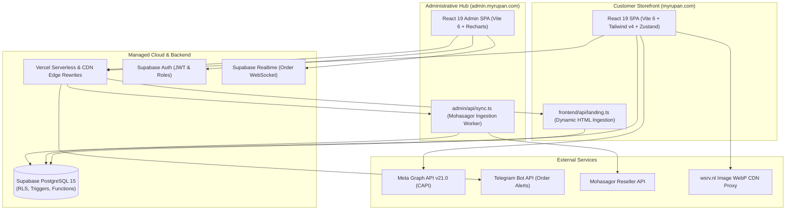

# 00. Master Brief: Rupan Project Intelligence and Architecture Dossier

> **CRITICAL NOTICE FOR AI ASSISTANTS & ARCHITECTS**:
> This report is an evidence-based snapshot of the **Rupan (`myrupan.com`)** repository conducted on **October 26, 2026**. It reflects the actual source code, SQL DDL migrations, package manifests, and configuration files present in the local codebase. It does not represent a guarantee of live production database state, active Vercel environment variables, or third-party service statuses. **Do not fabricate unverified features or assume the application requires a complete ground-up rewrite.** The website is currently functional in production.

---

## 1. Master Executive Summary

**Rupan** (`myrupan.com`) is a functional direct-to-consumer (D2C) e-commerce storefront, administrative operations hub, and dropshipping inventory synchronization platform tailored for the Bangladeshi retail market (traditional and modern lifestyle fashion: Panjabis, Sarees, Couple Collections, Western Wear, Kids Fashion).

Originally generated using AI coding tools and incrementally upgraded across versions (current codebase tagged as `v3.6.1`), the system features high cultural alignment with Bangladeshi e-commerce practices (guest checkout, Bangla QR, bKash/Nagad personal send-money, Inside/Outside Dhaka delivery tiers) and a dynamic landing page engine for advertising traffic.

However, incremental development without automated testing or formal architectural governance has left severe security vulnerabilities, data leakage risks, fragile file-copying build scripts, and test data baked into active checkout states.

---

## 2. Master Table of Contents & Supporting Report Index

| Report Document | Title & Core Subject | Key Contents & Purpose |
| :--- | :--- | :--- |
| **[`01_PROJECT_OVERVIEW.md`](file:///Users/Admin/Developer/antigravity/RupanV3/project-report/01_PROJECT_OVERVIEW.md)** | Project Identity & Business Context | Brand purpose, revenue model, customer segments, verified capabilities inventory, product gaps. |
| **[`02_TECH_STACK_AND_REPOSITORY.md`](file:///Users/Admin/Developer/antigravity/RupanV3/project-report/02_TECH_STACK_AND_REPOSITORY.md)** | Tech Stack & Monorepo Inventory | Exact dependency versions (React 19, Tailwind v4, Vite 6, Zustand 5, Supabase JS 2.110), file tree, env vars. |
| **[`03_SYSTEM_ARCHITECTURE.md`](file:///Users/Admin/Developer/antigravity/RupanV3/project-report/03_SYSTEM_ARCHITECTURE.md)** | Architecture & Dependency Map | 8 Mermaid architecture diagrams, request topologies, module coupling, `sync-shared.js` drift analysis. |
| **[`04_FEATURES_AND_BUSINESS_FLOWS.md`](file:///Users/Admin/Developer/antigravity/RupanV3/project-report/04_FEATURES_AND_BUSINESS_FLOWS.md)** | Complete User Journeys | 12-point step-by-step tracing of customer & admin workflows; investigation into hardcoded test data. |
| **[`05_APIS_AND_INTEGRATIONS.md`](file:///Users/Admin/Developer/antigravity/RupanV3/project-report/05_APIS_AND_INTEGRATIONS.md)** | API & Integration Catalog | Detailed schemas, validation, and error modes for `/api/landing`, `/api/place-order`, `/api/meta-capi`, `/api/sync`. |
| **[`06_DATABASE_AND_SECURITY.md`](file:///Users/Admin/Developer/antigravity/RupanV3/project-report/06_DATABASE_AND_SECURITY.md)** | Database, DDL & Security Assessment | Full PostgreSQL schema DDL, ER diagram, Row Level Security (RLS) audit, secret management, threat matrix. |
| **[`07_FRONTEND_AND_UX.md`](file:///Users/Admin/Developer/antigravity/RupanV3/project-report/07_FRONTEND_AND_UX.md)** | Frontend Architecture & UX | Route table, design tokens, typography, component hierarchy, SEO hook, performance bottlenecks. |
| **[`08_QUALITY_AND_OPERATIONS.md`](file:///Users/Admin/Developer/antigravity/RupanV3/project-report/08_QUALITY_AND_OPERATIONS.md)** | Testing, Reliability & Operations | Zero automated tests finding, Vercel routing, Supabase migration procedures, observability gaps. |
| **[`09_TECHNICAL_DEBT_AND_RECOMMENDATIONS.md`](file:///Users/Admin/Developer/antigravity/RupanV3/project-report/09_TECHNICAL_DEBT_AND_RECOMMENDATIONS.md)** | Technical Debt & Modernization Options | 13 prioritized technical debt items, comparison of 3 strategic modernization options, phased roadmap. |
| **[`10_CODEBASE_REFERENCE.md`](file:///Users/Admin/Developer/antigravity/RupanV3/project-report/10_CODEBASE_REFERENCE.md)** | Codebase & Symbol Index | Quick-reference index of core files, functions, hooks, classes, exported types, callers, and tables. |
| **[`11_OPEN_QUESTIONS.md`](file:///Users/Admin/Developer/antigravity/RupanV3/project-report/11_OPEN_QUESTIONS.md)** | Open Questions for the Owner | 8 high-leverage business and policy questions that cannot be resolved from code inspection alone. |

---

## 3. High-Level Architecture & Verified Technology Stack



- **Languages & Frameworks**: TypeScript 5.8, React 19.0.1, React DOM 19.0.1.
- **Styling & Icons**: Tailwind CSS 4.1.14 (Vite plugin, CSS `@theme` tokens), Lucide React 0.546.
- **Routing & State**: React Router DOM 7.18.1, Zustand 5.0.14 with `localStorage` persistence.
- **Backend & Database**: Supabase JS Client 2.110.0, PostgreSQL 15 with Row Level Security, Supabase Storage (`banners` bucket), Supabase Realtime WebSocket engine.
- **Hosting & Infrastructure**: Dual Vercel projects (Storefront + Admin) with Node.js 20 serverless functions (`@vercel/node` 5.8).

---

## 4. Top Five Critical Verified Findings

1. **Customer Order PII & User Profile Leakage (Critical Security Risk)**:
   - In [`supabase/schema.sql#L275`](file:///Users/Admin/Developer/antigravity/RupanV3/supabase/schema.sql#L275) and [`#L41`](file:///Users/Admin/Developer/antigravity/RupanV3/supabase/schema.sql#L41), Row Level Security policies on `public.orders` and `public.profiles` are configured as `using (true)`.
   - **Impact**: Any unauthenticated person with the public Supabase anon key can query PostgREST directly and download all customer orders (names, phone numbers, home delivery addresses, ordered items) and all registered user/admin emails and spending figures.
2. **Third-Party Secrets Exposed via Public Settings Table & Public HTML**:
   - Private Meta CAPI Graph API tokens and Telegram bot tokens are stored as plain text columns in `public.settings`.
   - Because `settings` has a public read policy (`using (true)`), the frontend client queries `select('*')` on mount and caches the Meta CAPI token and Telegram bot token into browser memory and `localStorage`.
   - Furthermore, customer browsers directly call the Telegram API (`https://api.telegram.org/bot<token>/sendMessage`), and `api/landing.ts` replaces `RUPAN_META_CAPI_TOKEN` placeholders with the live token in delivered HTML source.
3. **Hardcoded Test Customer Details in Storefront Checkout State**:
   - In [`frontend/src/store/useStore.ts#L208-L233`](file:///Users/Admin/Developer/antigravity/RupanV3/frontend/src/store/useStore.ts#L208-L233), default state for `currentUser` and `checkoutForm` is hardcoded with dummy values: `name: 'test'`, `phone: '534534563453'`, `address: 'test'`, and `email: 'phone-534534563453-nz9rfv2h@rupan.invalid'`.
   - Real customers arriving at `/checkout` see these fields pre-filled, leading to corrupted order submissions and user confusion.
4. **Order Price Verification Failure in SQL Trigger**:
   - The PostgreSQL trigger `validate_order_total()` ([`supabase/schema.sql#L382`](file:///Users/Admin/Developer/antigravity/RupanV3/supabase/schema.sql#L382)) correctly calculates `calc_subtotal` from database product prices and deducts stock.
   - However, it **never assigns** `calc_subtotal` to `new.subtotal` or `new.total`. It only verifies `if new.total < 0 then new.total := 0; end if;`.
   - As a result, direct API callers can submit orders with `total: 1`, and the database deducts stock and accepts the manipulated price without enforcement.
5. **Fragile, Destructive Build Script & Monorepo Drift (`sync-shared.js`)**:
   - The root script [`sync-shared.js`](file:///Users/Admin/Developer/antigravity/RupanV3/sync-shared.js) unidirectionally copies `shared/` to `frontend/` and `admin/` on every `npm run dev` and `npm run build`.
   - Active fixes in `frontend/src/types.ts`, `frontend/src/lib/supabase.ts`, and `frontend/src/services/orderService.ts` were **not** backported to `shared/`.
   - Running a build in `frontend/` executes `sync-shared.js` and **silently overwrites and destroys** these updates.

---

## 5. Major Architectural Strengths

Despite accumulated debt, the system possesses genuine architectural strengths that should be preserved:
- **Resilient Static CDN Routing**: Standard SPA routes are explicitly declared in `vercel.json`, bypassing serverless cold starts and maximizing CDN cache efficiency.
- **Dynamic Landing Page Generation**: Marketing managers can deploy standalone HTML/CSS/JS landing pages from the admin panel that render without storefront chrome and receive automated Meta Pixel and GA4 script injection.
- **Hyper-Local Checkout Design**: Guest checkout flow with Inside/Outside Dhaka shipping tiers and native payment options (Bangla QR, bKash, Nagad) is exceptionally well-suited for the Bangladeshi e-commerce landscape.
- **Robust Realtime Admin Updates**: Admin dashboard leverages Supabase Realtime WebSocket replication to auto-inject incoming orders instantly without manual refreshing.
- **Offline Simulator Engine**: The client-side `LocalDatabase` sandbox in `supabase.ts` allows local previews and UI development even when database credentials are not supplied.

---

## 6. Existing Capabilities That Must Be Preserved

When modernizing or refactoring the repository, **do not alter or break** the following established business capabilities:
1. **Bangla QR & MFS Payment Verification**: The multi-tab payment selector supporting Bangla QR, bKash Personal, Nagad Personal, and COD.
2. **Product ID Offset 3000 Tolerance**: The logic in `landing.ts` and `productService.ts` mapping legacy IDs (e.g. `Mohasagor8184` <-> `mohasagor-5184`) via +/- 3000 offset resolution.
3. **Dynamic Landing Page Injection Engine**: The capability of `api/landing.ts` to query `public.blogs` (`category = '__landing_page__'`) and inject ad tracking scripts into raw HTML.
4. **Mohasagor Reseller Ingestion Workflow**: Product attribute mapping, variant parsing (size/color), and category-level markup calculations in `admin/api/sync.ts`.
5. **Sitemap Generation Pipeline**: `generate-sitemap.cjs` building canonical URLs in the format `/product/{slug}-{numericId}`.

---

## 7. Recommended Modernization Strategy

The recommended strategy is **Approach B: Incremental Modular Modernization**, avoiding a high-risk total rewrite while methodically eliminating technical debt in three phases:

```
┌────────────────────────────────────────────────────────────────────────┐
│ PHASE 1: IMMEDIATE SECURITY & UX HOTFIXES (Days 1–3)                   │
│ - Tighten RLS on orders, profiles, and banners storage bucket          │
│ - Purge hardcoded 'test' customer details from useStore and forms      │
│ - Fix validate_order_total() trigger to assign calculated totals       │
│ - Migrate Meta CAPI and Telegram Bot tokens to Vercel environment vars │
│ - Disable client-side browser fetch to api.telegram.org                │
└───────────────────────────────────┬────────────────────────────────────┘
                                    │
                                    ▼
┌────────────────────────────────────────────────────────────────────────┐
│ PHASE 2: MONOREPO CONSOLIDATION & CLEANUP (Weeks 1–2)                  │
│ - Backport frontend/admin fixes to shared/ to prevent build overwrite  │
│ - Consolidate frontend/api and admin/api to eliminate code drift       │
│ - Delete 3,301 lines of dead AdminPanel.tsx from frontend codebase     │
│ - Transition to native pnpm workspaces; retire sync-shared.js          │
│ - Decompose monolithic 1,500-line modal code in admin/AdminPanel.tsx   │
└───────────────────────────────────┬────────────────────────────────────┘
                                    │
                                    ▼
┌────────────────────────────────────────────────────────────────────────┐
│ PHASE 3: SCALABILITY, PERFORMANCE & TESTING (Weeks 3–4)                │
│ - Implement on-demand server-side catalog pagination (12–24 per page)  │
│ - Migrate image optimization from wsrv.nl to dedicated CDN             │
│ - Add Vitest unit test suite and Playwright guest checkout E2E test    │
└────────────────────────────────────────────────────────────────────────┘
```

---

## 8. Immediate Action Items for the Engineering Team

1. **SQL DDL Execution in Supabase Editor**:
   - Run a migration to tighten RLS on `orders` (allow SELECT only if `auth.uid() = user_id` or `public.is_admin(auth.uid())`).
   - Run a migration to tighten RLS on `profiles` (allow SELECT only if `auth.uid() = id` or `public.is_admin(auth.uid())`).
   - Update `validate_order_total()` function to assign `new.subtotal := calc_subtotal; new.total := calc_subtotal + shipping - discount;`.
   - Update storage policies on `banners` bucket to require `public.is_admin(auth.uid())` for `INSERT`, `UPDATE`, and `DELETE`.
2. **Rotate Credentials**:
   - Rotate Mohasagor Reseller API key and secret key.
   - Rotate Telegram Bot Token via `@BotFather`.
   - Rotate Meta CAPI Graph API System User Token.
3. **Codebase Cleanup**:
   - Clear test defaults in [`frontend/src/store/useStore.ts`](file:///Users/Admin/Developer/antigravity/RupanV3/frontend/src/store/useStore.ts) and [`frontend/src/pages/AccountPage.tsx`](file:///Users/Admin/Developer/antigravity/RupanV3/frontend/src/pages/AccountPage.tsx).
   - Backport drift into `shared/` before running any build commands.
   - Delete [`frontend/src/components/AdminPanel.tsx`](file:///Users/Admin/Developer/antigravity/RupanV3/frontend/src/components/AdminPanel.tsx) and [`frontend/src/components/tabs/`](file:///Users/Admin/Developer/antigravity/RupanV3/frontend/src/components/tabs/).

---

## 9. Key Investigation Limitations

1. **Static Analysis Environment**: Node.js and npm are not present in the execution environment PATH; dynamic build, lint, and test commands (`npm run build`, `npm run lint`) could not be run.
2. **No Production Database Connection**: Live Supabase database contents, active rows in `public.settings`, and storage bucket contents could not be queried directly.
3. **No External Side Effects**: In compliance with strict execution guidelines, no live API requests were made to Telegram, Meta, or Mohasagor endpoints.
4. **Historical Origins**: The underlying rationale for the 3000 offset tolerance mapping on product IDs remains undocumented in Git commit messages.

---

## 10. Guidance for Another AI Assistant Reading This Dossier

When using this dossier to plan tasks or generate code for Rupan:
1. **Always refer to exact files**: Consult [`10_CODEBASE_REFERENCE.md`](file:///Users/Admin/Developer/antigravity/RupanV3/project-report/10_CODEBASE_REFERENCE.md) for symbol definitions and component responsibilities.
2. **Never overwrite without checking `shared/`**: Remember that `npm run build` runs `sync-shared.js`. Any modifications made to `frontend/src/services/` or `admin/src/services/` must also be reflected in `shared/services/` to prevent automated erasure.
3. **Respect Vercel Routing**: Maintain the explicit route list in `frontend/vercel.json` and keep the dynamic catch-all rewrite `"source": "/:path*"` at the bottom of the list.
4. **Preserve Cultural E-commerce Logic**: Do not replace Bangla QR, bKash, Nagad, or Inside/Outside Dhaka delivery models with generic Western e-commerce paradigms (e.g. Stripe or state-based taxes).
