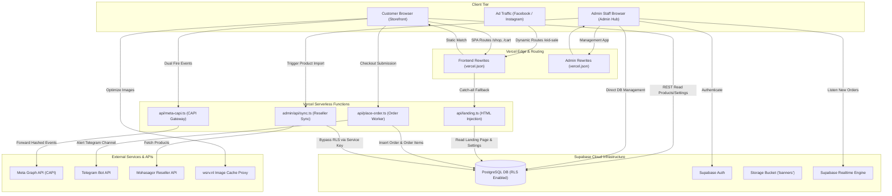
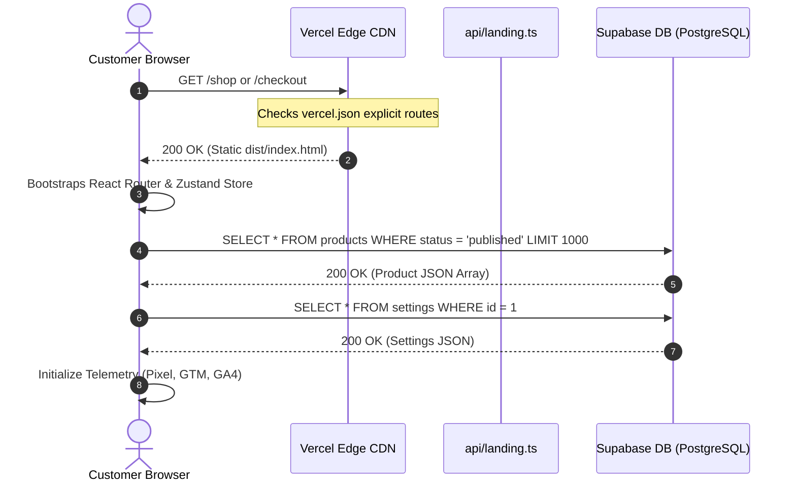
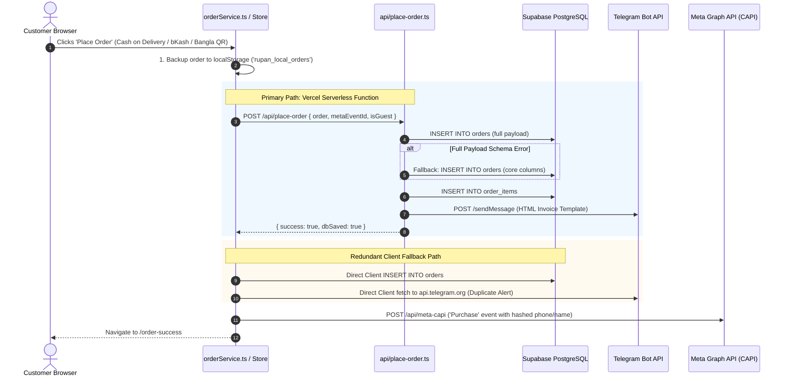
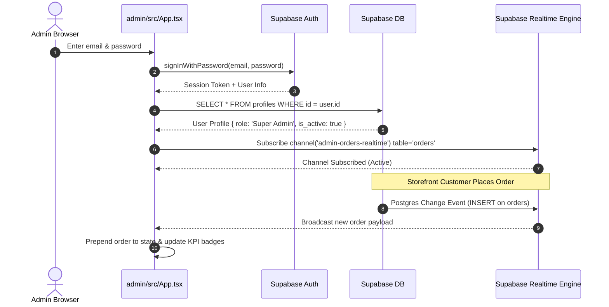
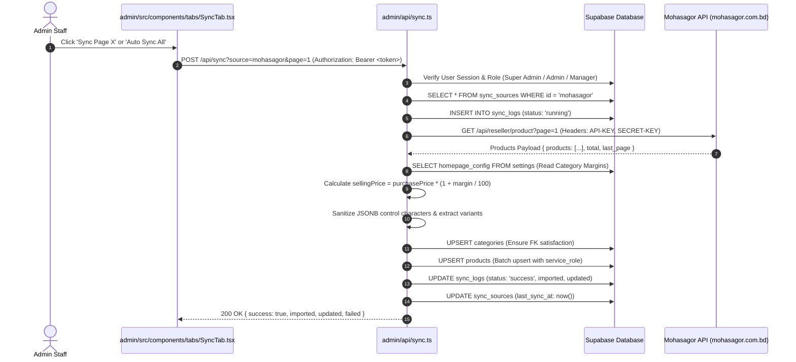
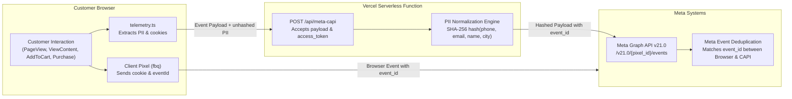
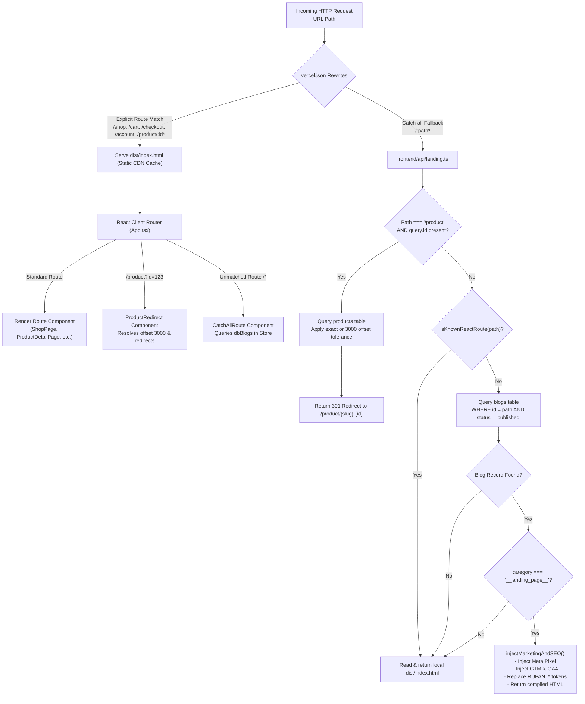
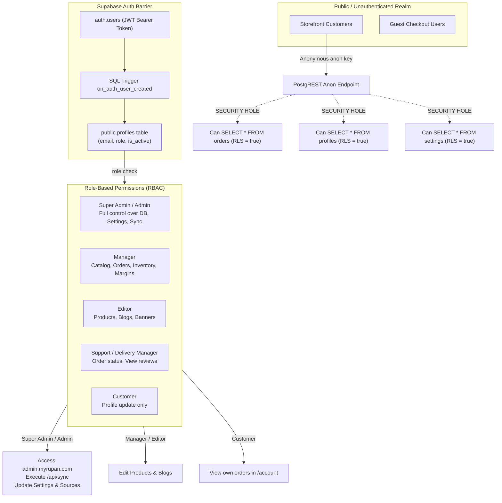

# 03. System Architecture and Dependency Map

## 3.1 Architecture and Deployment Topology

Rupan operates on a decoupled client-server architecture deployed primarily on **Vercel** with a managed **Supabase** backend.

```
                      ┌──────────────────────────────────────────────┐
                      │              PUBLIC INTERNET                 │
                      └───────┬──────────────────────────────┬───────┘
                              │                              │
                    https://myrupan.com             https://admin.myrupan.com
                              │                              │
                              ▼                              ▼
             ┌────────────────────────────────┐  ┌──────────────────────────────┐
             │       VERCEL PROJECT:          │  │       VERCEL PROJECT:        │
             │          FRONTEND              │  │           ADMIN              │
             │ ┌────────────────────────────┐ │  │ ┌──────────────────────────┐ │
             │ │ Vercel Edge / CDN Rewrites │ │  │ │ Vercel Edge Rewrites     │ │
             │ └──────────────┬─────────────┘ │  │ └────────────┬─────────────┘ │
             │                │               │  │              │               │
             │   ┌────────────┴───────────┐   │  │   ┌──────────┴──────────┐    │
             │   ▼                        ▼   │  │   ▼                     ▼    │
             │ Static SPA       Serverless    │  │ Static SPA      Serverless   │
             │ (index.html)     Functions:    │  │ (index.html)    Functions:   │
             │                  - landing.ts  │  │                 - sync.ts    │
             │                  - place-order │  │                 - place-order│
             │                  - meta-capi   │  │                 - meta-capi  │
             └─────────┬──────────────┬───────┘  └─────────┬──────────────┬─────┘
                       │              │                    │              │
                       │              └──────────┬─────────┘              │
                       │                         │                        │
                       ▼                         ▼                        ▼
        ┌────────────────────────────────────────────────────────────────────────┐
        │                        SUPABASE MANAGED CLOUD                          │
        │  ┌───────────────────────┐  ┌──────────────────┐  ┌──────────────────┐ │
        │  │ PostgreSQL 15 Database│  │ Supabase Auth    │  │ Supabase Storage │ │
        │  │  - Row Level Security │  │  - JWT & Sessions│  │  - 'banners'     │ │
        │  │  - SQL Triggers       │  │  - profiles sync │  │    public bucket │ │
        │  │  - Realtime Channels  │  └──────────────────┘  └──────────────────┘ │
        │  └───────────────────────┘                                             │
        └───────────────────────────────────┬────────────────────────────────────┘
                                            │
                                            ▼
                           ┌─────────────────────────────────┐
                           │       EXTERNAL SERVICES         │
                           │  - Telegram Bot API             │
                           │  - Meta Graph API (v21.0)       │
                           │  - Mohasagor Reseller API       │
                           │  - wsrv.nl Image CDN Proxy      │
                           └─────────────────────────────────┘
```

### Architectural Boundaries & Data Ownership
1. **Frontend Boundary (`frontend/`)**:
   - Single-Page Application (SPA) built with React Router 7.
   - Responsible for presentation, cart state, local UI filtering, guest checkout, and client-side pixel events.
   - Connects directly to Supabase PostgREST API using the public anonymous key (`VITE_SUPABASE_ANON_KEY`).
2. **Admin Boundary (`admin/`)**:
   - Isolated management SPA deployed under `admin.myrupan.com`.
   - Requires Supabase Auth authentication and role verification against `public.profiles`.
   - Interacts with Supabase PostgREST via user session tokens and connects to the `/api/sync` serverless worker.
3. **Serverless Boundary (`api/`)**:
   - Node.js functions running on Vercel's serverless infrastructure.
   - `landing.ts`: Dynamic HTML rendering and script injection for marketing pages.
   - `place-order.ts`: Backend order persistence and Telegram notification dispatch.
   - `meta-capi.ts`: Server-side conversions forwarding to Meta Graph API.
   - `sync.ts`: Privileged reseller product synchronization executing with `SUPABASE_SERVICE_ROLE_KEY`.
4. **Data Ownership & Source of Truth**:
   - **Catalog & Orders**: Managed PostgreSQL in Supabase is the primary source of truth.
   - **Local Browser Cache**: The frontend maintains substantial data copies in browser `localStorage` (`rup_db_products`, `rup_db_settings`, `rup_cart`, `rup_orders`). When offline or when keys are missing, the client reads and writes exclusively to this local sandbox.

---

## 3.2 System Architecture Diagrams

### Diagram 1: High-Level System Architecture



---

### Diagram 2: Customer Storefront Request Flow



---

### Diagram 3: Order Creation and Persistence Flow



---

### Diagram 4: Admin Operations and Realtime Access Flow



---

### Diagram 5: Reseller Catalog Synchronization Flow



---

### Diagram 6: Meta Conversions API (CAPI) Event Flow



---

### Diagram 7: Product and Landing Page Routing Architecture



---

### Diagram 8: Authentication and Authorization Boundaries



---

## 3.3 Module Dependency Map and Drift Analysis

### Evaluation of `shared/` and `sync-shared.js`

The monorepo attempts to avoid code duplication across `frontend/` and `admin/` by maintaining a single source of truth in `shared/` and copying files at build/dev time using [`sync-shared.js`](file:///Users/Admin/Developer/antigravity/RupanV3/sync-shared.js).

#### Verified Synchronization Drift
A line-by-line diff reveals that `shared/` is **outdated and desynchronized** from both `frontend/src/` and `admin/src/`:

1. **`types.ts` Drift**:
   - `frontend/src/types.ts` and `admin/src/types.ts` were updated to include `purchasePrice?: number;`, `sourceProductId?: string;`, and `supabaseUrl?: string;`.
   - `shared/types.ts` is missing these properties.
2. **`supabase.ts` Drift**:
   - `frontend/src/lib/supabase.ts` and `admin/src/lib/supabase.ts` include `removeChannel()` mock stubs, `items` JSON column handling, and `is_incognito_guest` field serialization.
   - `shared/supabase.ts` lacks these updates.
3. **`orderService.ts` Drift**:
   - `frontend/src/services/orderService.ts` has been heavily modified to execute `/api/place-order`, backup orders to `rupan_local_orders`, and implement core-column insert fallbacks.
   - `shared/services/orderService.ts` contains none of this logic.
4. **Build Destruction Vulnerability**:
   - Running `npm run dev` or `npm run build` in either application triggers `node ../sync-shared.js`.
   - Because `sync-shared.js` executes **unidirectional copying from `shared/` to apps**, running a build will **silently overwrite and delete** all recent fixes in `frontend/src` and `admin/src`!
5. **Unmanaged `api/` Duplication**:
   - `sync-shared.js` does not cover `api/` directories.
   - `frontend/api/place-order.ts` and `admin/api/place-order.ts` have diverged. Frontend includes critical fixes (such as chat ID normalization and fallback inserts) that are missing from `admin/api/place-order.ts`.
   - `frontend/api/meta-capi.ts` and `admin/api/meta-capi.ts` have also drifted.

### Single Points of Failure
1. **Single Database Row for Global Settings**:
   - All store configuration, payment phone numbers, Bangla QR image path, shipping charges, ad tracking credentials, and Telegram tokens reside in a single row (`id = 1`) in `public.settings`. If this row is deleted or malformed, the storefront cannot calculate shipping, render payments, or send notifications.
2. **External Image Proxy (`wsrv.nl`)**:
   - All product images are routed through `https://wsrv.nl/?url=...` in [`image.ts`](file:///Users/Admin/Developer/antigravity/RupanV3/frontend/src/utils/image.ts). If `wsrv.nl` experiences downtime, rate limits Rupan, or is blocked by local Bangladeshi ISPs, product thumbnails across the entire catalog fail to load.
3. **Client-Side Initial 1,000 Product Load**:
   - [`productService.ts#L16`](file:///Users/Admin/Developer/antigravity/RupanV3/frontend/src/services/productService.ts#L16) queries `limit(1000)` on initial page load, followed by background chunked pagination of the complete catalog index. As the reseller catalog grows beyond 5,000 items, client browser memory and initial payload size will degrade severely.
