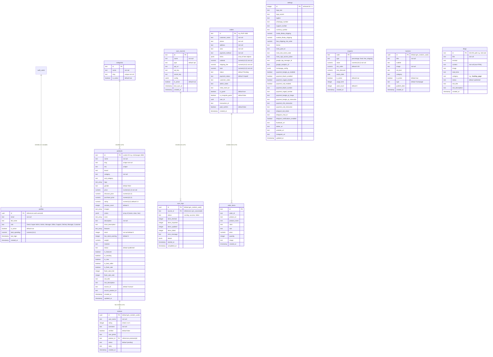

# 06. Database, Data Model, and Security Assessment

## 6.1 Database Architecture and Schema DDL

The database is PostgreSQL 15 managed via Supabase. Schema definitions and migrations are stored in [`supabase/schema.sql`](file:///Users/Admin/Developer/antigravity/RupanV3/supabase/schema.sql), [`supabase/add_capi_token_migration.sql`](file:///Users/Admin/Developer/antigravity/RupanV3/supabase/add_capi_token_migration.sql), and [`supabase/update_payment_settings.sql`](file:///Users/Admin/Developer/antigravity/RupanV3/supabase/update_payment_settings.sql).

### Entity Relationship Diagram



---

### Database Functions and Triggers

#### 1. Order Total Validation & Stock Deduction Trigger
- **Function**: `public.validate_order_total()`
- **Trigger**: `on_order_created` (`BEFORE INSERT ON public.orders FOR EACH ROW`)
- **Location**: [`supabase/schema.sql#L382-L452`](file:///Users/Admin/Developer/antigravity/RupanV3/supabase/schema.sql#L382-L452)
- **Implementation Flaw**:
  ```sql
  for item in select * from jsonb_array_elements(new.items) loop
    ...
    if found then
      actual_price := found_price;
      -- Deduct stock if available
      update public.products set stock = greatest(0, stock - prod_qty) where id = prod_id;
    else
      actual_price := item_price;
    end if;
    calc_subtotal := calc_subtotal + (actual_price * prod_qty);
  end loop;
  
  -- Ensure non-negative total
  if new.total < 0 then
    new.total := 0;
  end if;
  return new;
  ```
  - **Defect**: `calc_subtotal` is accumulated in local variable `calc_subtotal`, but it is **never assigned** to `new.subtotal` or `new.total`.
  - **Consequence**: Stock is decremented on order placement, but the submitted price (`new.total`) is accepted as provided by the client without enforcement or verification!

#### 2. Auth User Sync Trigger
- **Function**: `public.handle_new_user()`
- **Trigger**: `on_auth_user_created` (`AFTER INSERT ON auth.users FOR EACH ROW`)
- **Location**: [`supabase/schema.sql#L361-L379`](file:///Users/Admin/Developer/antigravity/RupanV3/supabase/schema.sql#L361-L379)
- **Behavior**: Automatically creates corresponding row in `public.profiles` with `role = 'Customer'` and `is_active = true`.

#### 3. Full-Text Search Function
- **Function**: `public.search_products(search_query text, match_limit int DEFAULT 20)`
- **Location**: [`supabase/schema.sql#L476-L494`](file:///Users/Admin/Developer/antigravity/RupanV3/supabase/schema.sql#L476-L494)
- **Behavior**: Uses PostgreSQL `to_tsvector('english', ...)` and `plainto_tsquery('english', search_query)` ordered by `ts_rank` and `created_at DESC`.

---

## 6.2 Row-Level Security (RLS) Policy Audit

| Table / Storage Bucket | RLS Status | Operation | Policy Name & Rule Expression | Authorized Roles | Security Assessment & Risk |
| :--- | :--- | :--- | :--- | :--- | :--- |
| `public.profiles` | Enabled | `SELECT` | `"Allow public read of profiles"`<br>`USING (true)` | **Anyone (Public / Anon)** | **CRITICAL LEAK**: Exposes every customer and admin email, full name, role, total spending, and last login to anyone with the anon key. |
| `public.profiles` | Enabled | `UPDATE` | `"Allow individual user profile updates"`<br>`USING (auth.uid() = id)` | Authenticated User | Secure: Users can only update their own record. |
| `public.profiles` | Enabled | `ALL` | `"Allow admin changes to profiles"`<br>`USING (public.is_admin(auth.uid()))` | Super Admin, Admin | Secure. |
| `public.settings` | Enabled | `SELECT` | `"Allow public read of settings"`<br>`USING (true)` | **Anyone (Public / Anon)** | **CRITICAL LEAK**: Exposes `meta_capi_access_token`, `telegram_bot_token`, and `telegram_chat_id` to the public internet. |
| `public.settings` | Enabled | `UPDATE` | `"Allow admin update of settings"`<br>`USING (role IN ('Super Admin', 'Admin', 'Manager'))` | Super Admin, Admin, Manager | Secure for writes. |
| `public.orders` | Enabled | `INSERT` | `"Allow public insert of orders"`<br>`WITH CHECK (true)` | Anyone (Public / Anon) | Required for guest checkout, but lacks rate limiting and price enforcement. |
| `public.orders` | Enabled | `SELECT` | `"Allow public tracking query"`<br>`USING (true)` | **Anyone (Public / Anon)** | **CRITICAL LEAK**: Allows any caller with the anon key to run `SELECT * FROM orders` and dump all customer names, phone numbers, delivery addresses, and purchase histories. |
| `public.orders` | Enabled | `ALL` | `"Allow admin order access"`<br>`USING (role IN ('Super Admin', 'Admin', 'Manager', 'Support', 'Delivery Manager'))` | Admin Staff | Secure. |
| `public.products` | Enabled | `SELECT` | `"Allow public read of products"`<br>`USING (true)` | Anyone | Standard public catalog browsing. |
| `public.products` | Enabled | `ALL` | `"Allow admin management of products"`<br>`USING (role IN ('Super Admin', 'Admin', 'Manager', 'Editor'))` | Admin Staff | Secure. |
| `public.sync_sources` | Enabled | `SELECT` | `"Allow admin read of sync sources"`<br>`USING (role IN ('Super Admin', 'Admin', 'Manager'))` | Admin Staff | Protected from public. |
| `public.sync_sources` | Enabled | `ALL` | `"Allow admin changes to sync sources"`<br>`USING (role IN ('Super Admin', 'Admin'))` | Super Admin, Admin | Protected from public. |
| `public.sync_logs` | Enabled | `SELECT` | `"Allow admin read of sync logs"`<br>`USING (role IN ('Super Admin', 'Admin', 'Manager', 'Support'))` | Admin Staff | Protected from public. |
| `public.sync_logs` | Enabled | `ALL` | `"Allow admin write of sync logs"`<br>`USING (role IN ('Super Admin', 'Admin'))` | Super Admin, Admin | Protected from public. |
| `public.reviews` | Enabled | `SELECT` | `"Allow public read of approved reviews"`<br>`USING (status = 'approved' OR is_admin)` | Anyone for approved; Admin for all | Secure. |
| `public.reviews` | Enabled | `INSERT` | `"Allow public review submission"`<br>`WITH CHECK (true)` | Anyone | Allows public review submission (default status pending). |
| `public.reviews` | Enabled | `ALL` | `"Allow admin review moderation"` | Admin Staff | Secure. |
| `public.coupons` | Enabled | `SELECT` | `"Allow public selection for checkout verification"`<br>`USING (true)` | Anyone | Intentional for checkout coupon verification. |
| `public.coupons` | Enabled | `ALL` | `"Allow admin coupon editing"` | Super Admin, Admin, Manager | Secure. |
| `public.banners` | Enabled | `SELECT` | `"Allow public read of active banners"`<br>`USING (is_active = true OR is_admin)` | Anyone for active; Admin for all | Secure. |
| `public.banners` | Enabled | `ALL` | `"Allow admin banner edits"` | Admin Staff | Secure. |
| `public.blogs` | Enabled | `SELECT` | `"Allow public read of published blogs"`<br>`USING (status = 'published' OR is_admin)` | Anyone for published; Admin for all | Secure. |
| `public.blogs` | Enabled | `ALL` | `"Allow admin blog edits"` | Admin Staff | Secure. |
| `storage.objects` (`banners` bucket) | Enabled | `SELECT` | `"Public Read Access Banners"`<br>`USING (bucket_id = 'banners')` | Anyone | Intentional for public banner display. |
| `storage.objects` (`banners` bucket) | Enabled | `INSERT` | `"Public Upload Access Banners"`<br>`WITH CHECK (bucket_id = 'banners')` | **Anyone (Public / Anon)** | **HIGH RISK**: Unauthenticated users can upload arbitrary files to the storage bucket. |
| `storage.objects` (`banners` bucket) | Enabled | `UPDATE` | `"Public Update Access Banners"`<br>`USING (bucket_id = 'banners')` | **Anyone (Public / Anon)** | **HIGH RISK**: Unauthenticated users can overwrite any existing file in the storage bucket. |
| `storage.objects` (`banners` bucket) | Enabled | `DELETE` | `"Public Delete Access Banners"`<br>`USING (bucket_id = 'banners')` | **CRITICAL RISK**: Unauthenticated users can delete any or all media files in the banners storage bucket. |

---

## 6.3 Secret Management & Exposed Credentials

In accordance with absolute rules, no actual secret values, passwords, or tokens are printed below. Findings document the file paths, line numbers, variable names, and sensitivity categories:

1. **Hardcoded Reseller API Key & Secret Key in SQL DDL**:
   - **File**: [`supabase/schema.sql#L217-L219`](file:///Users/Admin/Developer/antigravity/RupanV3/supabase/schema.sql#L217-L219)
   - **Fields**: `api_key` and `secret_key` in the `INSERT INTO public.sync_sources` statement.
   - **Category**: Third-party supplier API credentials (Mohasagor Reseller API).
   - **Remedy**: Credentials must be rotated immediately with Mohasagor and migrated to secure server environment variables or encrypted secrets.
2. **Third-Party Graph API and Telegram Bot Tokens in Public Database Table**:
   - **File**: [`supabase/add_capi_token_migration.sql#L16`](file:///Users/Admin/Developer/antigravity/RupanV3/supabase/add_capi_token_migration.sql#L16) and [`supabase/schema.sql#L800`](file:///Users/Admin/Developer/antigravity/RupanV3/supabase/schema.sql#L800)
   - **Columns**: `meta_capi_access_token`, `telegram_bot_token`, `telegram_chat_id` in `public.settings`.
   - **Category**: Meta System User Access Token & Telegram Bot Authorization Token.
   - **Remedy**: Move both tokens out of `public.settings` and configure them strictly as server-side environment variables in Vercel (`META_CAPI_ACCESS_TOKEN`, `TELEGRAM_BOT_TOKEN`).
3. **Telegram Bot Token Transmitted to and Executed by Customer Browser**:
   - **File**: [`frontend/src/store/useStore.ts#L652-L688`](file:///Users/Admin/Developer/antigravity/RupanV3/frontend/src/store/useStore.ts#L652-L688)
   - **Category**: Direct client-side invocation of `https://api.telegram.org/bot<token>/sendMessage`.
   - **Remedy**: Remove client-side Telegram dispatch entirely. All Telegram notifications must be handled exclusively by the serverless backend function (`api/place-order.ts`).

---

## 6.4 Security Threat Assessment

| Threat ID | Threat Description | Affected Files & Lines | Severity | Confidence | Business / Customer Impact |
| :--- | :--- | :--- | :--- | :--- | :--- |
| **SEC-01** | **Customer Order PII Data Leakage via Open RLS** | [`supabase/schema.sql#L275`](file:///Users/Admin/Developer/antigravity/RupanV3/supabase/schema.sql#L275) | **CRITICAL** | **Confirmed (Static Analysis)** | Unauthenticated callers using the public anon key can read all records from `public.orders`, exposing names, phone numbers, home addresses, and purchases. |
| **SEC-02** | **User Profile & Admin Email Leakage via Open RLS** | [`supabase/schema.sql#L41`](file:///Users/Admin/Developer/antigravity/RupanV3/supabase/schema.sql#L41) | **CRITICAL** | **Confirmed (Static Analysis)** | Any user can query `public.profiles` to extract email addresses, full names, roles, and spending figures of all customers and staff. |
| **SEC-03** | **Meta CAPI and Telegram Bot Token Exposure via Settings** | [`supabase/schema.sql#L148`](file:///Users/Admin/Developer/antigravity/RupanV3/supabase/schema.sql#L148), [`frontend/src/services/settingsService.ts#L10`](file:///Users/Admin/Developer/antigravity/RupanV3/frontend/src/services/settingsService.ts#L10) | **CRITICAL** | **Confirmed (Static Analysis)** | Private Meta CAPI token and Telegram bot credentials are queryable by anonymous clients and stored in browser `localStorage`. |
| **SEC-04** | **Arbitrary Storage Deletion in Banners Bucket** | [`supabase/update_payment_settings.sql#L50-L52`](file:///Users/Admin/Developer/antigravity/RupanV3/supabase/update_payment_settings.sql#L50-L52) | **HIGH** | **Confirmed (Static Analysis)** | Storage RLS policy allows anonymous users to delete or overwrite any media file in the `banners` bucket. |
| **SEC-05** | **Order Price Manipulation & Lack of Total Enforcement** | [`supabase/schema.sql#L382-L447`](file:///Users/Admin/Developer/antigravity/RupanV3/supabase/schema.sql#L382-L447), [`frontend/api/place-order.ts#L61-L82`](file:///Users/Admin/Developer/antigravity/RupanV3/frontend/api/place-order.ts#L61-L82) | **HIGH** | **Confirmed (Static Analysis)** | Orders can be submitted with arbitrary prices (e.g. `total: 1`) via direct API calls because the trigger never overwrites `new.total` with `calc_subtotal`. |
| **SEC-06** | **Unauthenticated /api/place-order Abuse & Telegram Spam** | [`frontend/api/place-order.ts#L14-L26`](file:///Users/Admin/Developer/antigravity/RupanV3/frontend/api/place-order.ts#L14-L26) | **MEDIUM** | **Confirmed (Static Analysis)** | Open CORS (`*`) and lack of rate limiting allows bots to post bogus orders and spam the brand's Telegram channel. |
| **SEC-07** | **Unsafe HTML Rendering in Landing Pages (Stored XSS Risk)** | [`frontend/api/landing.ts#L455-L464`](file:///Users/Admin/Developer/antigravity/RupanV3/frontend/api/landing.ts#L455-L464) | **MEDIUM** | **Confirmed (Static Analysis)** | Landing page content is stored as raw HTML in `public.blogs` and served directly with `Content-Type: text/html`. Compromise of an Editor/Manager account allows serving malicious JavaScript to visitors. |
| **SEC-08** | **CAPI Token Injection into Public HTML** | [`frontend/api/landing.ts#L127`](file:///Users/Admin/Developer/antigravity/RupanV3/frontend/api/landing.ts#L127) | **HIGH** | **Confirmed (Static Analysis)** | Serverless handler replaces `RUPAN_META_CAPI_TOKEN` placeholders with the live token in HTML delivered to the customer browser. |
